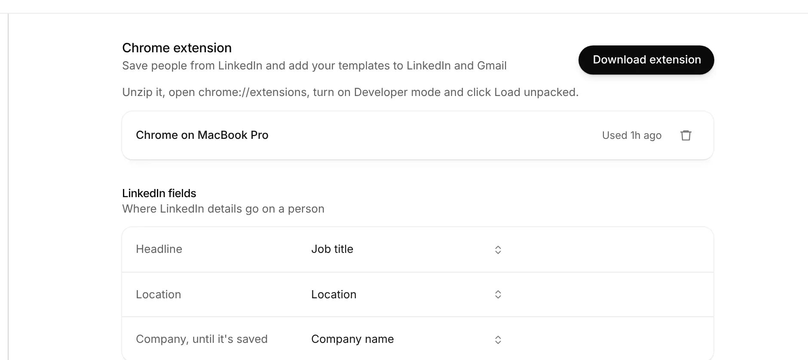
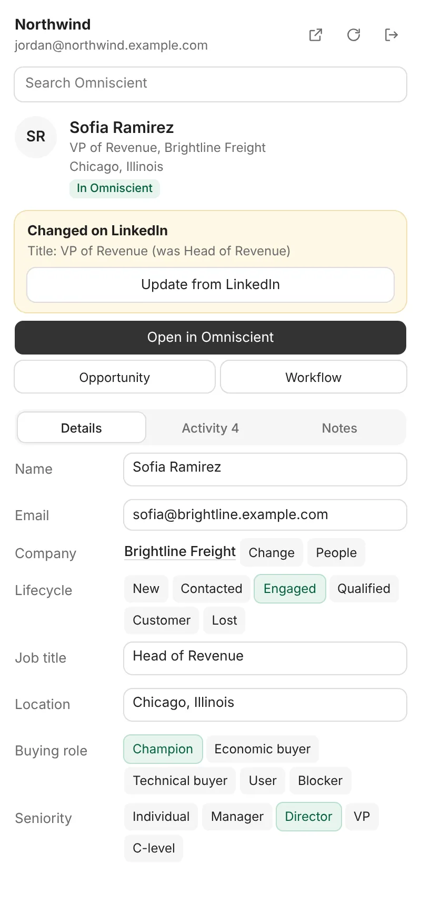

import { Aside, CardGrid, LinkCard, Steps } from '@astrojs/starlight/components';

The Omniscient extension brings your CRM to LinkedIn, Gmail and Outlook on the web. It saves the profile or company you are looking at, shows the person's record beside the page, and puts your team's message templates into the box you are typing in.

It only acts when you click. It never sends messages, never scrolls or opens pages for you and never reads tabs you don't have open.

## Install it

<Steps>

1. In Omniscient, go to **Settings**, then **Chrome extension**.
1. Click **Download extension**. A .zip file downloads.
1. Unzip the file.
1. In Chrome, open `chrome://extensions` and turn on **Developer mode** at the top right.
1. Click **Load unpacked** and pick the unzipped folder.
1. Pin the Omniscient icon to your toolbar so it's easy to reach.

</Steps>

## Connect it to your workspace

<Steps>

1. Go back to **Settings**, then **Chrome extension**, and reload the page.
1. Click **Connect this browser**. The button changes to **Connected**.

</Steps>

You don't need to paste any key. Each browser you connect shows in the list with when it was last used. Click **Disconnect** next to a browser to remove it.

## Open the side panel

Click the Omniscient icon in the toolbar. Chrome's side panel opens on the right and follows the tab you're on. It shows what it found on the page, and **Search Omniscient** at the top finds people and companies.

If the side panel shows **Connect this browser to your workspace.**, go back to the settings page and connect it.

## Choose where LinkedIn details go

Admins can set which person fields get the details the extension reads. Under **LinkedIn fields** in **Settings**, then **Chrome extension**, point the LinkedIn headline, location and company name at any person field. By default they go to Title, Location and Company.

<Aside type="note">
The extension reads only the page you have open when you click, or while its side panel is open beside it. It never visits profiles, never pages through results and never uses a LinkedIn session service.
</Aside>

## Next steps

<CardGrid>
  <LinkCard title="Use the extension" href="/chrome-extension/use-the-extension/" description="Save people, see records and add templates." />
  <LinkCard title="Troubleshooting" href="/reference/troubleshooting/#chrome-extension" description="When the extension can't connect or read a page." />
</CardGrid>
