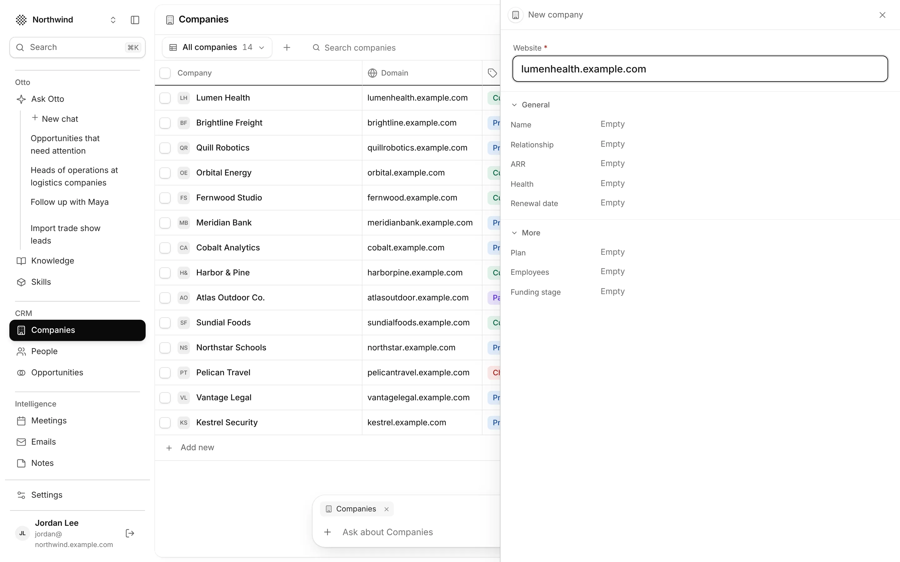
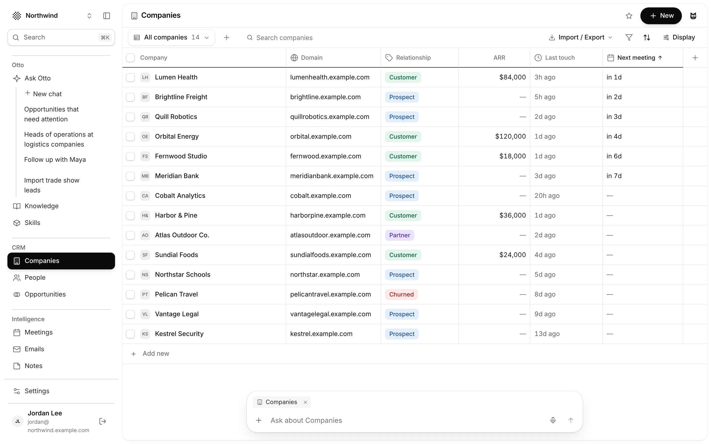
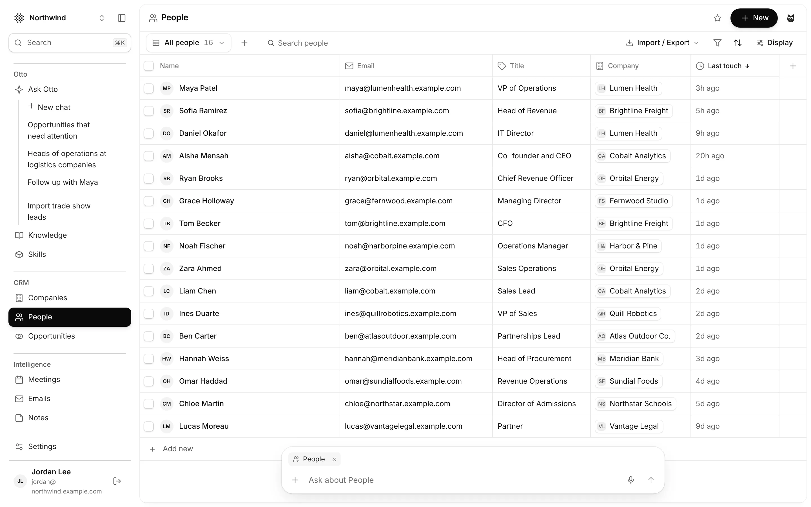
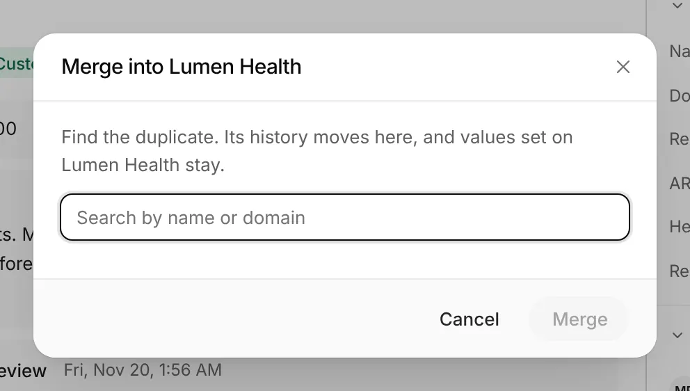
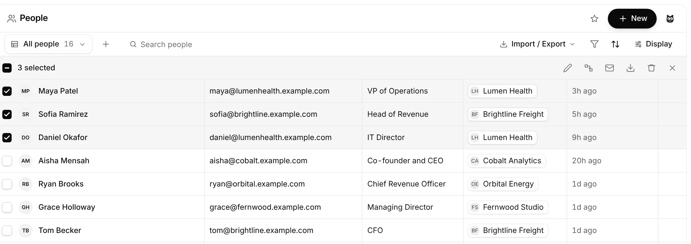

import { Aside, CardGrid, LinkCard, Steps } from '@astrojs/starlight/components';

Companies and people are the base of your CRM. Most of them come from your inbox on their own. You can also add them by hand or import them, and the Chrome extension saves them from LinkedIn.

## How records are made

When your mailbox syncs, Omniscient looks at who you email and meet with:

- Everyone outside your team becomes a **person**, matched by email address.
- Their work domain becomes a **company**. Personal domains like gmail.com never become companies.
- New emails and meetings land on the right person and company, so each record keeps its own history.

Your [sync settings](/get-started/connect-your-inbox/#choose-what-syncs) decide who gets added. For example, you can add people only when you reach out to them.

## Add a company or person by hand

<Steps>

1. Open **Companies** or **People** in the sidebar.
1. Click **New** at the top right.
1. Fill in the name, plus the website for a company or the email for a person.
1. Save it. The new record opens.

</Steps>

You can also press <kbd>⌘</kbd> <kbd>K</kbd> and pick **New company** or **New person**.

## What you see on the lists

**Companies** can show columns like these:

| Column | What it shows |
| --- | --- |
| Domain | The company's website |
| Relationship | Customer, Prospect, Partner or Churned |
| Health | Healthy, Watch or At risk |
| ARR | Yearly revenue from the customer |
| Open pipeline | The total of its open opportunities |
| Emails, Meetings, People | How many of each are on the record |
| Last touch | The last email or meeting |
| Next meeting | The next meeting on the calendar |

**People** can show Name, Email, Title, Company, Role, Lifecycle and Last touch.

- **Lifecycle** is where the person is with you: New, Contacted, Engaged, Qualified, Customer or Lost.
- **Role** is their part in a deal: Economic buyer, Decision maker, Champion, Influencer, User or Blocker.

Show, hide and sort any of these with the tools on the list. See [Views](/crm/views/).

## Merge duplicates

When the same company or person shows up twice, merge them:

<Steps>

1. Open the record you want to keep.
1. Open the record's menu and click **Merge a duplicate**.
1. Search for the duplicate and pick it.
1. Click the **Merge** button, which names both records. The duplicate's history moves to the record you kept, and the values already set on that record stay.

</Steps>

## Find emails

On **People**, tick the people who have no email, then click **Find emails** in the bar that shows. Omniscient looks for each person's work email and fills it in when it finds one.

## Delete records

Open the record's menu and click **Delete**, or tick several rows on a list and delete them together. Deleted records go to the Trash for 30 days, so you can restore them. See [Data and Trash](/workspace/data-and-trash/).

<Aside type="note">
Deleting a person or company in Omniscient never touches your mailbox. Omniscient only reads your mail.
</Aside>

## Next steps

<CardGrid>
  <LinkCard title="Record pages" href="/crm/record-pages/" description="Timeline, emails, meetings, notes and files." />
  <LinkCard title="Opportunities and pipelines" href="/crm/opportunities-and-pipelines/" description="Track deals through your stages." />
</CardGrid>
