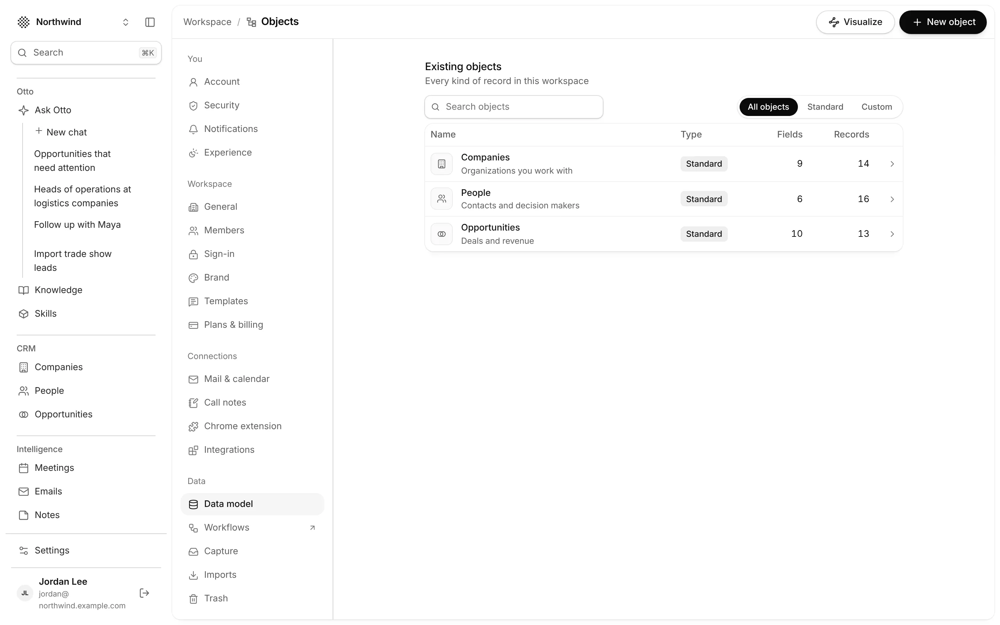

import { Aside, CardGrid, LinkCard, Steps } from '@astrojs/starlight/components';

Companies, People and Opportunities fit most teams. When you track something else, like projects, partners, properties or subscriptions, add your own object. It gets its own list and record pages, just like the built-in ones.

**Who:** owners and admins add objects and fields. Everyone adds and edits records.

## Add an object

<Steps>

1. Go to **Settings**, then **Data model**, and click **New object**.
1. Under **About**, pick an **Icon** and type the **Singular**, like "Project". The **Plural** fills in.
1. Add a **Description** so your team and Otto know what it's for.
1. Save.

</Steps>

The object shows in the sidebar under **CRM**. A workspace can have up to 50 objects. See [Data model](/crm/data-model/) for fields and relationships.

## The list

Each object's list works like Companies: search, **Filter**, **Sort**, **Display** with Table, Kanban, Calendar and List, saved views, editing in the table, bulk edit and **Import / Export**. Every object starts with the **Owner**, **Updated** and **Created** columns. Click **Fields** to show or hide more.

Click **New** to add a record. The form shows every field the object has.

## The record page

| Part | What it has |
| --- | --- |
| Header | The record's name and its menu, with delete |
| **Timeline** tab | Every change to the record, with who made it and when. A new record shows **No history yet**. |
| **Notes** tab | Notes on this record |
| Right rail | **Record** details: **Name**, **Owner**, **Created**, and every field. **Customize fields** picks which show. |

Deleting a record asks first, and the record goes to [Trash](/settings/trash/) for 30 days.

## Link to companies, people and opportunities

Add a relationship field in **Data model** to link records, like a Project to its Company. Each side is "one" or "many". The link shows on both records, and you can roll up values across it, like the total budget of a company's projects.

## Otto and the API

- Otto reads your objects. Ask "Which projects at Lumen Health go live this quarter?"
- Workflows can start when a record of your object is made or changes.
- The API reads and writes them under `/objects/:key/records`. See [Custom objects](/api-reference/custom-objects/) in the API reference.
- Webhooks send `record.created` and `record.updated`.

<Aside type="note">
If an object is deleted, its old links show "This object doesn't exist. It may have been deleted in Data model."
</Aside>

## Related

<CardGrid>
  <LinkCard title="Data model" href="/crm/data-model/" description="Fields, types and relationships." />
  <LinkCard title="Views" href="/crm/views/" description="Lists, boards and filters." />
</CardGrid>
