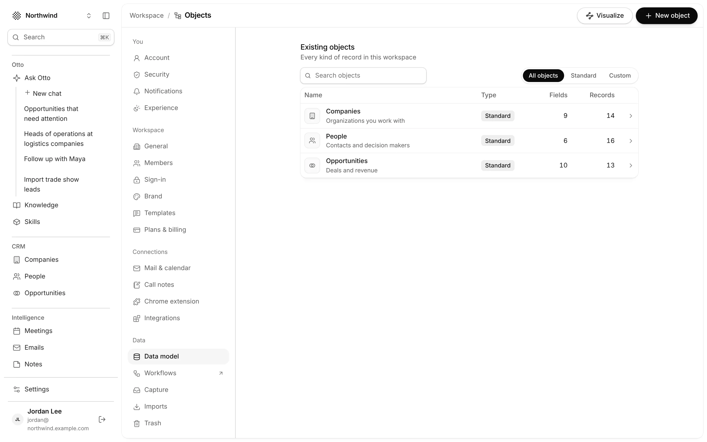
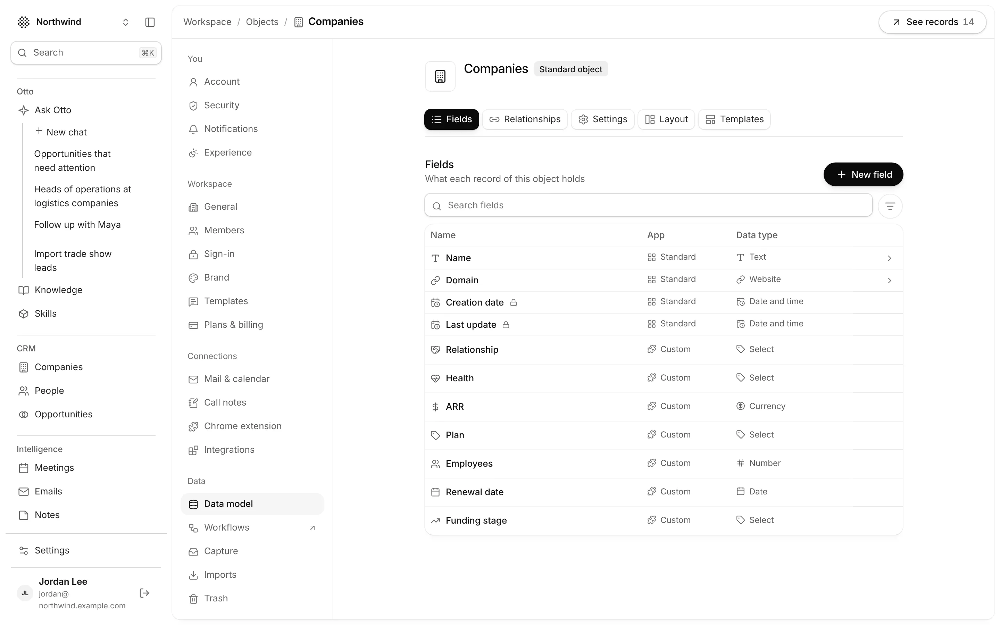

import { Aside, CardGrid, LinkCard, Steps } from '@astrojs/starlight/components';

The data model is the list of things your CRM keeps track of, and what each one holds. Companies, people and opportunities are the standard objects. You can add fields to them, or add your own objects, like projects or subscriptions. Owners and admins make these changes.

Open it from **Settings**, then **Data model**. The page lists **Existing objects** with their type, number of fields and number of records. Filter them with **All objects**, **Standard** or **Custom**.

## Add a field

<Steps>

1. Open the object, such as **Companies**, and stay on the **Fields** tab.
1. Click **New field** and pick a type.
1. Under **Icon and name**, name the field and pick an icon.
1. Under **Values**, set the choices for a choice field, or how a number or date shows.
1. Save. The field shows on every record of that object.

</Steps>

### Field types

| Group | Types |
| --- | --- |
| Text | Text, Long text, Rich text, Full name |
| Numbers | Number, Currency, Percent, Rating |
| Dates | Date, Date and time |
| Choices | Select, Multi-select, True/False |
| Contact details | Email, Emails, Phone, Phones, Website, Links, Address |
| People and files | Teammate, Files |
| Worked out for you | Formula, Rollup |
| Advanced | JSON, Array |

**Formula** fields work out a value from other fields on the same record. **Rollup** fields add up values from linked records, like the total amount of a company's opportunities.

### Field settings

Open a field to change it. Each section has one job:

- **Icon and name**: the name and icon of the field.
- **Values**: how values look and what they can be.
- **Rules**: **Required** means it can't be left empty. **Unique** means no two records can have the same value.
- **Description**: what the field is for. Otto reads it too.
- **Otto fills it**: let Otto fill this field from emails and calls. See below.

### Let Otto fill a field

Under **Otto fills it**, pick a mode and describe the field in plain words, like "the date their current contract ends".

Fields filled by rules come with Pro and Business. On a lower plan, the box shows "Fields filled by rules come with Pro" with **Upgrade**, and Otto fills nothing. The modes and hints you set stay saved for when you upgrade.

| Mode | What happens |
| --- | --- |
| Off | Otto leaves the field alone |
| Suggest | Otto suggests a value with the quote it came from, and you accept or skip it |
| Fill when empty | Otto fills the field when it's empty, and leaves values a person typed |

### Turn off or delete a field

Under the field's danger zone, turn the field off to hide it everywhere while keeping its values. Turned-off fields show under **Inactive** on the **Fields** tab. Custom fields can also be deleted.

## Add a custom object

<Steps>

1. On **Data model**, click **New object**.
1. Under **About**, pick an **Icon** and type the **Singular** name, like "Subscription". The **Plural** fills itself in.
1. Add a **Description** if you like.
1. Under **Advanced**, you can change the key other tools use for this object.
1. Save. The new object shows in the sidebar under **CRM**, with its own list and record pages.

</Steps>

## Link objects together

The **Relationships** tab shows how an object connects to others. Click **Add relationship**, pick the **Related object** and the **Relationship type**, then set **Names** for what each side calls the other. For example, a subscription belongs to one company, and a company has many subscriptions.

## Arrange the record page

On the **Layout** tab, **Record page** lists the groups of fields on each record, top to bottom. Move fields between groups, or into **More** or **Hidden**. **Reset** goes back to the default groups.

**Navigation** sets where records open from a list: **Side panel**, **Full page** or **Member preference**, which lets each person choose.

## Templates for new records

On the **Templates** tab, make named ways to create a record, with default values filled in. When someone clicks **New**, they can pick a template at the top of the form.

<Aside type="note">
Changes to the data model affect the whole workspace. Turning a field off is safer than deleting it, because you can turn it back on with its values.
</Aside>

## Next steps

<CardGrid>
  <LinkCard title="Views" href="/crm/views/" description="Filter and group by your new fields." />
  <LinkCard title="Record updates and drafts" href="/otto/record-updates-and-drafts/" description="Review what Otto suggests." />
</CardGrid>
