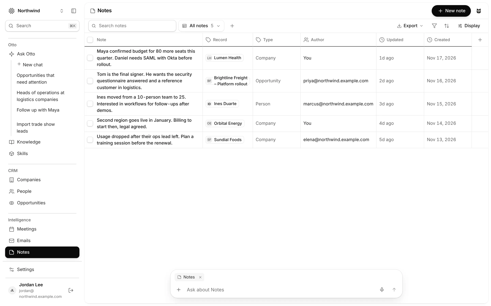

import { Aside, CardGrid, LinkCard, Steps } from '@astrojs/starlight/components';

**Notes**, under **Intelligence** in the sidebar, lists every note your team wrote, on every company, person and opportunity, newest first. Use it to find what someone wrote without knowing which record it's on.

**Address:** `/notes` **Who:** everyone sees every note. Only a note's author can edit or delete it.

## The list

| Column | What it shows |
| --- | --- |
| **Note** | The first lines of the note |
| **Record** | The company, person or opportunity it's on. Click to open it. |
| **Type** | **Company**, **Opportunity** or **Person** |
| **Author** | Who wrote it. Your own show as **You**. |
| **Updated** | When it last changed |
| **Created** | The day it was written |

Type in **Search notes** to find words in any note. Filter and sort by any column, and save the list as a view, like every list. See [Views](/crm/views/).

A new workspace shows **Add your first note**.

## Add a note

<Steps>

1. Click **New note**.
1. In **Link to a company, opportunity or person**, start typing a name and pick the record.
1. Write the note. Markdown works: `#` for a heading, `-` for a list, `**bold**`.
1. Save.

</Steps>

You can also add a note on a record's **Notes** tab, from Otto ("add a note to Lumen Health: …"), from the Chrome extension's side panel, or through the [API](/api-reference/notes/).

## Read, edit or delete

Click a note to open it beside the list. The author can change it in place. **Delete note** asks "Delete this note?" first. **Close** puts it away.

<Aside type="note">
Otto reads notes when you ask about a record, and finds them by meaning. "Who worried about the price?" finds a note that says "budget is tight".
</Aside>

## Related

<CardGrid>
  <LinkCard title="Record pages" href="/crm/record-pages/" description="Notes on one record." />
  <LinkCard title="Ask Otto" href="/otto/ask-otto/" description="Ask about what your notes say." />
</CardGrid>
