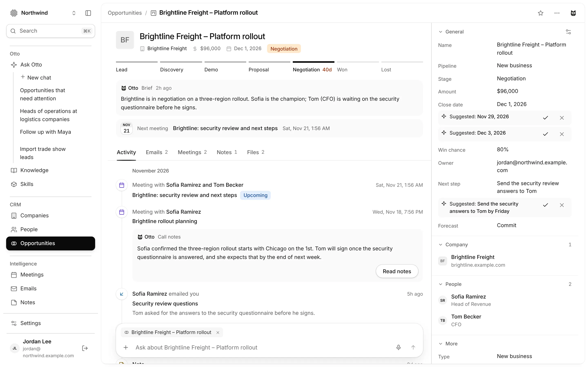
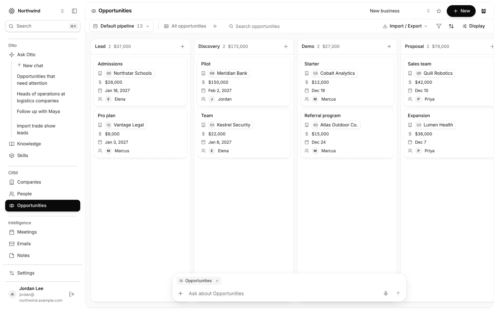
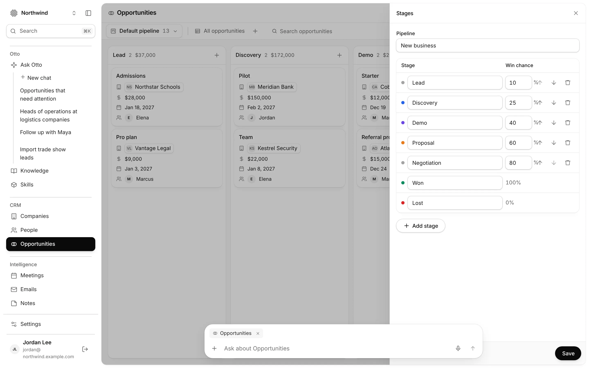
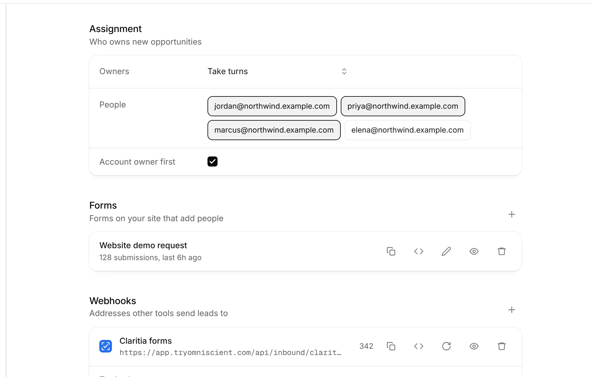

import { Aside, CardGrid, LinkCard, Steps } from '@astrojs/starlight/components';

An opportunity is a deal you are working on with a company. Each one sits in a pipeline and moves through its stages until it is won or lost.

## Where opportunities come from

- **From your inbox.** Once you have had a meeting with a company, or emails have gone both ways, Omniscient opens an opportunity for it. New activity is filed under that opportunity.
- **By hand.** On **Opportunities**, click **New**. You can also press <kbd>⌘</kbd> <kbd>K</kbd> and pick **New opportunity**.
- **From an import.** See [Import your data](/get-started/import-your-data/).
- **From a form or webhook.** See [Capture leads](#capture-leads-from-forms-and-webhooks) below.

## What an opportunity holds

| Field | What it means |
| --- | --- |
| Opportunity | Its name |
| Company | The company it is with |
| Stage | Where it is in the pipeline |
| Amount | What it is worth |
| Win chance | The stage's chance of winning, as a percent |
| Weighted | Amount times win chance |
| Close date | When you expect it to close |
| Owner | The teammate who runs it |
| Next step | What happens next, in a few words |
| Last touch and Next meeting | The latest email or meeting, and the next one on the calendar |

Omniscient has no separate tasks. Keep what comes next in **Next step**.

## Move an opportunity to another stage

Open the opportunity. The stage bar at the top shows every stage and how long the opportunity sat in each. Click a stage to move it there. On the board view, drag the card to another column.

When Otto reads a call or an email that points to a new stage, it suggests the change for you to accept. See [Record updates and drafts](/otto/record-updates-and-drafts/).

## Use the board

On **Opportunities**, click **Display** and set **Layout** to **Kanban**. Pick the field for the columns in **Lanes by**, which is usually Stage. The board is on Pro and Business. See [Views](/crm/views/).

## Set up pipelines and stages

Most teams need one pipeline. Add more when you sell in different ways, like new business and renewals.

<video class="clip" src="/videos/edit-stages.mp4" autoplay muted loop playsinline preload="metadata" width="1280" height="800" aria-label="Opening Import / Export, then Edit stages, to see the pipeline and its stages"></video>

### Edit stages

<Steps>

1. On **Opportunities**, click **Import / Export** in the toolbar, then **Edit stages**.
1. Rename the pipeline in **Pipeline name**.
1. For each stage, set the **Stage name** and its **Win chance**.
1. Use **Move up** and **Move down** to change the order.
1. Click **Delete stage** to remove one. Its opportunities move to the first stage, and Omniscient asks before it moves them.
1. Save.

</Steps>

Each pipeline also has won and lost stages, which close an opportunity.

### Add or delete a pipeline

- To add one, click **Import / Export**, then **New pipeline**, and type its name.
- To switch pipelines, use the **Pipeline** menu at the top of the page. It shows when you have more than one.
- To delete one, open **Edit stages** and click **Delete pipeline**. Its opportunities move to your default pipeline.

## Capture leads from forms and webhooks

Owners and admins set this up in **Settings**, then **Capture**. Each new lead adds the person, opens an opportunity, picks an owner and emails that owner right away.

### Choose who owns new opportunities

Under **Assignment**, pick how owners are chosen:

| Option | How it works |
| --- | --- |
| Off | No owner is picked for you |
| Take turns | New opportunities go to each person in **People** in turn |
| Fewest open opportunities | The person with the fewest open opportunities gets the next one |

Tick **Account owner first** to give a lead to the person who already owns that company.

### Add a form to your site

<Steps>

1. Under **Forms**, click **New form**.
1. Set the **Title**, **Source** and **Fields**. **Work email** is always asked. Mark any other field **Required**.
1. Set the **Button** text, and either a **Thank-you message** or a **Page after sending**.
1. Save. Then click **Copy link** to share the form, or **Copy embed code** to put it on your website.

</Steps>

Turn a form off or on with its switch, or delete it.

### Send leads from another tool

Under **Webhooks**, click **New webhook** to get an address that other tools, such as your form builder, can send leads to. Click **Copy address**, and **Copy example** for a sample of what to send. **New address** replaces the address if it ever leaks.

<Aside type="tip">
Tools that connect in one click, like Claritia, send leads without any setup here. See [Integrations](/integrations/).
</Aside>

## Next steps

<CardGrid>
  <LinkCard title="Views" href="/crm/views/" description="Filters, sorting, grouping, the board and saved views." />
  <LinkCard title="Workflows" href="/otto/workflows/" description="Send follow-ups when a stage changes." />
</CardGrid>
