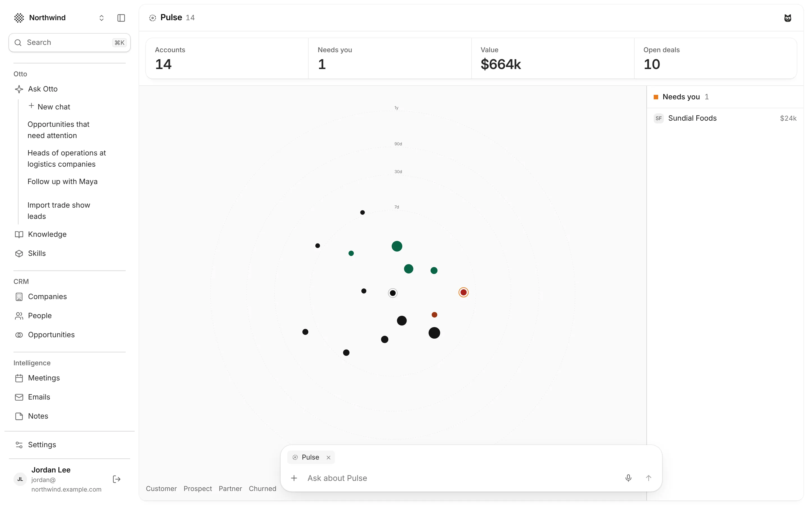

import { CardGrid, LinkCard } from '@astrojs/starlight/components';

Pulse is the whole workspace on one screen. You are the dot in the middle. Each account sits around you. Open it with <kbd>⌘</kbd> <kbd>K</kbd> and type "Pulse".

**Address:** `/pulse` **Who:** everyone

## Read the map

| What you see | What it means |
| --- | --- |
| Distance from the middle | How recently you talked. Closer is more recent. The dashed rings mark time. |
| Size of the dot | How much the account is worth |
| Color | Its health |
| Slice | Its relationship, like customer or prospect |
| Lines between dots | Accounts that are linked, or share people on the same threads |
| A ring of fire | It needs you |

Scroll to zoom, drag to move around, and double-click to reset. Hover a dot to see its **Value**, **Last touch**, **Open deals**, **Contacts** and **Health**. Click it to open the account.

## Needs you

The list on the right, **Needs you**, shows up to 30 accounts that need your attention, with their count. Hover one to light it up on the map, and click it to open the account.

## The numbers

Four cards across the top:

| Card | What it counts |
| --- | --- |
| **Accounts** | Accounts on the map |
| **Needs you** | Accounts that need your attention |
| **Value** | Their total value |
| **Open deals** | Their open opportunities |

## Empty map

With no accounts yet, Pulse says **No accounts yet** with a **Connect mail** button. Your accounts show up once your mail syncs.

## Related

<CardGrid>
  <LinkCard title="Companies and people" href="/crm/companies-and-people/" description="Every account as a list." />
  <LinkCard title="Opportunities" href="/crm/opportunities-and-pipelines/" description="Open deals by stage." />
</CardGrid>
