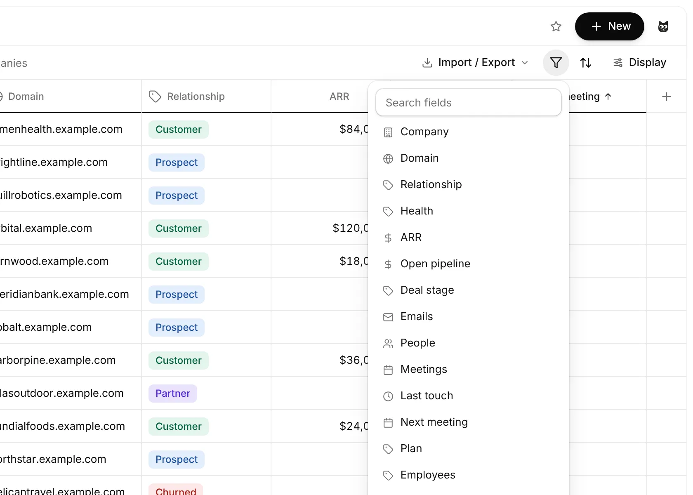
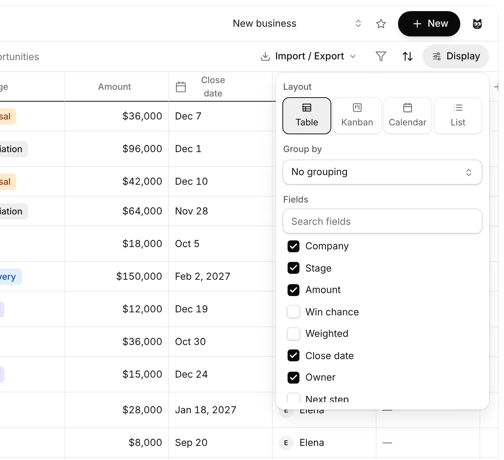
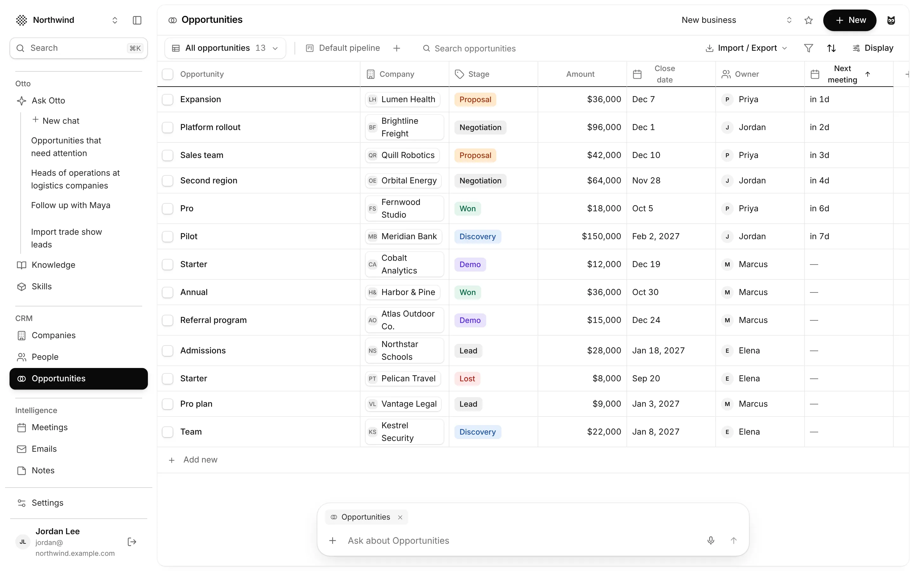
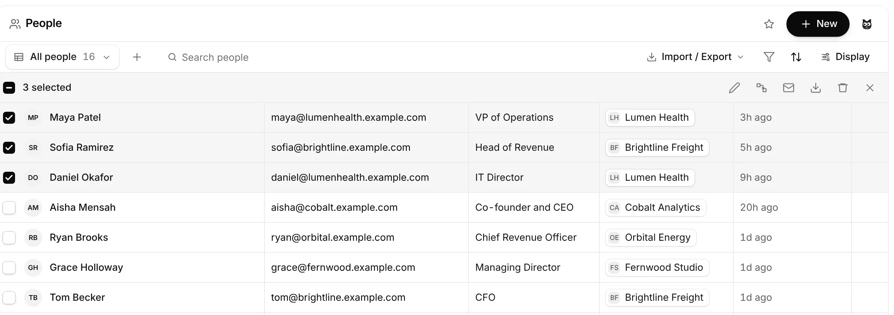
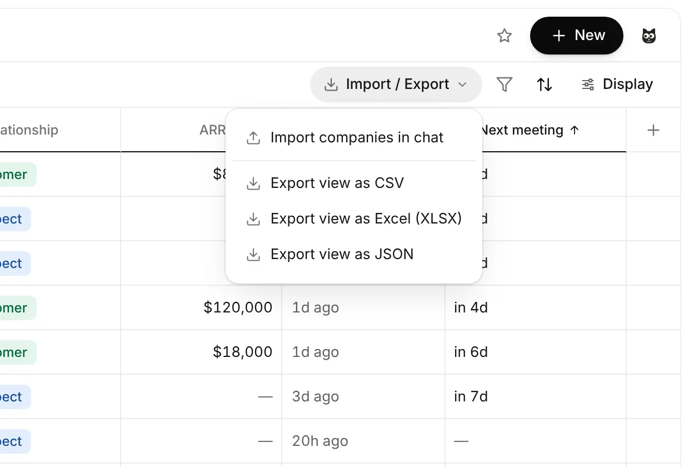

import { Aside, CardGrid, LinkCard, Steps } from '@astrojs/starlight/components';

Every list in the CRM, like **Companies**, **People**, **Opportunities** and any object your team adds, works the same way. The toolbar above the list holds search, **Filter**, **Sort**, **Display** and **Import / Export**.

## Filter and sort

- **Search** finds rows by name as you type.
- **Filter** lists every field. Pick one and choose the values or a condition. Add more filters to narrow the list.
- **Advanced filter** lets you build groups of conditions and pick whether rows must **Match** **Any**, **All** or **None** of them.
- **Sort** orders rows by any field, **Ascending** or **Descending**. You can also click a column header to sort by it.

Each filter shows as a chip above the list. Click **Remove filter** on a chip to clear it.

## Change the layout

Click **Display** to choose how the list looks.

| Layout | Best for | What it needs |
| --- | --- | --- |
| Table | Working across many fields | Nothing |
| Kanban | Moving records between stages or statuses | A choice field for **Lanes by** |
| Calendar | Seeing records by date | A date field for **Date** |
| List | Reading rows on a small screen | Nothing |

**Display** also has **Group by**, to split the list into groups by a field, and **Fields**, to show or hide columns. The Kanban board is on Pro and Business.

## Save a view

A view keeps your filters, sorts, layout and columns, so you can come back to the same list.

<Steps>

1. Set up the list the way you want.
1. Click **Save as view** and type a **View name**.
1. Click **Save view**.

</Steps>

Your views show as tabs above the list. When you change a saved view, click **Save view** to keep the change. Click **Add view** to open another, and **Delete view** to remove one.

Click the star next to the page title to **Add to favorites**. Favorites show at the top of the sidebar.

## Edit in the table

Click a cell to edit it. You can move through the table with the keyboard:

| Keys | What they do |
| --- | --- |
| <kbd>J</kbd> or <kbd>↓</kbd> | Start at the first row |
| Arrow keys | Move between cells |
| <kbd>Tab</kbd> | Next cell |
| <kbd>Enter</kbd> | Edit the cell |
| <kbd>⌘</kbd> <kbd>Enter</kbd> | Open the row |
| <kbd>Shift</kbd> <kbd>Space</kbd> | Tick the row |
| <kbd>Shift</kbd> <kbd>↓</kbd> | Select more cells |
| <kbd>⌘</kbd> <kbd>C</kbd> and <kbd>⌘</kbd> <kbd>V</kbd> | Copy and paste cells |
| <kbd>Delete</kbd> | Clear cells |
| <kbd>Esc</kbd> | Stop |

Click **Calculate** at the foot of a column to show a sum, an average or a count. Click **Add a column** at the right end of the header to show another field.

## Work with many records

Tick the box at the start of each row you want, or **Select all**. A bar shows at the top of the list with actions for the rows you picked:

- **Edit** sets one field on all of them at once. You can undo it from the message that follows.
- **Add to workflow** puts them in a live workflow. See [Workflows](/otto/workflows/).
- **Find emails** looks up work emails for people.
- **Export to CSV** downloads just those rows.
- **Delete** moves them to the Trash.

The same actions show when you right-click a row, or press <kbd>⌘</kbd> <kbd>K</kbd> with rows ticked.

## Export a list

Click **Import / Export**, then **Export view as CSV**, **Export view as Excel (XLSX)** or **Export view as JSON**. The file holds the rows and columns in your current view.

## Shortcuts anywhere in the app

| Keys | What they do |
| --- | --- |
| <kbd>⌘</kbd> <kbd>K</kbd> | Search and actions |
| <kbd>⌘</kbd> <kbd>\\</kbd> | Fold the sidebar |
| <kbd>⌘</kbd> <kbd>Z</kbd> | Undo a delete |
| <kbd>?</kbd> | Show all shortcuts |

On Windows and Linux, use <kbd>Ctrl</kbd> where you see <kbd>⌘</kbd>.

## Next steps

<CardGrid>
  <LinkCard title="Record pages" href="/crm/record-pages/" description="Open a row to see everything on it." />
  <LinkCard title="Data model" href="/crm/data-model/" description="Add the fields you want to filter and group by." />
</CardGrid>
