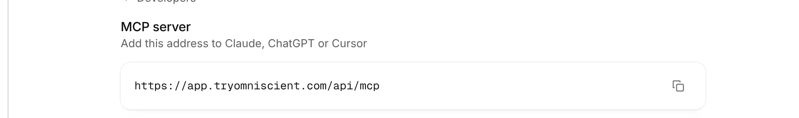

import { Aside, CardGrid, LinkCard, Steps } from '@astrojs/starlight/components';

The Omniscient MCP server lets your AI app work with your CRM. Ask Claude to "add a note to the Northwind opportunity" or ChatGPT to "list my opportunities in Proposal", and it reads or writes Omniscient for you.

Server address: `https://app.tryomniscient.com/api/mcp`

You can also find and copy it in **Settings**, then **Integrations**, then **Developers**, under **MCP server**.

## Connect your AI app

<Steps>

1. In your AI app, add a new connector or MCP server and paste the address above.
1. The app sends you to Omniscient's approve page. Sign in if you need to.
1. An owner or admin of the workspace clicks **Allow**.
1. You're back in your AI app, connected.

</Steps>

You don't need to copy a key. The connection shows as a key named after the app, like "Claude (MCP)", under **API keys** in **Developers**. Click **Revoke** there to disconnect the app.

<Aside type="note">
Apps that can't sign in this way can use a plain [API key](/developers/api/#make-an-api-key) as a Bearer token instead.
</Aside>

## What your AI app can do

| Tool | What it does |
| --- | --- |
| `search` | Finds companies by name or domain, people by name or email, and opportunities by name |
| `list_records` | Lists companies, people or opportunities, newest first. Filters by company or stage. |
| `get_record` | Reads one record with its latest notes. A company comes with its people and opportunities. |
| `describe_fields` | Lists fields, their types and choices, plus pipelines and stages |
| `upsert_company` | Adds a company by domain, or fills in the one that has it |
| `upsert_person` | Adds a person by email, or fills in the one that has it |
| `create_opportunity` | Opens an opportunity at a company |
| `update_record` | Changes fields like stage, amount, close date, next step and custom fields |
| `add_note` | Adds a note to a record, written as the person who connected the app |

## Rules the server follows

- Every request stays inside the workspace you connected.
- Changes are checked against the record's fields and the pipeline's stages before they're written.
- Formula, rollup and list fields can't be changed.
- Changes show in each field's history, and workflows see them like any other change.
- The same limit as the API applies: 600 calls a minute.
- The server never touches LinkedIn or contracts.

## Next steps

<CardGrid>
  <LinkCard title="REST API" href="/developers/api/" description="Build your own connection." />
  <LinkCard title="Ask Otto" href="/otto/ask-otto/" description="Otto works with your CRM inside Omniscient." />
</CardGrid>
