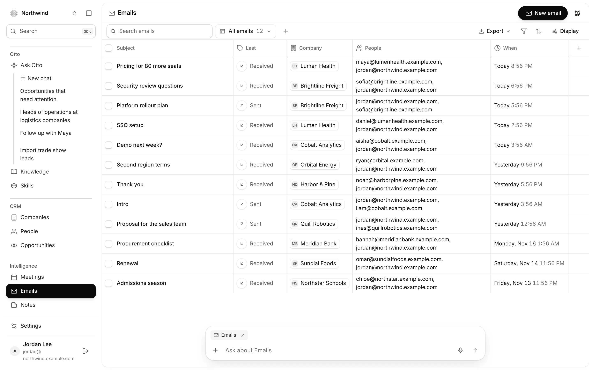
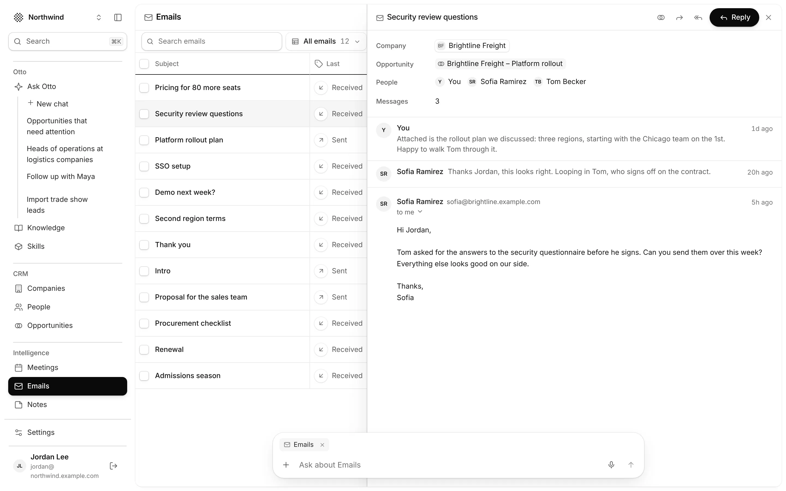
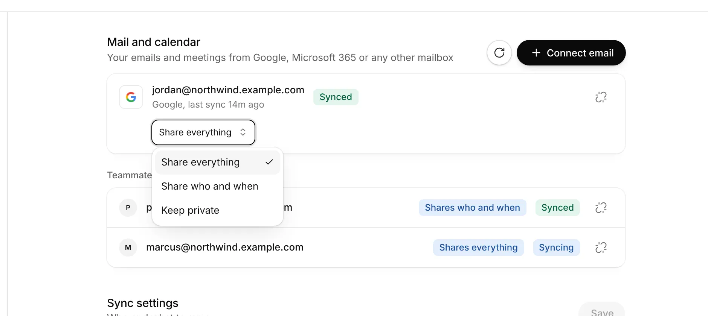

import { Aside, CardGrid, LinkCard, Steps } from '@astrojs/starlight/components';

Omniscient reads your email to keep your CRM current. It never deletes or edits anything in your mailbox, and it sends an email only when you click **Send** or when a workflow you approved sends it.

## What syncs

When you connect a mailbox, Omniscient reads your recent mail and calendar, then keeps reading new mail every few minutes.

- **The first sync** goes back as far as you chose in **How far back**, from one week to one year.
- **Emails with people outside your team** land on the right person and company. Mail between teammates stays out.
- **Newsletters, notifications and promotions** are skipped.
- **Each email's subject and a short preview** are saved on the record. The full text is read from your mailbox when you open the email.

Your [sync settings](/get-started/connect-your-inbox/#choose-what-syncs) decide who gets added as a person, and **Do not track** keeps chosen people and domains out completely.

## The Emails page

Click **Emails** under **Intelligence** in the sidebar to see every synced thread. Columns include **Subject**, **Messages**, **Last**, **Company**, **People**, **When** and **Preview**. Use **Search emails** to find a thread.

Threads that are waiting on you carry a **Needs reply** tag. Pick **Needs reply** at the top to see only those.

## Read a thread

Click a thread to open it. You see the whole conversation, who was on it, and the company and opportunity it belongs to. Click **Open company** or **Open opportunity** to jump to them, or **Open in inbox** to see it in Gmail or Outlook.

<Aside type="note">
If the full thread doesn't load, the mailbox may need to sign in again. A line says so, and you can click **Reconnect** in **Settings**, then **Mail & calendar**.
</Aside>

## Who sees your email

You choose what your teammates see from your mailbox. Go to **Settings**, then **Mail & calendar**, and use the menu under the mailbox:

| Option | Teammates see |
| --- | --- |
| Share everything | The subject, the preview and the facts Otto found |
| Share who and when | Only that a conversation happened, and when |
| Keep private | Nothing from this mailbox |

The rule is enforced in the database, so it holds everywhere: on records, in search, in Otto's answers, in digests and in anything sent to other tools. Your own view always shows everything from your own mailbox.

## Send email from Omniscient

You can reply to a thread or start a new email, and it goes out from your own mailbox.

<Steps>

1. **Allow sending, once.** Reading and sending are separate permissions. The first time, click **Allow sending** on a thread, or the send icon next to your mailbox in **Settings**, then **Mail & calendar**. Approve the extra access.
1. **Reply.** Open a thread and click **Reply**, **Reply all** or **Forward**. Write your message and click **Send**.
1. **Start a new email.** On a person or company, open the **Emails** tab and click **New email**. Pick **From**, then fill in **To**, **Subject** and **Message**.

</Steps>

Only the owner of a mailbox can send from it. Sent emails show on the record like any other.

## Disconnect

In **Settings**, then **Mail & calendar**, click the disconnect icon next to a mailbox. Omniscient stops syncing it and deletes the emails and meetings it brought in. Your companies, people and opportunities stay.

## Next steps

<CardGrid>
  <LinkCard title="Meetings and call notes" href="/email-and-calendar/meetings-and-call-notes/" description="Calendar sync, prep briefs and notes from calls." />
  <LinkCard title="Record updates and drafts" href="/otto/record-updates-and-drafts/" description="Have Otto draft your follow-ups." />
</CardGrid>
