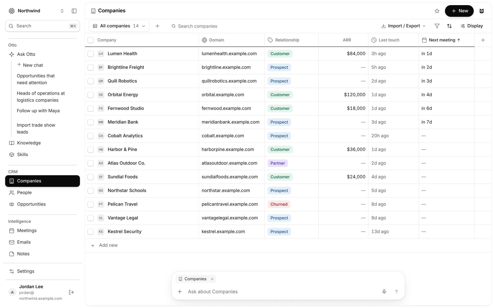
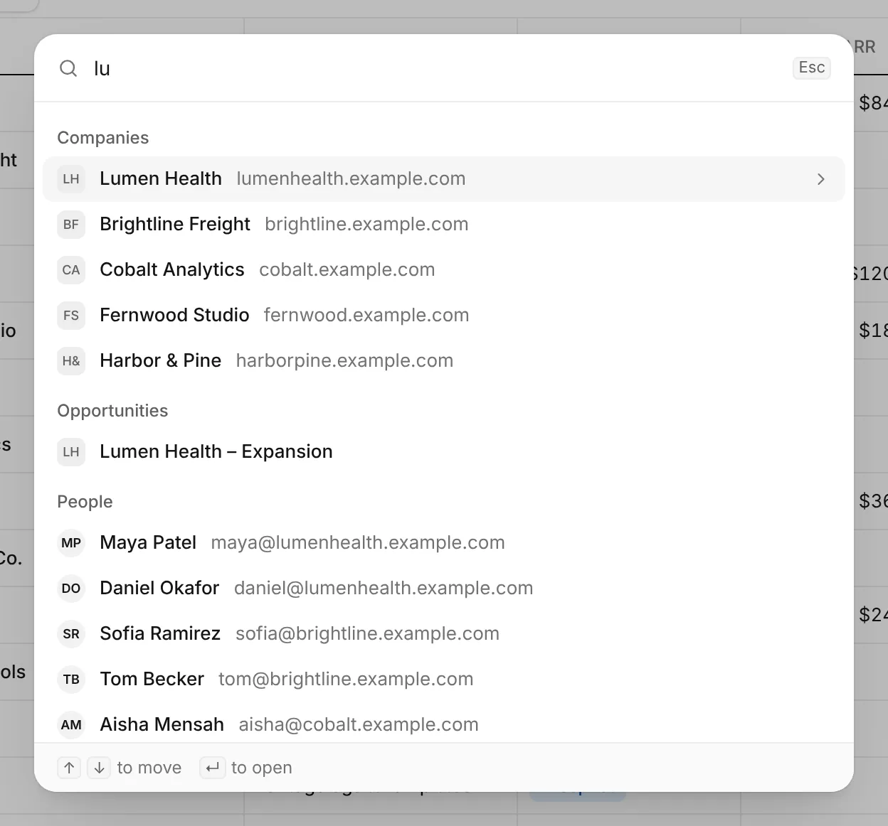
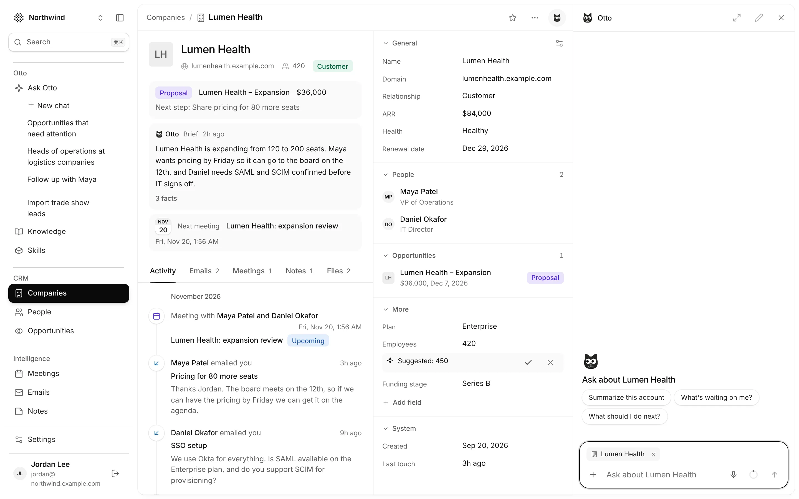

import { Aside, CardGrid, LinkCard } from '@astrojs/starlight/components';

Omniscient has one layout on every screen: the sidebar on the left, the page in the middle, and Otto a click away at the bottom. This page names each part, so the rest of the docs make sense.

## The sidebar

From top to bottom:

| Part | What it does |
| --- | --- |
| Workspace name | Click it to open **Workspaces** and switch to another workspace you're in, or **Sign out** |
| **Search** | Opens search and actions. The same as <kbd>⌘</kbd> <kbd>K</kbd>. |
| **Favorites** | Records, lists and views you starred. Drag to reorder. |
| **Otto** | **Ask Otto**, **Knowledge** and **Skills** |
| **CRM** | **Companies**, **People**, **Opportunities**, and any objects your team added |
| **Intelligence** | **Meetings**, **Emails** and **Notes** |
| **Automations** | **Workflows** |
| **Settings** | At the very bottom |

Click a section's name to fold or open it. Omniscient remembers which sections you keep open. Click **Fold sidebar (⌘\\)** to hide the sidebar, and **Open sidebar (⌘\\)** to bring it back.

Clicking a page you were on before takes you back to where you left it, with the same record or filter.

## Favorites

Star a list, a saved view or a record to **Add to favorites**. It shows under **Favorites** at the top of the sidebar. To take one off, hover it and click **Remove from favorites**. Favorites are your own. Teammates have their own.

## Search and actions

Press <kbd>⌘</kbd> <kbd>K</kbd> (<kbd>Ctrl</kbd> <kbd>K</kbd> on Windows), or click **Search**. The box says "Search or ask Otto".

<video class="clip" src="/videos/command-menu.mp4" autoplay muted loop playsinline preload="metadata" width="1280" height="800" aria-label="Pressing Command K, typing lumen and opening Lumen Health from the results"></video>

| Type | You get |
| --- | --- |
| A page name, like "meet" | Go to **Meetings**. Every page is listed: Companies, People, Opportunities, Meetings, Emails, Notes, Ask Otto, Knowledge, Skills, Workflows, Pulse, Data model and Settings. |
| "new" | **New company**, **New person** and **New opportunity** |
| A name, domain or email | Matching companies, people and opportunities |
| A question | **Ask Otto: *your question*** at the bottom, to send it to Otto |
| "shortcuts" | **Keyboard shortcuts** |

Use the arrow keys and <kbd>Enter</kbd>, or click. <kbd>Esc</kbd> closes it. "No matches" means nothing fit.

## Otto on every page

A round box floats at the bottom of most pages. Its chip names what's on screen: the record, the meeting or the list. Ask a question, and Otto opens as a panel on the right while the page narrows beside it.

- The panel stays open as you move between pages, and its chip follows the page.
- Otto reads the list on screen too, with its filters, so "which of these" means the rows you see.
- **Open in Ask Otto** opens the chat in full. **New chat** starts over. **Close** hides the panel.
- Every chat is saved under **Ask Otto**.

## The page

Every screen is one of a few kinds, so you learn them once:

| Kind | Examples | What it has |
| --- | --- | --- |
| List | Companies, People, Notes | One header with one main button, a filter bar, the table and a bar for selected rows |
| Record | A company, a person, an opportunity | A back link, tabs with their own address, and fields on the right |
| Editor | A workflow, a skill | The thing you're building, with its settings beside it |
| Conversation | Ask Otto | The chat and the box to write in |
| Settings | Every settings page | Sections with a title and one short line |

Clicking a row in a list opens it in a **side panel** on the right, so you keep your place. Open it in full from the panel, or press <kbd>⌘</kbd> <kbd>Enter</kbd> on the row.

## Messages at the bottom

Short lines at the bottom of the screen say what just happened, like "Name saved", or what went wrong, with a **Retry** button. After you delete something, the line has **Undo** for 10 seconds. See [Error messages](/reference/error-messages/).

## A banner when sync stops

If one of your mailboxes or your Zoom stops syncing, a banner shows at the top of every page with **Reconnect**, or **Go to settings**. **Hide for today** hides it until tomorrow.

## On a phone

The sidebar opens from the menu button, and panels open as sheets from the bottom. Everything works the same.

## Related

<CardGrid>
  <LinkCard title="Keyboard shortcuts" href="/reference/keyboard-shortcuts/" description="Every key in one place." />
  <LinkCard title="Ask Otto" href="/otto/ask-otto/" description="What Otto can do." />
  <LinkCard title="Settings" href="/settings/" description="Every settings page." />
</CardGrid>
