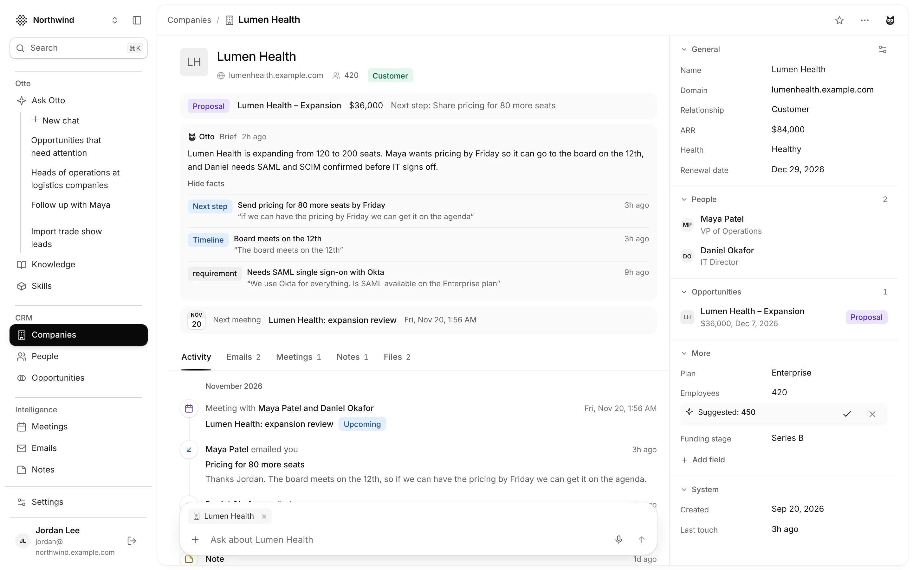

import { Card, CardGrid, LinkCard, Steps, TabItem, Tabs } from '@astrojs/starlight/components';

Omniscient reads the email and calendar you connect. Everyone outside your team becomes a person, their work domain becomes a company, and real back-and-forth turns into opportunities. After each call, Otto suggests updates with the quote behind each one. Nothing changes until you accept it.

## Explore the docs

<CardGrid>
  <Card title="Get started" icon="rocket">
    Make your workspace, connect your inbox and bring your team. [Start here](/get-started/create-your-workspace/)
  </Card>
  <Card title="CRM" icon="database">
    Companies, people, opportunities, pipelines, views and your data model. [Work with records](/crm/companies-and-people/)
  </Card>
  <Card title="Otto" icon="star">
    Ask questions, use skills, find leads and build workflows by asking. [Meet Otto](/otto/ask-otto/)
  </Card>
  <Card title="Email and calendar" icon="email">
    What syncs, who sees it, sending email, meetings and call notes. [Read about sync](/email-and-calendar/email/)
  </Card>
  <Card title="Chrome extension" icon="puzzle">
    Save people from LinkedIn on your click and see their record next to Gmail. [Set it up](/chrome-extension/install-and-connect/)
  </Card>
  <Card title="Integrations" icon="setting">
    Google, Microsoft, Zoom, Slack and imports from your old CRM. [See all](/integrations/)
  </Card>
  <Card title="Workspace" icon="padlock">
    Members, roles, sign-in, single sign-on, plans and your data. [Manage your workspace](/workspace/members-and-roles/)
  </Card>
  <Card title="Developers" icon="seti:json">
    API keys, the REST API, webhooks and the MCP server. [Build on Omniscient](/developers/api/)
  </Card>
</CardGrid>

## How Omniscient works

<Steps>

1. **You connect your inbox**

   Sign in with Google or Microsoft, or add any other mailbox. Omniscient reads your mail and calendar and keeps reading new mail as it arrives. [Connect your inbox](/get-started/connect-your-inbox/)

1. **Records build themselves**

   People outside your team become people. Their work domains become companies. A meeting, or emails that go both ways, opens an opportunity. [Companies and people](/crm/companies-and-people/)

1. **Otto keeps them current**

   After a call, Otto writes notes and suggests field changes, each with the quote it came from. You accept or skip each one. [Record updates and drafts](/otto/record-updates-and-drafts/)

1. **You ask for the rest**

   Ask Otto what needs you today, prep for a meeting, find new leads or set up a follow-up workflow. [Ask Otto](/otto/ask-otto/)

</Steps>

## Find your way around

The sidebar in the app has four sections, with Settings at the bottom.

| Section | Pages |
| --- | --- |
| Otto | Ask Otto, Knowledge, Skills |
| CRM | Companies, People, Opportunities, and any objects your team adds |
| Intelligence | Meetings, Emails, Notes |
| Automations | Workflows |

Press <kbd>⌘</kbd> <kbd>K</kbd> (or <kbd>Ctrl</kbd> <kbd>K</kbd>) anywhere to search records, jump to a page or ask Otto.

## Three ways to use Omniscient

<Tabs>
  <TabItem label="In the app">

Sign in at [app.tryomniscient.com](https://app.tryomniscient.com). Your first sign-in creates your account, and a short setup builds your CRM.

  </TabItem>
  <TabItem label="In your browser">

The Chrome extension saves the LinkedIn profile you are looking at, shows the person's record beside LinkedIn and Gmail, and puts your team's templates into a message box. [Chrome extension](/chrome-extension/install-and-connect/)

  </TabItem>
  <TabItem label="From your AI app">

Connect Claude, ChatGPT or Cursor to the Omniscient MCP server and work with your records in plain words. [MCP server](/developers/mcp/)

  </TabItem>
</Tabs>

## Need help?

<CardGrid>
  <LinkCard title="FAQ" href="/reference/faq/" description="Quick answers about sync, privacy, Otto, plans and billing." />
  <LinkCard title="Troubleshooting" href="/reference/troubleshooting/" description="Fix sync problems, missing records and sign-in issues." />
</CardGrid>

Still stuck? Write to [hello@tryomniscient.com](mailto:hello@tryomniscient.com).
