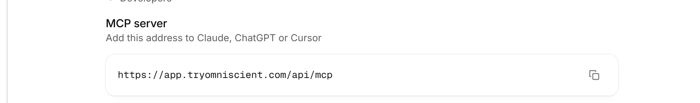

import { Aside, CardGrid, LinkCard, Steps } from '@astrojs/starlight/components';

Already work in Claude, ChatGPT or Cursor? Connect it to Omniscient, and it can find records, read their notes, open opportunities and update fields for you.

## At a glance

| | |
| --- | --- |
| **Connect** | Paste `https://app.tryomniscient.com/api/mcp` into your AI app as a connector, then **Allow** |
| **Who connects** | Anyone can start it. An owner or admin clicks **Allow**. |
| **Direction** | Both ways. The app reads records and, when you agree, writes them. |
| **How often** | Each time you ask the app |
| **What it can do** | Search, list and read companies, people and opportunities; add and update them; add notes |
| **What it can't do** | Delete anything, or touch LinkedIn, contracts, emails or meetings |
| **Disconnect** | **Revoke** next to the app's key in **Settings**, then **Integrations**, then **Developers** |

## Connect

<Steps>

1. In Omniscient, go to **Settings**, then **Integrations**, and open **Developers**. Copy the address under **MCP server**.
1. In your AI app, add a connector (Claude), an app (ChatGPT) or an MCP server (Cursor), and paste the address.
1. The app sends you to Omniscient's approve page. Sign in if asked.
1. An owner or admin clicks **Allow**.

</Steps>

The connection shows as a key named after the app, like "Claude (MCP)", under **API keys**.

## Things to ask

- "Find Lumen Health and tell me about its open opportunities."
- "Move the Brightline renewal to Negotiation and set the close date to December 15."
- "Add a note to Harbor Bank: they want SSO before signing."
- "List my opportunities in Proposal, biggest first."

A well-behaved app asks you before it changes anything. Omniscient's server tells it to.

## How changes are kept safe

- Each change is checked against your fields and stages before it's written.
- Changes show in each field's history, marked as made by AI.
- Workflows see the change like any other edit.
- The app works only inside the workspace you approved.

<Aside type="tip">
Otto, inside Omniscient, does all of this and more: it reads your emails and meetings, uses your skills and Knowledge, and shows confirm cards. Use an outside AI app when you're already working there.
</Aside>

## Disconnect

In **Settings**, then **Integrations**, then **Developers**, click **Revoke** next to the app's key. The app stops working with Omniscient at once.

## Related

<CardGrid>
  <LinkCard title="MCP tools" href="/api-reference/mcp-tools/" description="Every tool the app can call." />
  <LinkCard title="Use Omniscient from Claude" href="/recipes/use-omniscient-from-claude/" description="A step-by-step recipe." />
</CardGrid>
