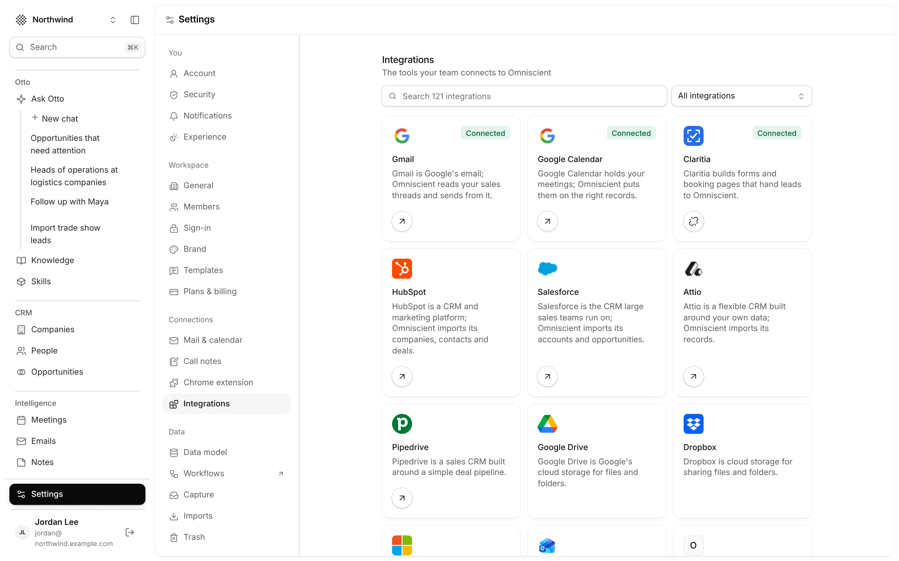

import { Aside, CardGrid, LinkCard, Steps } from '@astrojs/starlight/components';

**Settings**, then **Integrations**, is an app store. It lists every tool Omniscient connects to, as cards with logos. Most apps connect with one sign-in. Once connected, Otto can look things up in them and act in them after you confirm, and workflows can send to them.

## At a glance

| | |
| --- | --- |
| **Connect** | Click an app's card, then **Connect**, and sign in on the app's own page |
| **Who connects** | Owners and admins connect team apps. Anyone connects a personal app for themselves. |
| **Direction** | Omniscient reads from the app when Otto or a workflow asks. Changes go out only after a click or a workflow step someone set up. |
| **How often** | When asked. There is no background copy of the app's data. |
| **What it asks for** | What the app's own sign-in page lists |
| **Disconnect** | The app's card, then **Disconnect** |

## Find an app

- Type in **Search integrations** to find an app by name.
- Use the **Category** menu to see one kind of app, or **All integrations**.
- Each card shows **Connected**, **Not connected**, **Connect again** or **Built in**.

Click a card to open its sheet. The sheet has **What it is**, **What Omniscient reads or does** and **Use cases**, and the buttons to connect.

## Connect an app

<Steps>

1. Open the app's card in **Settings**, then **Integrations**.
1. Click **Connect**. The app's sign-in page opens.
1. Sign in and approve. Some apps ask for an API key on that page instead. You type it there, never in Omniscient.
1. You come back to Omniscient, and the card says **Connected**.

</Steps>

A card that says **Owners and admins connect it** is a team app. Ask an admin to connect it for everyone. A card that says **Not available yet** isn't ready on your server.

### Team apps and personal apps

| Kind | Who connects | Whose account it uses |
| --- | --- | --- |
| Team app | Owners and admins, once | The account they signed in with, for the whole team |
| Personal app | Each person | Their own account |

Personal apps are Zoom, Calendly, Cal.com, Fireflies, Fathom, Grain, Otter, tl;dv and Read.ai. Everything else is a team app.

## The categories

| Category | Apps |
| --- | --- |
| CRMs and files | HubSpot, Salesforce, Attio, Pipedrive, Google Drive, Dropbox, OneDrive |
| Mail and calendar | Gmail, Google Calendar, Outlook, Other email |
| Booking | Calendly, Cal.com, Microsoft Bookings |
| Phone and texting | Aircall, Dialpad, Twilio, WhatsApp Business |
| Calls and meetings | Zoom, Zoom Webinars, Gong, Avoma, Grain, Fireflies, Fathom, Otter, tl;dv, Read.ai, Webex |
| Research and partners | Crunchbase, BuiltWith, Similarweb |
| Website chat and lead ads | Crisp, LiveChat, HubSpot Chat, Facebook Lead Ads, Google Ads |
| Sequencing | Apollo, Lemlist, Instantly, Smartlead, Reply.io |
| Events, surveys and reviews | Eventbrite, SurveyMonkey, Delighted |
| Customer success and support | Zendesk, Intercom, Freshdesk, Help Scout, Front, Gorgias, Zoho Desk, Jira Service Management |
| Billing, accounting and stores | Stripe, Recurly, Maxio, Lemon Squeezy, QuickBooks, Xero, NetSuite, FreshBooks, Zoho Books, Shopify |
| Marketing email | Mailchimp, Klaviyo, ActiveCampaign, Customer.io, Brevo, HubSpot Marketing |
| Forms and sites | Typeform, Tally, Jotform, Fillout, Paperform, Google Forms, HubSpot Forms, Webflow, WordPress, Framer, Wix |
| Product data and warehouses | Segment, PostHog, Mixpanel, Amplitude, Snowflake, BigQuery, Databricks |
| Work tools and docs | Linear, Jira, Asana, ClickUp, Monday.com, Trello, Basecamp, Notion, Confluence, SharePoint, Google Docs, Google Sheets, Excel, Airtable, Box, Coda |
| Team chat and directory | Slack, Microsoft Teams, Google Chat, Discord, Telegram, Google Workspace |
| E-sign | DocuSign, Dropbox Sign, PandaDoc, Qwilr |
| Otto and Omniscient apps | Claude, ChatGPT, Cursor, Chrome extension, Claritia, Arrowsterr, MoltSets, Coresignal |

HubSpot, HubSpot Chat, HubSpot Marketing and HubSpot Forms share one connection. So do Zoom and Zoom Webinars, and Jira and Jira Service Management. There is no LinkedIn app.

Some cards open another page instead of connecting here: mail apps open **Mail & calendar**, Claude, ChatGPT and Cursor open **Developers**, the Chrome extension opens its settings, and MoltSets and Coresignal are **Built in** and open Ask Otto.

## What a connected app does

### In Otto

Ask Otto about something in a connected app, like "Which Zendesk tickets are open for Lumen Health?" or "What's on Brightline's latest Stripe invoice?"

- **Reads** run right away. Otto treats what comes back as data, never as instructions.
- **Changes**, like adding a person to a Mailchimp list, show as a confirm card in the chat. Nothing changes until you click **Confirm**.
- **Some actions are never offered**: anything on LinkedIn; deleting, archiving, cancelling or refunding; keys, tokens and sign-ins; and message templates, which your team writes itself.

Some apps are read-only for Otto:

| Apps | Rule |
| --- | --- |
| DocuSign, Dropbox Sign, PandaDoc, Qwilr | Read only. Otto never writes agreement text. |
| Crunchbase, BuiltWith, Similarweb | Read only |
| Google Workspace, Snowflake, BigQuery, Databricks | Read only |
| Stripe, Recurly, Maxio, Lemon Squeezy | Never moves money |

### In workflows

The **Send to app** step runs one action in a connected app for each record that reaches it. Pick the app and the action, then fill in its form. Each box can hold record values like `{{first_name}}` or `{{company}}`. Actions that are never offered in Otto aren't offered here either.

If the app has a hiccup, the step tries again with growing waits. If the app isn't connected or a required box is empty, the run shows a setup problem, like "Set up Stripe: …", and isn't retried.

## Disconnect an app

Open the app's card and click **Disconnect**. Omniscient asks first and warns that Otto and workflows stop using it. A **Send to app** step for that app fails until it's connected again.

<Aside type="tip">
Don't see your tool? Write to [hello@tryomniscient.com](mailto:hello@tryomniscient.com). Tools Omniscient can't connect yet include Chili Piper, RingCentral, Outreach, Salesloft, Gainsight, Chargebee, Marketo and Okta.
</Aside>

## Related

<CardGrid>
  <LinkCard title="Integrations" href="/integrations/" description="The core connections." />
  <LinkCard title="Workflows" href="/otto/workflows/" description="Add a Send to app step." />
  <LinkCard title="E-sign tools" href="/integrations/e-sign/" description="DocuSign, Dropbox Sign, PandaDoc and Qwilr." />
</CardGrid>
