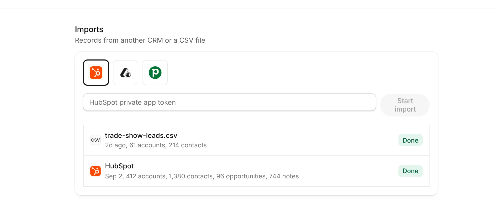

import { Aside, CardGrid, LinkCard, Steps } from '@astrojs/starlight/components';

You don't have to leave your current CRM on day one. Connect your inbox and run Omniscient next to it. When you are ready, bring your records over in a few clicks. Owners and admins run imports.

## What comes over

| From your old CRM | Becomes in Omniscient |
| --- | --- |
| Companies or accounts | Companies |
| Contacts | People |
| Leads | People |
| Pipelines and their stages | Pipelines and stages |
| Deals or opportunities | Opportunities, in the right pipeline and stage |
| Notes | Notes on the matching records |

Records already in Omniscient are matched, so nothing is copied twice. Only their blank fields get filled. Nothing a person typed is overwritten.

## Run an import

<Steps>

1. Go to **Settings**, then **Imports**.
1. Pick your CRM by its logo: HubSpot, Salesforce, Attio or Pipedrive.
1. Click **Connect HubSpot** (or your CRM's name) and sign in to approve access. Pipedrive asks for your Pipedrive key on its sign-in page.
1. The import starts. Each step shows as it runs: accounts, contacts, leads, pipelines, opportunities, then notes.
1. When the status says **Finished**, open **Companies**, **People** and **Opportunities** to check your records.

</Steps>

If your CRM is already connected in **Settings**, then **Integrations**, the import starts as soon as you click.

<Aside type="tip">
Set up your pipelines after the import. The import brings your old pipelines and stages with it. You can rename, reorder or delete them later in [Opportunities and pipelines](/crm/opportunities-and-pipelines/#set-up-pipelines-and-stages).
</Aside>

## If an import fails

The import shows **Failed** with a line saying why. Common causes:

- **Access ended.** Sign in again from the import page and start the import again.
- **Missing permissions.** The account you signed in with must be able to read the records you want. Use an admin account in your old CRM.

## From a spreadsheet

For any other tool, export a CSV file and import it with Otto. See [Import your data](/get-started/import-your-data/#import-a-csv-file-with-otto).

## Each CRM

| CRM | Signs in with | Leads come over | Page |
| --- | --- | --- | --- |
| HubSpot | One click | Yes, contacts at early lifecycle stages | [HubSpot](/integrations/hubspot/) |
| Salesforce | One click | Yes, Salesforce leads | [Salesforce](/integrations/salesforce/) |
| Attio | One click, or an access token | No | [Attio](/integrations/attio/) |
| Pipedrive | Your Pipedrive API key on the sign-in page | No | [Pipedrive](/integrations/pipedrive/) |

## Next steps

<CardGrid>
  <LinkCard title="Data model" href="/crm/data-model/" description="Add fields your old CRM had." />
  <LinkCard title="Invite your team" href="/get-started/invite-your-team/" description="Bring everyone in once the data is there." />
</CardGrid>
