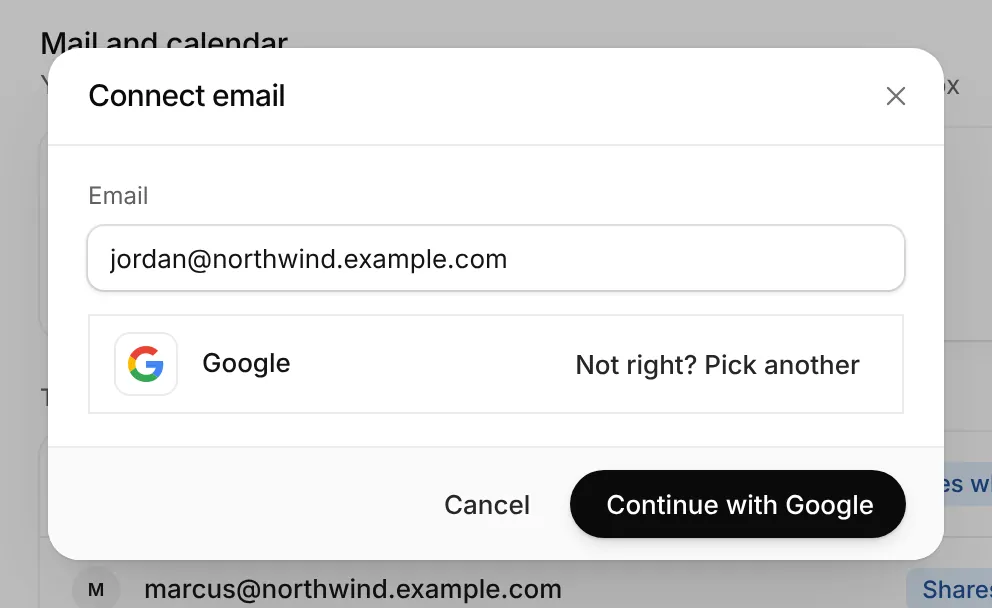
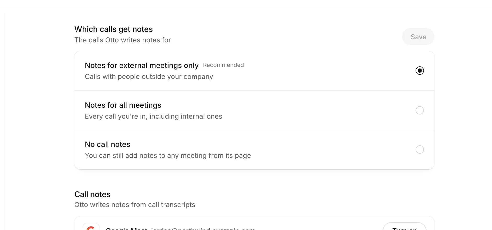

import { Aside, CardGrid, LinkCard, Steps } from '@astrojs/starlight/components';

Connecting your Google account brings in your Gmail and Google Calendar. You can also let Omniscient send from Gmail and read your Google Meet transcripts for call notes. Each permission is asked for only when you turn that part on.

## At a glance

| | |
| --- | --- |
| **Connect** | **Settings**, then **Mail & calendar**, then **Connect email**, then **Continue with Google** |
| **Who connects** | Each person connects their own Google account |
| **What syncs** | Gmail threads and Google Calendar meetings, filtered by your sync settings, and Google Meet transcripts when you turn them on |
| **Direction** | Into Omniscient. Emails you send from Omniscient go out through Gmail. Nothing in Gmail or Calendar is changed. |
| **How often** | About every 5 minutes. The first sync reads back 90 days by default, and meetings 60 days ahead. |
| **Skipped** | Chats, drafts, and Gmail's Promotions, Social, Updates and Forums tabs. All-day events. |
| **Disconnect** | The disconnect icon next to the mailbox in **Settings**, then **Mail & calendar** |

## What Omniscient asks for

| Part | Access | When it's asked |
| --- | --- | --- |
| Gmail | Read only | When you connect |
| Google Calendar | Read only | When you connect |
| Sending from Gmail | Send only | When you click **Allow sending** |
| Google Meet | Read meeting transcripts | When you click **Turn on** in **Call notes** |

Omniscient never deletes or changes anything in your Gmail or your calendar. Your email and calls are never used to train AI models, and Google's Limited Use rules apply to data from Google accounts.

## Connect Gmail and Google Calendar

<Steps>

1. Go to **Settings**, then **Mail & calendar**, and click **Connect email**.
1. Type your Gmail or Google Workspace address and click **Continue**.
1. Click **Continue with Google**, pick the account and approve access.

</Steps>

The first sync starts right away. See [Connect your inbox](/get-started/connect-your-inbox/) for sync settings.

## Allow sending

To reply or write new emails from Omniscient, and to let workflows send from your Gmail:

1. Open any email thread in Omniscient and click **Allow sending**, or click the send icon next to your mailbox in **Settings**, then **Mail & calendar**.
1. Approve the send permission in Google's window.

## Turn on Google Meet call notes

<Steps>

1. Go to **Settings**, then **Call notes**.
1. Click **Turn on** next to **Google Meet** and approve access.
1. Turn on transcripts for your meetings in Google Meet.

</Steps>

After each call, Otto reads the transcript and writes notes on the meeting. See [Meetings and call notes](/email-and-calendar/meetings-and-call-notes/). Summary emails from Gemini's notes in your inbox are matched to their meeting too.

## Sign in with Google

Signing in to Omniscient with **Continue with Google** is separate from connecting your mailbox. You can sign in with Google and connect a different mailbox, or the other way around.

## Disconnect

In **Settings**, then **Mail & calendar**, click the disconnect icon next to your Google account. Omniscient stops syncing and deletes the emails and meetings it brought in. Records stay. You can also remove Omniscient's access from your Google account's security settings.

<Aside type="caution">
If you remove access from Google's side, your mailbox shows **Connect again** in Omniscient. Click **Reconnect** to start syncing again.
</Aside>

## Next steps

<CardGrid>
  <LinkCard title="Email" href="/email-and-calendar/email/" description="Privacy, reading threads and sending." />
  <LinkCard title="Microsoft" href="/integrations/microsoft/" description="Outlook and Teams." />
</CardGrid>
