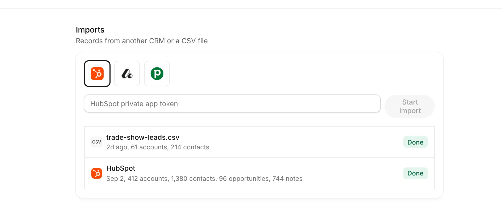

import { Aside, CardGrid, LinkCard, Steps } from '@astrojs/starlight/components';

Move from HubSpot to Omniscient in a few clicks. Omniscient reads your HubSpot records once and copies them in. It never writes to HubSpot.

## At a glance

| | |
| --- | --- |
| **Connect** | **Settings**, then **Imports**, then **HubSpot**, then **Connect HubSpot**. Or from HubSpot's card in **Settings**, then **Integrations**. |
| **Who connects** | Owners and admins |
| **What comes over** | Companies, contacts, leads, pipelines and stages, deals and notes, with deal owners |
| **Direction** | HubSpot into Omniscient, one time per import |
| **How often** | When you click **Import**. Run it again to bring in what's new. |
| **What it asks for** | Read access to companies, contacts, deals, owners and deal pipelines |
| **Disconnect** | HubSpot's card in **Settings**, then **Integrations** |

## Import from HubSpot

<Steps>

1. Go to **Settings**, then **Imports**.
1. Pick **HubSpot** by its logo.
1. Click **Connect HubSpot** and sign in with a HubSpot user who can see all the records you want.
1. Approve access. The import starts on its own.
1. Watch each step finish: **Accounts**, **Contacts**, **Leads as people**, **Pipelines**, **Opportunities** and **Notes**. The status goes from **Queued** to **Starting**, **Running** and **Finished**.
1. When it says **Finished**, open **Companies**, **People** and **Opportunities** to check.

</Steps>

## What comes over

| In HubSpot | In Omniscient |
| --- | --- |
| Companies | Companies, matched by their domain or website |
| Contacts | People, linked to their company |
| Contacts at the subscriber, lead or marketing qualified lead stage | People, with their lead status |
| Deal pipelines and stages | Pipelines and stages, with each stage's probability. Closed won and closed lost stages become won and lost. |
| Deals | Opportunities with their name, amount, close date, pipeline, stage and owner |
| Notes | Notes on the matching company, person or opportunity |

Deal owners are matched by email to people in your workspace. Invite your team first, so their deals land on them.

### What doesn't come over

Tasks, emails, calls, meetings, tickets, products, quotes and custom objects. Omniscient fills in emails and meetings from your own inboxes once you connect them.

## Running it again

Each record keeps its HubSpot id. A second import matches records it brought before and fills only empty fields. Nothing you changed in Omniscient is overwritten. Only one import runs at a time.

## Without one-click sign-in

If HubSpot sign-in isn't set up on your server, the import page shows "HubSpot sign-in isn't set up yet." and a box for a token. Make a private app in HubSpot with the same read scopes, then paste its token. This is a fallback. Most workspaces never see it.

## Disconnect

Open HubSpot's card in **Settings**, then **Integrations**, and click **Disconnect**. Records already imported stay. You can also remove the Omniscient app in HubSpot's connected apps settings.

<Aside type="note">
HubSpot Chat, HubSpot Marketing and HubSpot Forms share the same HubSpot connection for Otto and workflows. See [The app store](/integrations/app-store/).
</Aside>

## Related

<CardGrid>
  <LinkCard title="CRM imports" href="/integrations/crm-imports/" description="All four imports side by side." />
  <LinkCard title="Import from another CRM" href="/recipes/import-from-another-crm/" description="A step-by-step recipe." />
</CardGrid>
