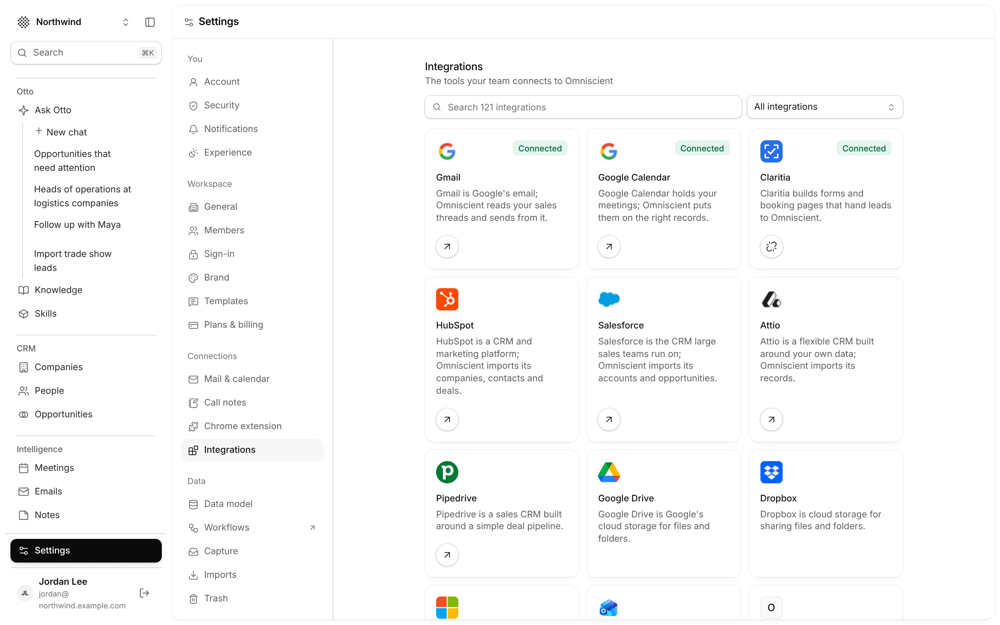

import { Aside, CardGrid, LinkCard, Steps } from '@astrojs/starlight/components';

Connecting a tool to Omniscient is one click: a sign-in button like **Connect HubSpot** or **Add to Slack**. You never need to paste an API key in the main flow. Find every tool in **Settings**, then **Integrations**.

## Find and connect a tool

<Steps>

1. Go to **Settings**, then **Integrations**.
1. Search with **Search integrations**, or pick a category from the menu. **All integrations** shows everything.
1. Click a tool's card to open its sheet. It says what the tool is, what Omniscient reads or does with it, and how teams use it.
1. Click **Connect** and sign in to approve access.

</Steps>

A connected tool shows **Connected**. A tool that needs you to sign in again shows **Connect again** or **Reconnect**. Click the disconnect icon to remove it.

### Who connects what

- **Team tools** like Slack, HubSpot or Salesforce are connected once for the whole workspace, by owners and admins. Members see **Owners and admins connect it**.
- **Personal tools** like Zoom, your mailbox and notetaker apps are connected by each person, for themselves.

## Core integrations

<CardGrid>
  <LinkCard title="Google" href="/integrations/google/" description="Gmail, Google Calendar and Google Meet call notes." />
  <LinkCard title="Microsoft" href="/integrations/microsoft/" description="Outlook, Microsoft 365 calendar and Teams call notes." />
  <LinkCard title="Zoom" href="/integrations/zoom/" description="Call notes from your Zoom transcripts." />
  <LinkCard title="Slack" href="/integrations/slack/" description="The team digest and workflow notices in a channel." />
  <LinkCard title="Other email (IMAP)" href="/integrations/other-email/" description="Any mailbox over IMAP, like Zoho, Fastmail or iCloud." />
  <LinkCard title="Notetaker apps" href="/integrations/notetakers/" description="Summaries from Otter, Fireflies, Fathom and more." />
  <LinkCard title="CRM imports" href="/integrations/crm-imports/" description="Move from HubSpot, Salesforce, Attio or Pipedrive." />
  <LinkCard title="HubSpot" href="/integrations/hubspot/" description="Import companies, contacts, deals and notes." />
  <LinkCard title="Salesforce" href="/integrations/salesforce/" description="Import accounts, contacts, leads and opportunities." />
  <LinkCard title="Attio" href="/integrations/attio/" description="Import companies, people, deals and notes." />
  <LinkCard title="Pipedrive" href="/integrations/pipedrive/" description="Import organizations, people, deals and notes." />
  <LinkCard title="Claritia" href="/integrations/claritia/" description="Forms and booking pages that hand off leads." />
  <LinkCard title="Arrowsterr" href="/integrations/arrowsterr/" description="Marketing activity on your records." />
  <LinkCard title="Claude, ChatGPT and Cursor" href="/integrations/ai-apps/" description="Your AI app works with your CRM." />
  <LinkCard title="The app store" href="/integrations/app-store/" description="More than 100 apps for Otto and workflows." />
  <LinkCard title="E-sign tools" href="/integrations/e-sign/" description="DocuSign, Dropbox Sign, PandaDoc and Qwilr." />
</CardGrid>

## Claritia and Arrowsterr

Claritia (forms, meetings and workflows) and Arrowsterr (SEO and AI search) connect to Omniscient with an approve page. You start from the other app, and an owner or admin of your Omniscient workspace clicks **Allow**.

| App | What it can do in Omniscient |
| --- | --- |
| Claritia | Read and write contacts, accounts and opportunities, hand off new people to your team, log marketing activity and see owners' open times |
| Arrowsterr | Read and write contacts, accounts and opportunities, and log marketing activity |

Marketing activity, like form fills and email clicks, shows in a **Marketing** card on the person's record. To disconnect an app, find its card in **Integrations** and click the disconnect icon.

## AI apps

Claude, ChatGPT and Cursor connect to Omniscient through its MCP server, so you can work with your records from your AI app. See [MCP server](/developers/mcp/).

## More apps for Otto and workflows

**Integrations** also lists many more apps. Pick a category from the menu to browse them:

| Category | Examples |
| --- | --- |
| Booking | Calendly, Cal.com, Microsoft Bookings |
| Phone and texting | Aircall, Dialpad, Twilio, WhatsApp Business |
| Calls and meetings | Gong, Avoma, Grain, Fireflies, Fathom, tl;dv, Webex |
| Research and partners | Crunchbase, BuiltWith, Similarweb |
| Website chat and lead ads | Crisp, HubSpot Chat, Facebook Lead Ads, Google Ads |
| Sequencing | Apollo, Lemlist, Instantly, Smartlead, Reply.io |
| Customer success and support | Zendesk, Intercom, Freshdesk, Front, Gorgias |
| Billing, accounting and stores | Stripe, QuickBooks, Xero, Shopify |
| Marketing email | Mailchimp, Klaviyo, ActiveCampaign, Brevo, Customer.io |
| Forms and sites | Typeform, Tally, Jotform, Webflow, Framer, Wix |
| Product data and warehouses | Segment, PostHog, Mixpanel, Amplitude, BigQuery |
| Work tools and docs | Notion, Linear, Jira, Asana, Google Sheets, Airtable |
| Team chat and directory | Microsoft Teams, Google Chat, Discord |
| Events, surveys and reviews | Eventbrite, SurveyMonkey, Delighted |
| E-sign | DocuSign, Dropbox Sign, PandaDoc, Qwilr |

Once an app is connected:

- **Otto can use it.** Otto reads from the app when your question needs it. Any change in the app, like creating an item, shows as a card in the chat first, and nothing happens until you click **Confirm**.
- **Workflows can use it.** The **Send to app** step runs one of the app's actions, with fields from the record filled in.

Some actions are always blocked: anything on LinkedIn, deleting or canceling things, moving money, and sign-in or key changes. E-sign apps are read only, and Otto never writes agreement text.

<Aside type="note">
A card that shows **Not available yet** can't be connected from your workspace today. Write to [hello@tryomniscient.com](mailto:hello@tryomniscient.com) if you need it.
</Aside>

## Developers

API keys, webhooks and the MCP address live at the bottom of **Integrations**, under **Developers**, for owners and admins. See [REST API](/developers/api/).
