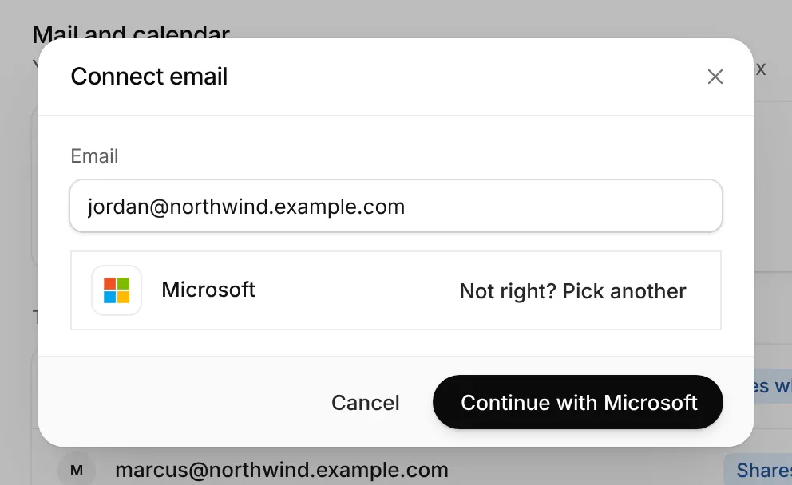

import { Aside, CardGrid, LinkCard, Steps } from '@astrojs/starlight/components';

Connecting your Microsoft 365 account brings in your Outlook mail and calendar. You can also let Omniscient send from Outlook and read your Teams meeting transcripts for call notes.

## At a glance

| | |
| --- | --- |
| **Connect** | **Settings**, then **Mail & calendar**, then **Connect email**, then **Continue with Microsoft** |
| **Who connects** | Each person connects their own Microsoft 365 account |
| **What syncs** | Outlook mail and calendar meetings, filtered by your sync settings, and Teams transcripts when you turn them on |
| **Direction** | Into Omniscient. Emails you send from Omniscient go out through Outlook. Nothing in your mailbox or calendar is changed. |
| **How often** | About every 5 minutes. The first sync reads back 90 days by default, and meetings 60 days ahead. |
| **Permissions** | Your profile, mail read and calendar read. Mail send when you allow sending. Online meetings and their transcripts when you turn on Teams. |
| **Disconnect** | The disconnect icon next to the mailbox in **Settings**, then **Mail & calendar** |

## What Omniscient asks for

| Part | Access | When it's asked |
| --- | --- | --- |
| Outlook mail | Read only | When you connect |
| Outlook calendar | Read only | When you connect |
| Sending from Outlook | Send mail | When you click **Allow sending** |
| Microsoft Teams | Read online meetings and their transcripts | When you click **Turn on** in **Call notes** |

Omniscient never deletes or changes anything in your mailbox or calendar.

## Connect Outlook

<Steps>

1. Go to **Settings**, then **Mail & calendar**, and click **Connect email**.
1. Type your work address and click **Continue**.
1. Click **Continue with Microsoft**, sign in and approve access.

</Steps>

Some companies require an admin to approve new apps in Microsoft 365. If you see a message asking for admin approval, ask your IT admin to approve Omniscient, then try again.

## Allow sending

Click **Allow sending** on any email thread in Omniscient, or the send icon next to your mailbox in **Settings**, then **Mail & calendar**. Approve the send permission. Replies, new emails and workflow emails then go out from your Outlook.

## Turn on Teams call notes

<Steps>

1. Go to **Settings**, then **Call notes**.
1. Click **Turn on** next to **Microsoft Teams** and approve access.
1. Make sure transcription is on for your Teams meetings.

</Steps>

After each call, Otto reads the transcript and writes notes. See [Meetings and call notes](/email-and-calendar/meetings-and-call-notes/).

## Outlook on the web and the extension

The [Chrome extension](/chrome-extension/use-the-extension/#gmail-and-outlook) works in Outlook on the web. It shows the people in the open email and adds your team's templates to the message you are writing.

## Disconnect

In **Settings**, then **Mail & calendar**, click the disconnect icon next to your Microsoft account. Omniscient stops syncing and deletes the emails and meetings it brought in. Records stay.

## Next steps

<CardGrid>
  <LinkCard title="Email" href="/email-and-calendar/email/" description="Privacy, reading threads and sending." />
  <LinkCard title="Zoom" href="/integrations/zoom/" description="Call notes from Zoom." />
</CardGrid>
