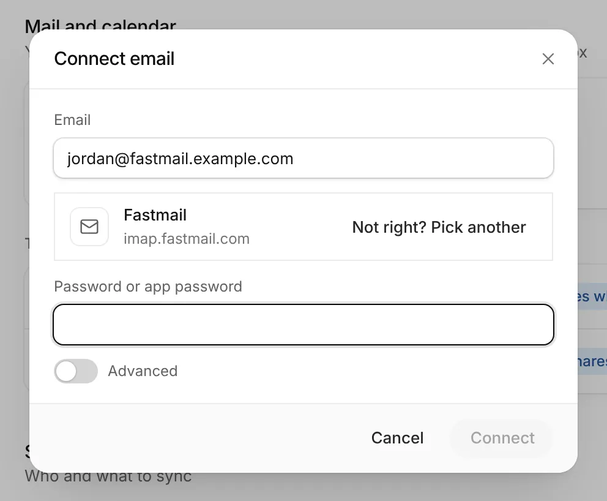

import { Aside, CardGrid, LinkCard, Steps } from '@astrojs/starlight/components';

Not on Google or Microsoft? Connect any mailbox that offers IMAP, such as Fastmail, iCloud, Yahoo, Zoho, Titan, Hostinger, GoDaddy or AOL. Omniscient reads it like Gmail and fills in your CRM from the same emails.

## At a glance

| | |
| --- | --- |
| **Connect** | **Settings**, then **Mail & calendar**, then **Connect email**. Type your address and password. |
| **Who connects** | Each person connects their own mailbox |
| **What syncs** | Your inbox and your Sent folder |
| **Direction** | Into Omniscient. Sending goes out through your SMTP server. |
| **How often** | About every 5 minutes |
| **What it asks for** | Your email, your password or an app password, and the IMAP and SMTP servers |
| **Calendar** | No. IMAP has no calendar. Log meetings by hand, or connect a Google or Microsoft calendar too. |
| **Disconnect** | The disconnect icon next to the mailbox in **Settings**, then **Mail & calendar** |

## Connect your mailbox

<Steps>

1. Go to **Settings**, then **Mail & calendar**, and click **Connect email**.
1. Type your email address and click **Continue**. Omniscient looks up where your mail lives.
1. If your provider is known, the servers are filled in. Type your **Password or app password** and click connect.
1. To change the servers, open **Advanced**. You'll see **IMAP** and **SMTP**, each with its server and **Port**, and a **Username**.

</Steps>

The first sync starts right away. It reads back as far as your sync settings say, 90 days by default.

### Providers Omniscient knows

Omniscient fills in the servers for Titan, Hostinger, Zoho, Fastmail, iCloud, AOL, Yahoo and GoDaddy. For anything else, it reads your domain's mail records to make a guess. Check them against your provider's help page if the first try fails.

### App passwords

Most providers don't let a mail app sign in with your normal password once two-step sign-in is on. Make an **app password** in your provider's security settings and paste that instead. iCloud, Yahoo, AOL, Fastmail and Zoho all work this way.

## What Omniscient reads

- The **inbox** and the **Sent** folder. Other folders are skipped.
- Each email once. If a sync stops halfway, the next one picks up where it left off, so nothing is read twice.
- Summary emails from notetaker apps, which become [call notes](/integrations/notetakers/).

Your [sync settings](/settings/mail-and-calendar/#sync-settings) and [sharing](/settings/mail-and-calendar/#sharing) work the same as for Gmail and Outlook.

## Send from this mailbox

Emails you send from Omniscient, and workflow emails, go out through your SMTP server and land in your Sent folder. No extra permission is needed beyond the password you gave.

## When it stops syncing

| You see | Why | What to do |
| --- | --- | --- |
| Check the server names and ports. | The servers or ports are wrong, or the password was refused | Check them, and use an app password |
| Too many tries. Wait a few minutes. | The server blocked repeated tries | Wait, then try again |
| A teammate already connected this address. | A shared inbox can be connected once per workspace | The teammate who connected it keeps it |
| Connect again | Your password changed | Click **Reconnect** and type the new one |

Failed syncs are retried on their own, waiting a little longer each time, up to 6 hours apart.

## Disconnect

Click the disconnect icon next to the mailbox in **Settings**, then **Mail & calendar**, and confirm. Omniscient stops syncing and removes the emails it brought in. Companies, people and notes stay. The password is deleted.

## Related

<CardGrid>
  <LinkCard title="Mail & calendar settings" href="/settings/mail-and-calendar/" description="Sync, sharing and sending." />
  <LinkCard title="Connect your inbox" href="/get-started/connect-your-inbox/" description="The first-week guide." />
</CardGrid>
