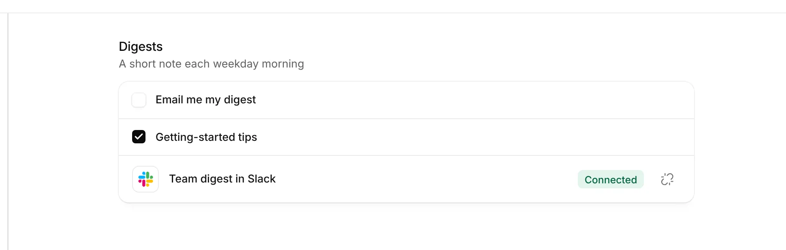

import { Aside, CardGrid, LinkCard, Steps } from '@astrojs/starlight/components';

With Slack connected, Omniscient posts to one channel your team picks. Owners and admins connect it once for the whole workspace.

## At a glance

| | |
| --- | --- |
| **Connect** | **Settings**, then **Notifications**, then **Add to Slack**. Or Slack's card in **Settings**, then **Integrations**. |
| **Who connects** | Owners and admins, once for the whole workspace |
| **What it posts** | The team digest and workflow notices, in one channel you pick |
| **Direction** | Out of Omniscient into Slack. Omniscient reads only the list of channels, so you can pick one. |
| **How often** | The digest goes out each weekday at 8 in the morning, in the workspace owner's time zone. Workflow notices go out as they happen. |
| **Disconnect** | **Disconnect Slack** in **Settings**, then **Notifications** |

## What Omniscient posts

- **The team digest**, each weekday morning in the owner's time zone: today's meetings, emails to answer and opportunities that need attention.
- **Workflow notices** from **Notify owner** steps, so owners see them where they already work. See [Workflows](/otto/workflows/).

## Add Omniscient to Slack

<Steps>

1. Go to **Settings**, then **Notifications**.
1. Next to **Team digest in Slack**, click **Add to Slack**.
1. Sign in to Slack and approve the Omniscient app.
1. Back in Omniscient, pick the **Channel** to post in. The app joins a public channel by itself.

</Steps>

You can also connect Slack from its card in **Settings**, then **Integrations**, and pick the channel in its sheet.

When it's connected, **Team digest in Slack** shows **Connected**. To post somewhere else, pick another channel.

## Disconnect Slack

Click **Disconnect Slack** next to **Team digest in Slack** and confirm. The team digest stops posting.

<Aside type="note">
If your workspace connected Slack earlier with a webhook address, it keeps posting there. Clicking **Reconnect** on Slack's card in **Integrations** moves it to the Slack app.
</Aside>

## Each person's email digest

The Slack digest is for the team. Each person can also get their own digest by email. Turn **Email me my digest** on or off in **Settings**, then **Notifications**. See [Account and security](/workspace/account-and-security/#notifications).

## Next steps

<CardGrid>
  <LinkCard title="Workflows" href="/otto/workflows/" description="Use Notify owner steps." />
  <LinkCard title="Integrations" href="/integrations/" description="Every tool you can connect." />
</CardGrid>
