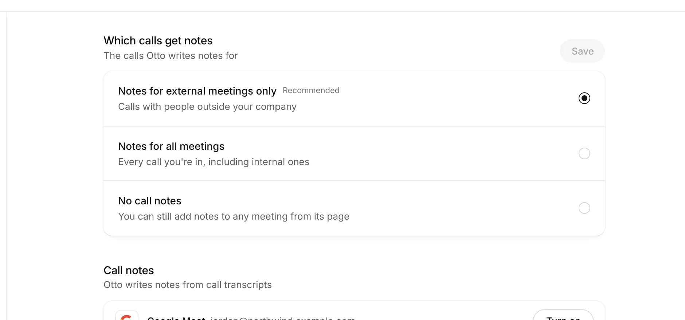

import { Aside, CardGrid, LinkCard, Steps } from '@astrojs/starlight/components';

Connect Zoom and Otto writes notes after your Zoom calls, using the transcripts Zoom makes from your cloud recordings. Each person connects their own Zoom account.

## At a glance

| | |
| --- | --- |
| **Connect** | **Settings**, then **Call notes**, then **Connect Zoom** |
| **Who connects** | Each person connects their own Zoom account |
| **What it reads** | Your Zoom user details, your cloud recordings and their transcripts |
| **Direction** | Into Omniscient. Omniscient never joins, records or changes your calls. |
| **How often** | Each account is checked for new recordings about every 20 minutes |
| **Notes** | Written for the calls your **Which calls get notes** setting allows |
| **Disconnect** | **Disconnect Zoom** next to the account in **Settings**, then **Call notes** |

## Connect Zoom

<Steps>

1. Go to **Settings**, then **Call notes**.
1. Click **Connect Zoom** and sign in to Zoom.
1. Approve access. You come back to Omniscient, and your Zoom account shows **On**.

</Steps>

To add a second Zoom account, click **Connect Zoom** next to **Add another Zoom account**.

## What Omniscient reads

Omniscient reads your Zoom user details and the list of your cloud recordings, then downloads the transcript for each call. It doesn't join your calls or record anything itself.

Each Zoom account shows when Omniscient last checked it for new recordings.

## Set up Zoom for transcripts

Otto needs a transcript to write notes. In your Zoom settings:

1. Turn on **cloud recording**.
1. Turn on **audio transcript** for cloud recordings.
1. Record the calls you want notes for.

Cloud recording and transcripts depend on your Zoom plan (check Zoom's own plan page).

## Choose which calls get notes

Under **Which calls get notes** on the same settings page, pick **Notes for external meetings only**, **Notes for all meetings** or **No call notes**. See [Meetings and call notes](/email-and-calendar/meetings-and-call-notes/#turn-on-call-notes).

## Zoom AI Companion

If you use Zoom AI Companion, its meeting summary emails in your inbox are matched to the meeting in Omniscient and show there too.

## Disconnect

Click **Disconnect Zoom** next to the account in **Settings**, then **Call notes**. Notes already written stay on their meetings.

<Aside type="caution">
If Zoom access ends, the account shows **Connect again**. Click **Connect Zoom** to sign in again.
</Aside>

## Next steps

<CardGrid>
  <LinkCard title="Meetings and call notes" href="/email-and-calendar/meetings-and-call-notes/" description="Prep briefs, notes and updates." />
  <LinkCard title="Record updates and drafts" href="/otto/record-updates-and-drafts/" description="Accept what Otto finds in a call." />
</CardGrid>
