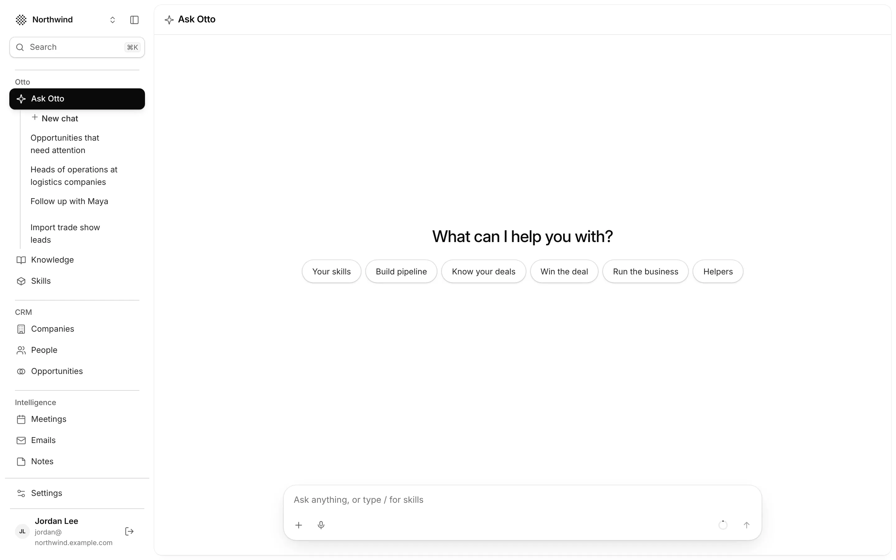
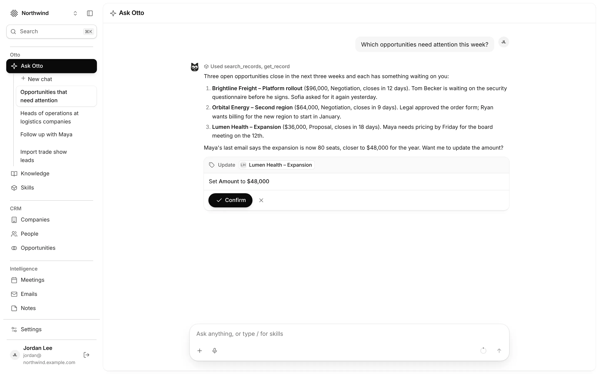
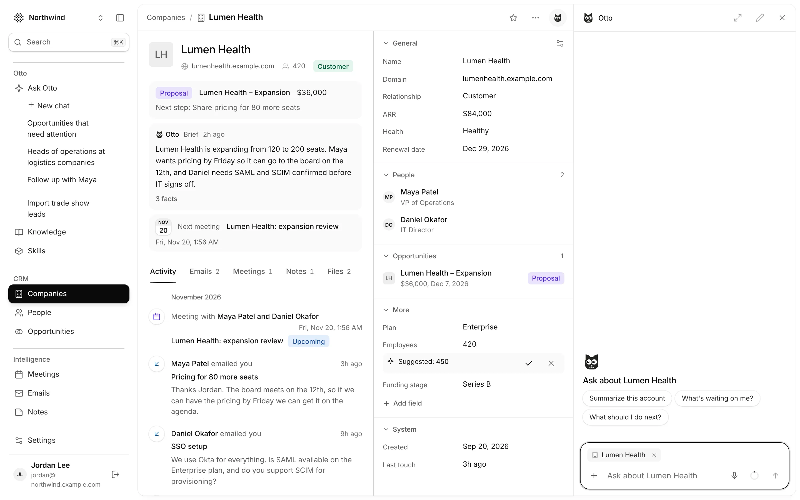
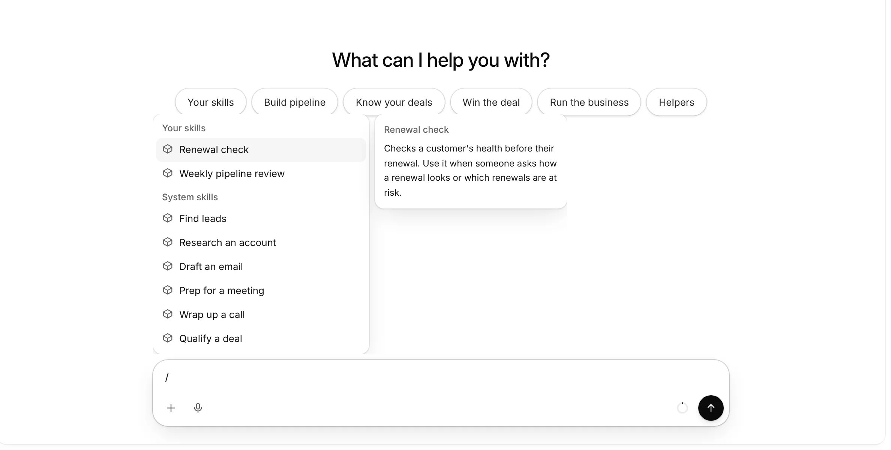
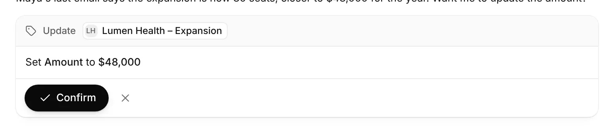

import { Aside, CardGrid, LinkCard, Steps } from '@astrojs/starlight/components';

Otto is the agent inside Omniscient. He reads your records, emails, meetings, notes and Knowledge, and answers in plain words. He can also do work for you, like drafting an email or updating a record, but he always asks first. Ask Otto is on Starter, Pro and Business.

## Start a chat

<Steps>

1. Click **Ask Otto** in the sidebar.
1. Type your question in **Ask anything, or type / for skills**.
1. Press <kbd>Enter</kbd> or click **Send**. Click **Stop** to end an answer early.

</Steps>

Your chats are saved on the left. Click **New chat** to start fresh, or **Delete chat** to remove one.

### Questions to try

- "What needs my attention today?"
- "Which opportunities have a close date this month and no meeting booked?"
- "What did Priya say about pricing?"
- "Prep me for my next meeting."
- "Show me won deals by month as a chart."

## Ask from any page

A small Otto box floats at the bottom of most pages. It knows what's on screen, like the record or the list you have open, so "which of these have no next step?" means the rows in front of you. Your question opens Otto in a panel on the right. Click **Open in Ask Otto** to keep going on the full page.

<video class="clip" src="/videos/otto-panel.mp4" autoplay muted loop playsinline preload="metadata" width="1280" height="800" aria-label="Opening the Otto panel beside the Lumen Health company record"></video>

You can also press <kbd>⌘</kbd> <kbd>K</kbd> and type a question in **Search or ask Otto**.

## Give Otto more to work with

Click the **+** button, **Add files and more**, for these:

- **Attach files**: PDF and Word (.docx) files up to 10 MB, or text files like .txt, .md, .csv and .json. Otto quotes them by page or part. You can also drop files on the box.
- **Add a record**: pick a company, person or opportunity so Otto knows exactly what you mean.
- **Think harder**: Otto takes longer and reasons more deeply. Use it for hard questions. You get a few each day.

Click the microphone, **Dictate**, to speak your question. It shows when your browser supports it.

Click **Usage today** to see your **Questions today**, how many **Think harder** answers are left and when they reset.

## Use a skill

Type <kbd>/</kbd> in the box to pick a skill, like **Prep for a meeting** or **Find leads**. The skill shows as a chip on your question. Otto also picks a skill on his own when your question clearly fits one, and shows "Used" with the skill's name above the answer. See [Skills and Knowledge](/otto/skills-and-knowledge/).

## Otto asks before he changes anything

When Otto wants to change your data, he shows a card. Nothing is saved until you click.

| Card | What the button does |
| --- | --- |
| Update | **Confirm** sets the field, such as a stage or an amount |
| Note | **Confirm** adds the note to the record |
| Email draft | **Open in Gmail** opens the draft for you to edit and send, or copy the text |
| Leads | **Save** adds the people or companies you picked to the CRM |
| Skill or Knowledge | **Save** adds the new skill or Knowledge page |
| Workflow | Saves the workflow as a draft |
| Scores | Saves each outcome to a field, or **Copy as CSV** |

Click **Dismiss** to skip a card.

## What Otto can do

- **Find anything.** Otto searches records, email subjects and previews, meeting notes, notes and Knowledge. He searches by meaning, so "pricing worries" finds "we can't justify the cost".
- **Work out numbers.** For charts, trends and spreadsheets, Otto runs the math on your records and gives you a chart to view or a file to download. Ask with "chart", "breakdown by" or "export to Excel".
- **Sort and score.** Ask a question of up to 500 records at once, like "tag every account by how likely it is to renew".
- **Import.** Drop a CSV and ask Otto to import it. See [Import your data](/get-started/import-your-data/).
- **Use your connected apps.** Otto can read from apps your team connected in **Settings**, then **Integrations**. A change in another app shows as a card first.

<Aside type="note">
Otto sees only what you can see. Mail a teammate keeps private stays private in Otto's answers too.
</Aside>

## What Otto never does

- Send an email on his own. You send every draft yourself.
- Change a record without your click.
- Read or act on LinkedIn.
- Write, draft or suggest contract text. He can read a contract and pull out its terms. See [Skills and Knowledge](/otto/skills-and-knowledge/#system-skills).
- Write message templates. Templates are your team's own.

## Next steps

<CardGrid>
  <LinkCard title="Skills and Knowledge" href="/otto/skills-and-knowledge/" description="Teach Otto how your team works." />
  <LinkCard title="Find leads" href="/otto/find-leads/" description="Build a lead list from one sentence." />
</CardGrid>
