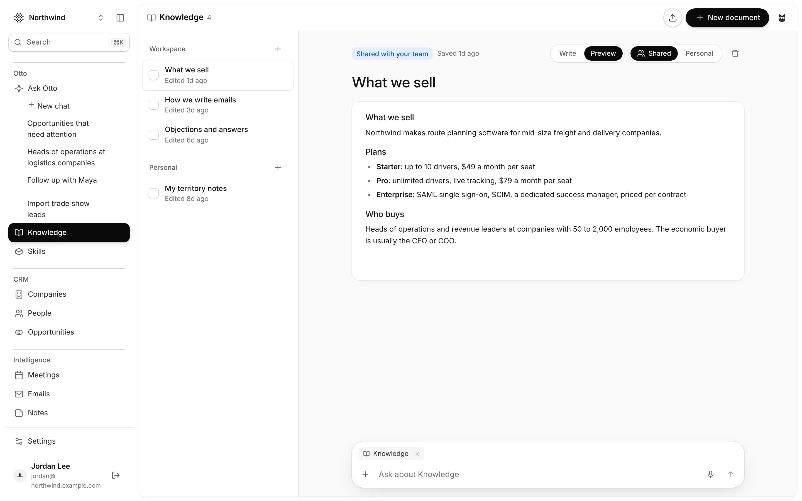
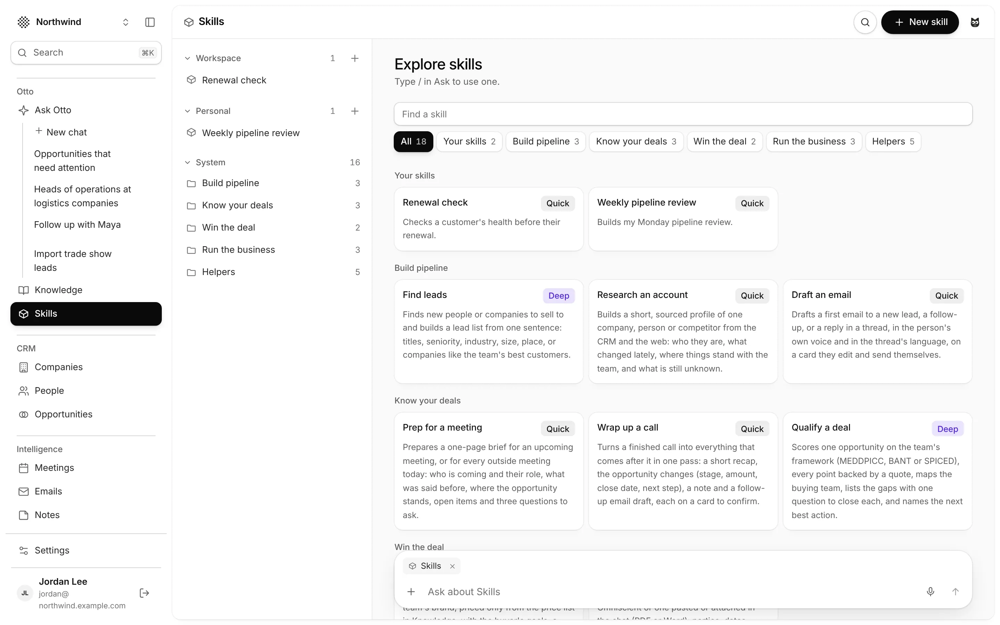
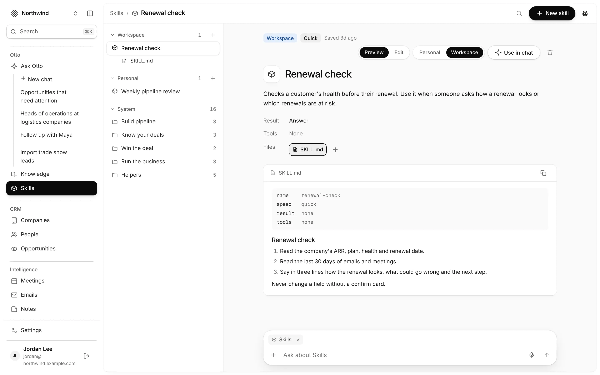

import { Aside, CardGrid, LinkCard, Steps } from '@astrojs/starlight/components';

Two pages under **Otto** in the sidebar shape how Otto works. **Knowledge** holds facts about your business. **Skills** hold the steps for a job, like prepping a meeting or reviewing the pipeline.

## Knowledge

Knowledge is a set of short documents Otto reads before every answer. Good pages cover what you sell and what it costs, your ideal customer, your competitors and how you like to sound.

### Add a document

<Steps>

1. Click **Knowledge** in the sidebar.
1. Click **New document**.
1. Give it a **Title** and write in plain words. Use `##` for headings and `-` for lists. Switch between **Write** and **Preview** to check it.
1. Choose **Shared** for the whole team, or **Personal** for only you.

</Steps>

To bring in documents you already have, click **Upload files** and pick Markdown, text or CSV files. To remove one, click **Delete document**.

### Add to Knowledge from a chat

Ask Otto to "add this to Knowledge" with a file or a web page attached, or with text pasted in. Otto writes short pages, one per topic, and shows each on a card. Click **Save** to keep it. Otto can also check your Knowledge for pages that overlap, disagree or are out of date.

<Aside type="tip">
Keep each page short and about one thing, like "Competitor: Acme" or "Pricing". Short pages are easier for Otto to use and for your team to keep current.
</Aside>

## Skills

A skill is a written playbook Otto follows for one kind of job. Open **Skills** in the sidebar to see them all. Click **Explore skills** to browse, or use **Find a skill** to search.

<video class="clip" src="/videos/skill-picker.mp4" autoplay muted loop playsinline preload="metadata" width="1280" height="800" aria-label="Typing a slash in Ask Otto and then find, to pick the Find leads skill"></video>

### Use a skill

- Type <kbd>/</kbd> in Ask Otto and pick a skill.
- On the **Skills** page, open a skill and click **Use in chat**.
- Or just ask. Otto reads every skill's description and picks the one that fits.

### System skills

These come with Omniscient. You can read them, and copy one to change it. Three of them are plan features. On a lower plan they show their plan's tag on **Skills**, and they aren't in the **/** menu.

| Group | Skill | What it gives you |
| --- | --- | --- |
| Build pipeline | Find leads | A lead list from one sentence. Saves on your click. |
| Build pipeline | Research an account | A short profile of a company or person from the CRM and the web, with sources |
| Build pipeline | Draft an email | A first email, follow-up or reply in your voice, for you to edit and send |
| Know your deals | Prep for a meeting | A one-page brief: who is coming, what was said before, open items and questions to ask. Pro and Business. |
| Know your deals | Wrap up a call | A recap, opportunity changes, a note and a follow-up draft, each on a card |
| Know your deals | Qualify a deal | A score on MEDDPICC, BANT or SPICED with a quote behind each point, plus the gaps. Business. |
| Win the deal | Pull contract terms | The parties, dates, renewal and notice, value and other terms of a contract, each with its quote and page |
| Run the business | Review the pipeline | Which opportunities need attention and why, and the forecast. Pro and Business. |
| Run the business | Study closed deals | Patterns in won and lost deals, with numbers and quotes |
| Run the business | Clean up data | Fixes for blank, messy or duplicate records, each on a card |
| Helpers | Create a skill | A new skill written for you, on a card to save |
| Helpers | Add to Knowledge | New or updated Knowledge pages, on cards to save |
| Helpers | Sort and score records | One question asked of up to 500 records, with a reason for each answer |
| Helpers | Build a report | Numbers, a chart or a spreadsheet from your records |
| Helpers | Build a workflow | A workflow from a plain description, saved as a draft |

<Aside type="note">
**Pull contract terms** only reads. Otto never writes, drafts or suggests contract text, and nothing it pulls out is legal advice. It works on a contract pasted or attached in the chat, or one already in Omniscient.
</Aside>

### Make your own skill

Skills come in three scopes:

| Scope | Who sees it | Who can change it |
| --- | --- | --- |
| System | Everyone | Nobody. Copy it to change it. |
| Workspace | Everyone in the workspace | Owners and admins |
| Personal | Only you | You |

<Steps>

1. On **Skills**, click **New skill**. To start from a system skill, open it and click **Copy and edit**.
1. Write the skill's `SKILL.md`. It starts with a short header that names the skill and describes when to use it, then the steps in plain words.
1. Pick **Personal** or **Workspace**.
1. Click **Add a file** for longer reference lists, like your qualification questions.

</Steps>

The editor checks the skill as you write and shows the first problem to fix. A skill can hold up to 12 files.

Or ask Otto: "Create a skill that preps me for renewal calls the way I just did it." Otto writes the skill and shows it on a card to save.

### Write a good description

Otto picks skills by their description, so say what the skill does and the words people use when they want it. For example: "Preps a renewal call. Use it when someone says renewal, renew, contract ending or QBR."

## Next steps

<CardGrid>
  <LinkCard title="Find leads" href="/otto/find-leads/" description="The Find leads skill, step by step." />
  <LinkCard title="Ask Otto" href="/otto/ask-otto/" description="Chats, files, cards and what Otto can do." />
</CardGrid>
