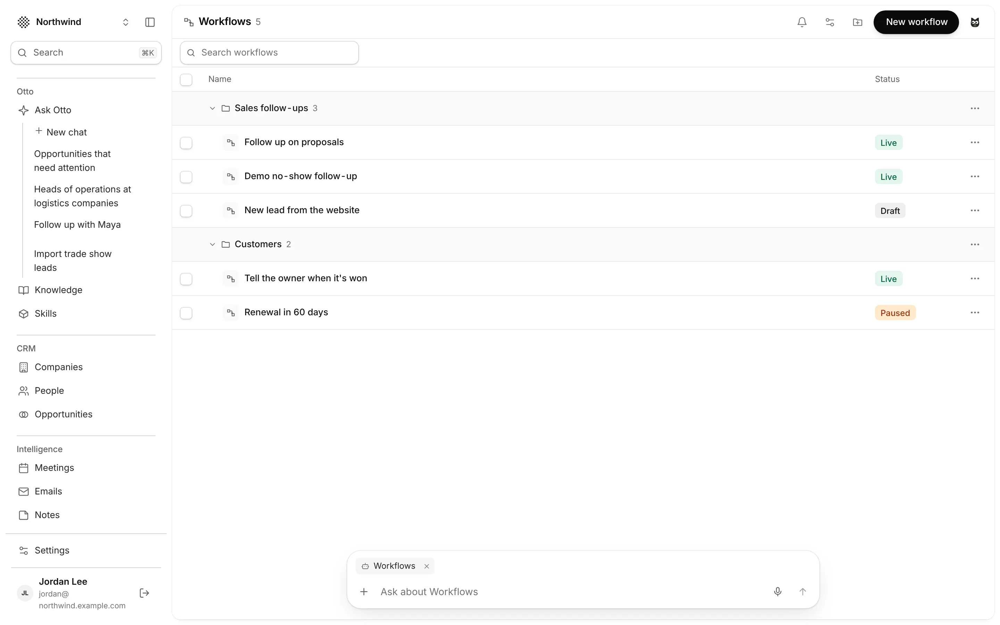
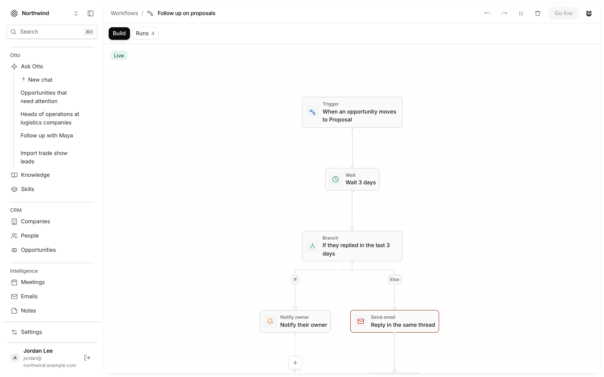
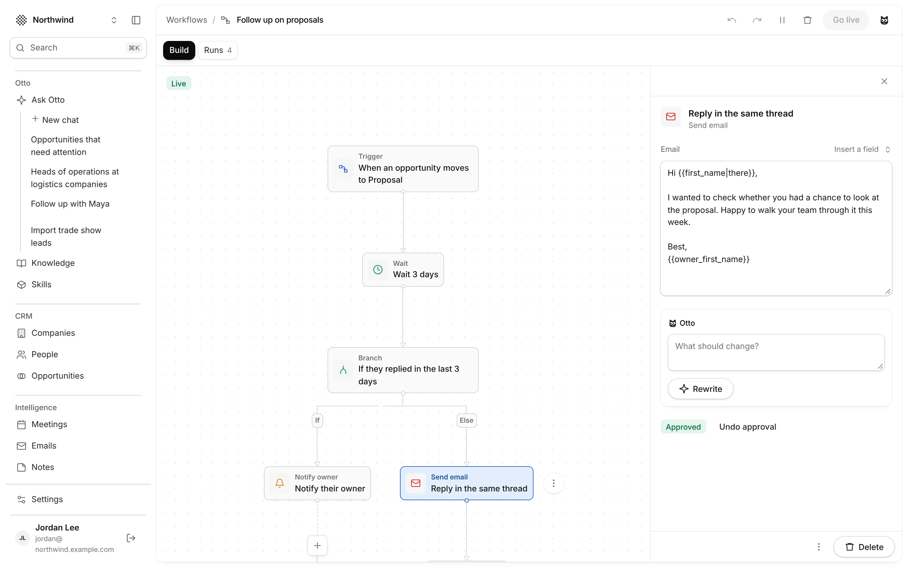
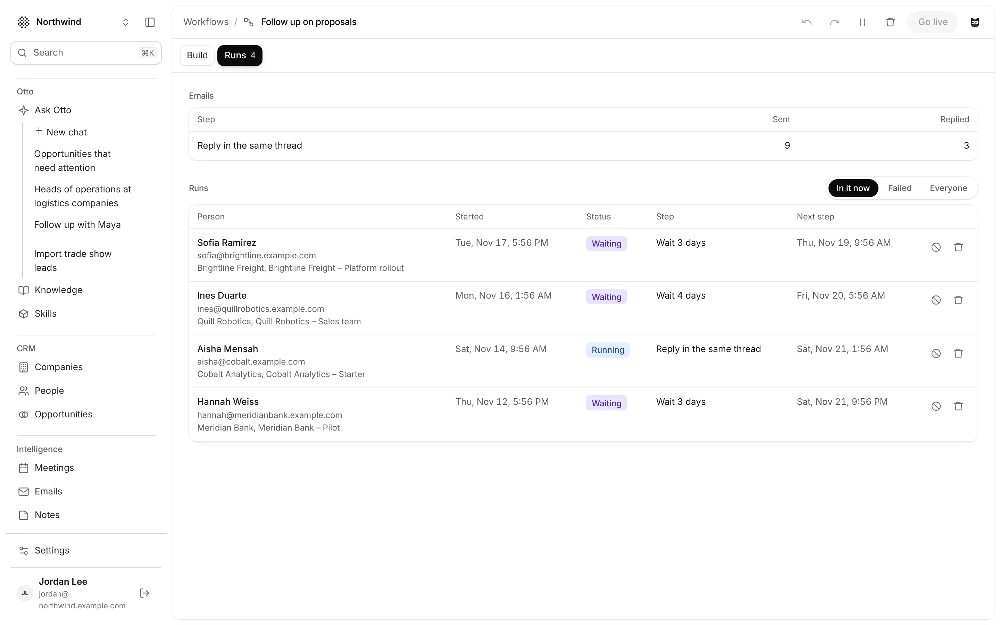

import { Aside, CardGrid, LinkCard, Steps } from '@astrojs/starlight/components';

A workflow runs a sales motion on its own: when something happens, it sends emails, waits, checks for replies and updates records. Emails go out from the owner's own mailbox, and every email needs a person's approval before the workflow can go live. Open **Workflows** under **Automations** in the sidebar.

## Make a workflow

<Steps>

1. Click **New workflow**. On an empty page, the button sits under **Automate your follow-ups**.
1. Click the **Trigger** card and pick what starts it in **Starts when**.
1. Click **+** under a card, then **Add an action**, to add a step.
1. Click a step to set it up in the panel on the right.
1. Approve each email step, then click **Go live**.

</Steps>

Or ask Otto: "Build a workflow that emails people two days after a meeting and stops if they reply." Otto shows the workflow on a card, and saving it makes a draft for you to check. Otto never takes a workflow live from a chat.

## What starts a workflow

| Trigger | When it runs |
| --- | --- |
| Record created | A new person, company or opportunity is added |
| Record updated | A record changes |
| Field changed | One field changes, optionally to a set value |
| Opportunity stage changed | An opportunity moves to any stage, or to the one you pick |
| Meeting booked | A meeting is added to the calendar |
| Meeting held | A meeting took place |
| Meeting no-show | A meeting is marked as a no-show |
| Meeting ended with notes | Notes arrive for a finished meeting |
| Email received | Someone emails you |
| Email replied | Someone answers a thread your team started |
| Added by hand or in bulk | You add people with **Add to workflow** |
| On a schedule | Every day or week at an hour you pick |

Use **Only if** to limit who goes in, and **People go through** to choose **Once** or **Again** after a gap.

A run is always one person. A company stands for its people, an opportunity for the people linked to it, a meeting for its attendees and an email for its sender.

## Steps

| Step | What it does |
| --- | --- |
| Send email | Sends an email you wrote, with fields like `{{first_name}}`. Turn on **Reply in the same thread** to answer the email before. |
| Wait | Waits a set time, until a day and hour, or until a time before their next meeting |
| Branch | Splits into Yes and No paths, by a field or by whether **They replied** in the last few days |
| Update field | Sets a field on the person, company or opportunity |
| Notify owner | Tells the owner in the app, and in Slack when Slack is connected |
| Send to app | Runs an action in an app your team connected, like adding a row to a sheet |
| Webhook | Sends the record to an address you choose |
| Stop | Ends the run |

Turn on **Keep going if this fails** on a step to move on when that step can't finish.

### Write the emails

In a **Send email** step, write the **Subject** and the **Email**. Click a field name to drop it in, like `{{first_name|there}}`, which uses "there" when the first name is blank. Click **Draft** to have Otto write it, or **Rewrite** to have him rework your words.

When the words look right, click **Approve**. Changing an approved email takes the approval away, so it gets checked again. The workflow won't go live until every email is approved.

## Go live, pause and change

- **Go live** makes your draft the live version. People who join from then on follow it.
- **Pause** stops the workflow. People in it stay where they are until you click **Resume**.
- Edits after going live show as **Changes not live** until you click **Go live** again.
- People already in a run stay on the version they started with.

## Add people by hand

On **People**, **Companies** or **Opportunities**, tick the rows you want, click **Add to workflow** and pick a live workflow. You can also add people from the Chrome extension.

## How sending stays safe

- **From your own mailbox.** Emails go from the opportunity owner's mailbox, or the workflow owner's.
- **A reply stops the run.** When someone answers, their runs stop in every workflow. An out-of-office reply puts the run back, waiting until they return.
- **Unsubscribe.** Every email carries a one-click unsubscribe link. Anyone who uses it is never emailed by a workflow again.
- **Bounces.** A bounced email stops the run and blocks that address.
- **Daily limits.** Each mailbox sends up to 100 workflow emails a day by default, or 50 for a free Gmail address. New mailboxes warm up slowly, starting at 20 a day.
- **Working hours.** Emails go out only inside the owner's working hours and days, a few minutes apart.

Change working hours and each mailbox's **Emails a day** from **Sending** at the top of the folder list.

## Watch your runs

Open a workflow and click **Runs** to see who is in it, the step they are on, when the next step runs, and how many emails were sent and answered. Replies are tagged **Interested**, **Not interested**, **Out of office** or **Other reply**.

- Click a run to see the workflow with each step marked done, failed, waiting or not reached. Click a step to see what it did.
- **Stop** or **Take out** removes a person from the run.
- **Retry from the failed step** picks a failed run up where it stopped. It's never offered for an email that may already have gone out.

**Notices** at the top of the folder list collects the messages from **Notify owner** steps.

## Organize workflows

Workflows live in folders. Click **New folder**, then drag workflows into it, or use **Move to folder**. Deleting a folder keeps its workflows under **No folder**.

<Aside type="note">
Workflows never create tasks and never act on LinkedIn.
</Aside>

## Next steps

<CardGrid>
  <LinkCard title="Email" href="/email-and-calendar/email/" description="Allow sending from your mailbox." />
  <LinkCard title="Slack" href="/integrations/slack/" description="Get Notify owner messages in Slack." />
</CardGrid>
