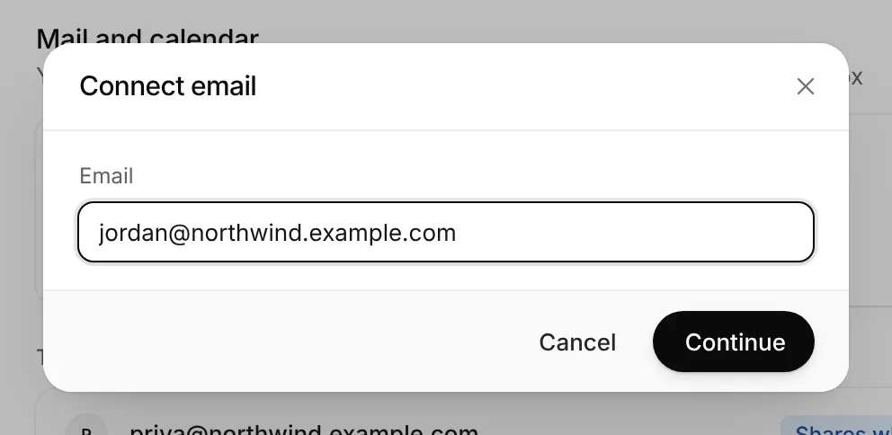
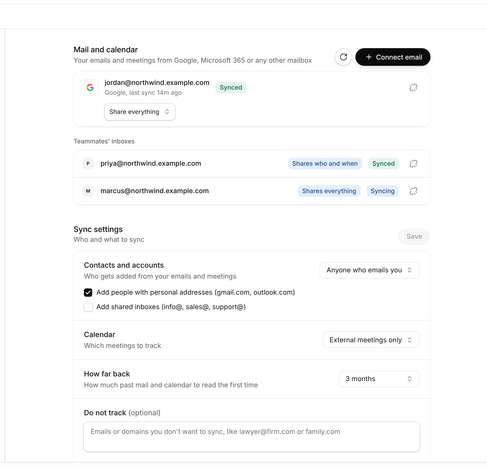
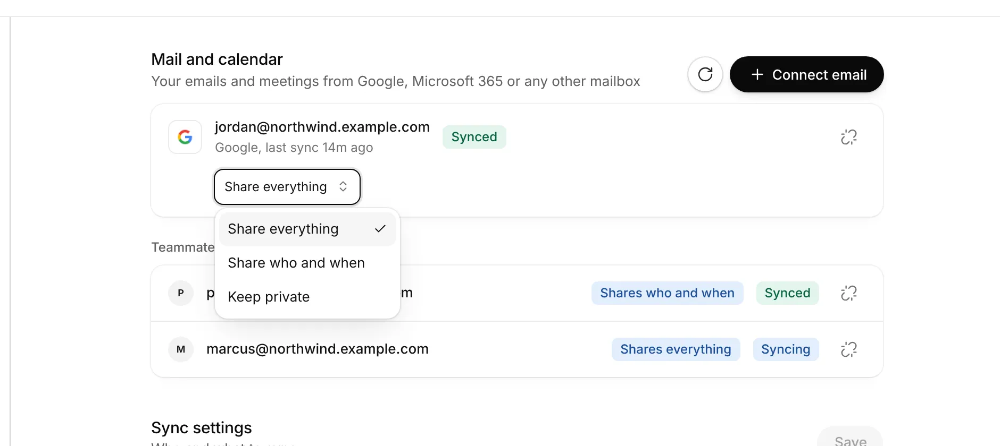
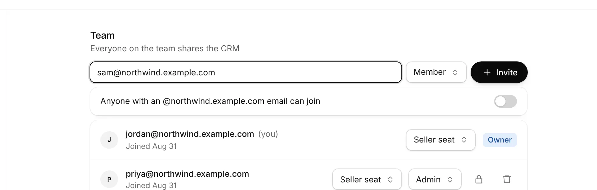
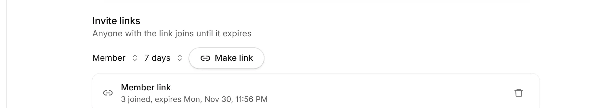
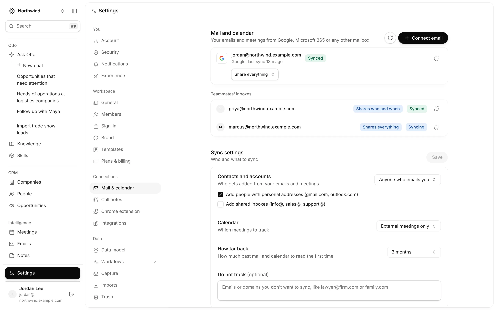
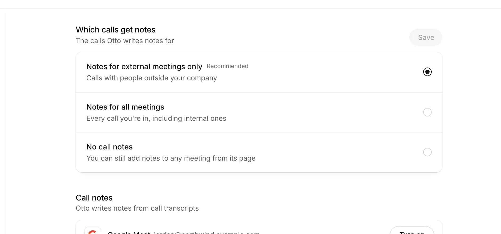
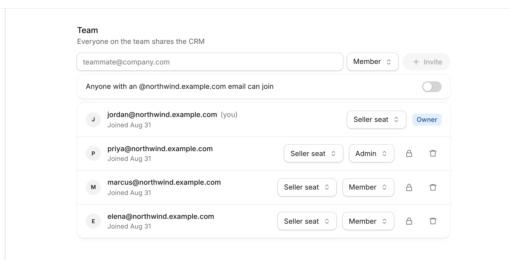

import { Aside, CardGrid, LinkCard, Steps } from '@astrojs/starlight/components';

**Goal:** every rep's email, meetings and calls flow into Omniscient, with the right privacy, so the CRM fills itself in for everyone.

**Time:** about 15 minutes for you, then 5 minutes for each person. **Who:** an owner or admin starts. Each person connects their own mailbox, because only they can sign in to it.

<Steps>

1. **Connect your own mailbox first**

   Go to **Settings**, then **Mail & calendar**, and click **Connect email**. Type your work address and click **Continue**. Omniscient works out if it's Google, Microsoft or other mail. Sign in and approve.

   

   

   

1. **Set what gets synced**

   Under **Sync settings**, pick who gets added (**When you reach out** or **Anyone who emails you**), whether calendars bring **External meetings only**, and **How far back** the first sync reads. Put private contacts in **Do not track**. Click **Save**.

   

1. **Pick your sharing**

   Next to your mailbox, pick **Share everything**, **Share who and when** or **Keep private**. Tell your team which one you'd like them to use. Each person picks their own.

   

1. **Invite everyone**

   Go to **Settings**, then **Members**. Type each person's email, pick **Member** or **Admin**, and invite. They join when they sign in with that email.

   

1. **Or share one link**

   For a big team, make an invite link in **Settings**, then **Sign-in**, under **Invite links**. Pick the role and when it expires, and post it in your team chat.

   

1. **Each person connects their mailbox**

   When a teammate joins, onboarding asks them to connect their inbox. If they skip it, they do it later in **Settings**, then **Mail & calendar**. Their row shows under **Teammates' inboxes** for you, with its status and sharing.

   

1. **Each person turns on call notes**

   In **Settings**, then **Call notes**, each person clicks **Turn on** for **Google Meet** or **Microsoft Teams**, or **Connect Zoom**. Their calls then get notes after they end.

   

1. **Check everyone is syncing**

   Back in **Mail & calendar**, every teammate's mailbox should say **Synced**. Anyone whose mailbox says **Connect again** sees a banner with **Reconnect** on every page.

   

</Steps>

<Aside type="tip">
Turn on the **Team digest in Slack** in **Settings**, then **Notifications**, so everyone sees today's meetings and emails to answer each weekday morning.
</Aside>

## Related

<CardGrid>
  <LinkCard title="Connect your inbox" href="/get-started/connect-your-inbox/" description="More on mailboxes." />
  <LinkCard title="Invite your team" href="/get-started/invite-your-team/" description="Roles and seats." />
</CardGrid>
