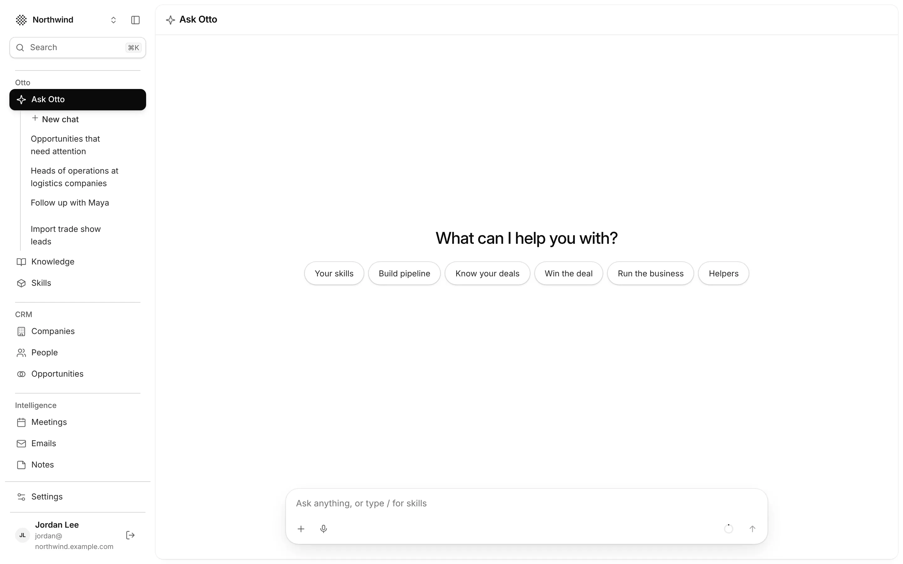
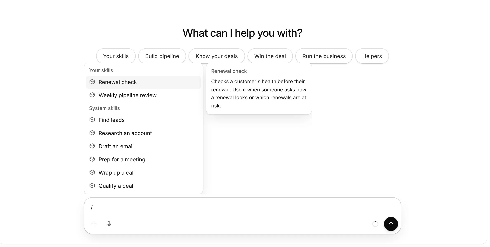
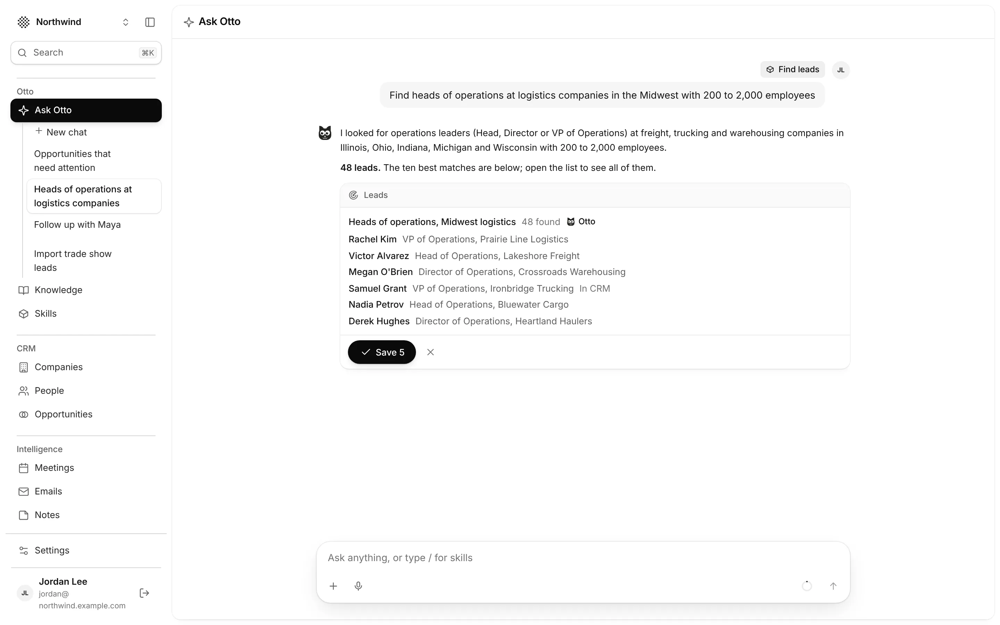
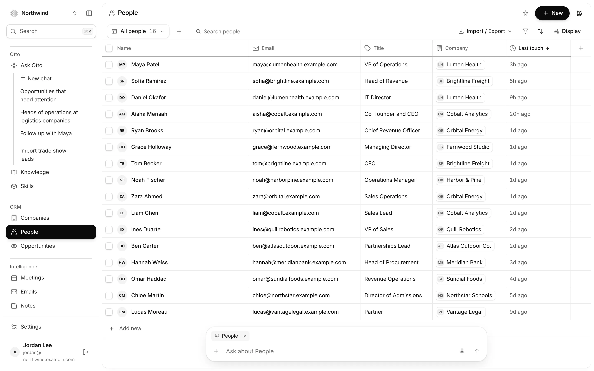
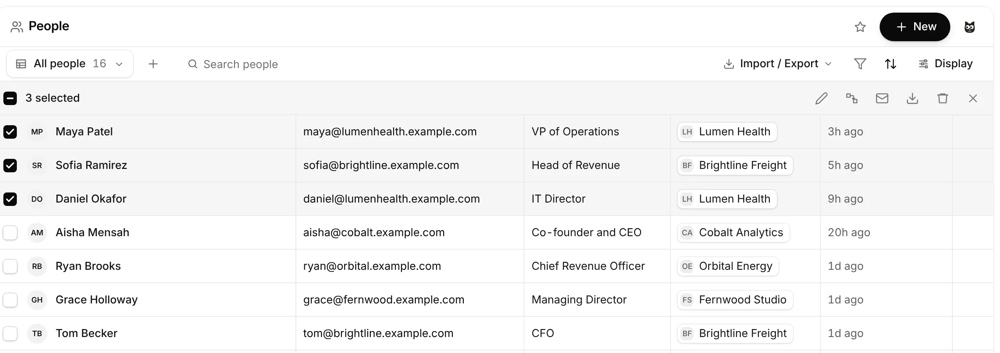

import { Aside, CardGrid, LinkCard, Steps } from '@astrojs/starlight/components';

**Goal:** a list of people who fit your ideal customer, saved in Omniscient with their companies and work emails.

**Time:** about 10 minutes. **Who:** anyone. Leads use your daily [credits](/workspace/plan-limits/#credits): 1 for each lead, 10 for each email found.

<Steps>

1. **Tell Otto who you sell to**

   Open **Ask Otto** from the sidebar. If your team has a Knowledge document about your ideal customer, Otto reads it first. If not, add one under **Knowledge**: who you sell to, their size, their industry and the titles you talk to.

   

1. **Pick the Find leads skill**

   Type **/** in the box and pick **Find leads**, or just ask in plain words. Otto picks the skill on its own when you ask for leads.

   

1. **Ask for the list**

   Be specific. Titles work better than seniority, and fewer filters find more people. For example: "Heads of operations at logistics companies in the Midwest with 50 to 500 people."

   Otto answers with its plan in one sentence, one line with the lead count, then the leads.

   

1. **Check the leads**

   Read down the list. Leads already in your CRM are marked **In CRM**, so you never save anyone twice. Remove anyone who doesn't fit.

   

1. **Find their work emails**

   Click **Find emails**. Each lookup uses 10 credits, and people who already have an email cost nothing. A lookup that finds nothing gives its credits back.

   

1. **Save them**

   Click **Save**. Otto never saves without your click. Each lead becomes a person in **People**, linked to their company in **Companies**.

   

1. **Follow up**

   Tick the saved people and click **Add to workflow** to follow up by email. Or ask Otto to **Draft an email** to one of them. You read and send every draft yourself.

   

</Steps>

## Other ways to find leads

- "Who works at Brightline Freight?" finds people at one company.
- "Find companies like Lumen Health" finds lookalike companies.
- Otto checks saved people for job changes each month, so you hear when a champion moves.

<Aside type="note">
Otto never reads LinkedIn. To save someone from a LinkedIn page you're looking at, use the [Chrome extension](/recipes/save-a-prospect-list/).
</Aside>

## Related

<CardGrid>
  <LinkCard title="Find leads" href="/otto/find-leads/" description="Every option of the skill." />
  <LinkCard title="Plan limits" href="/workspace/plan-limits/#credits" description="How credits work." />
</CardGrid>
