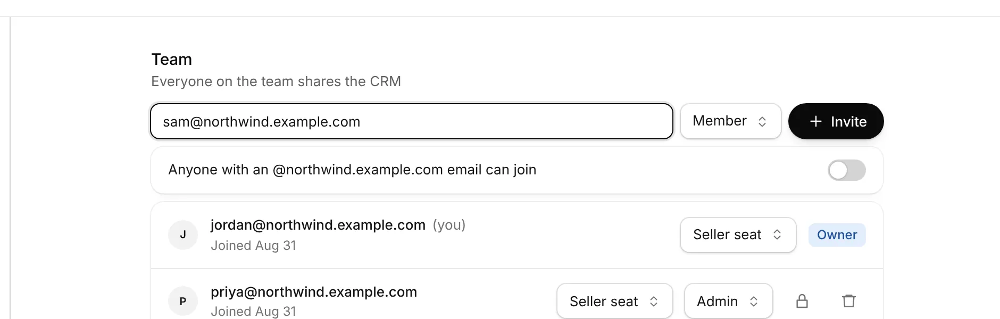
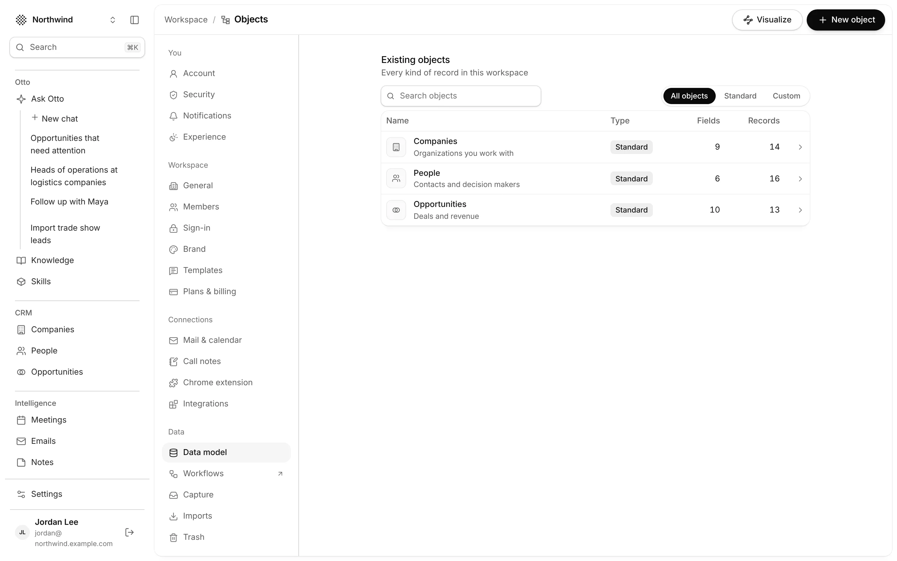
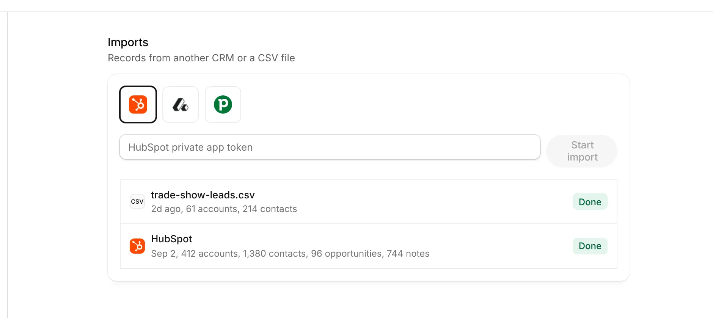
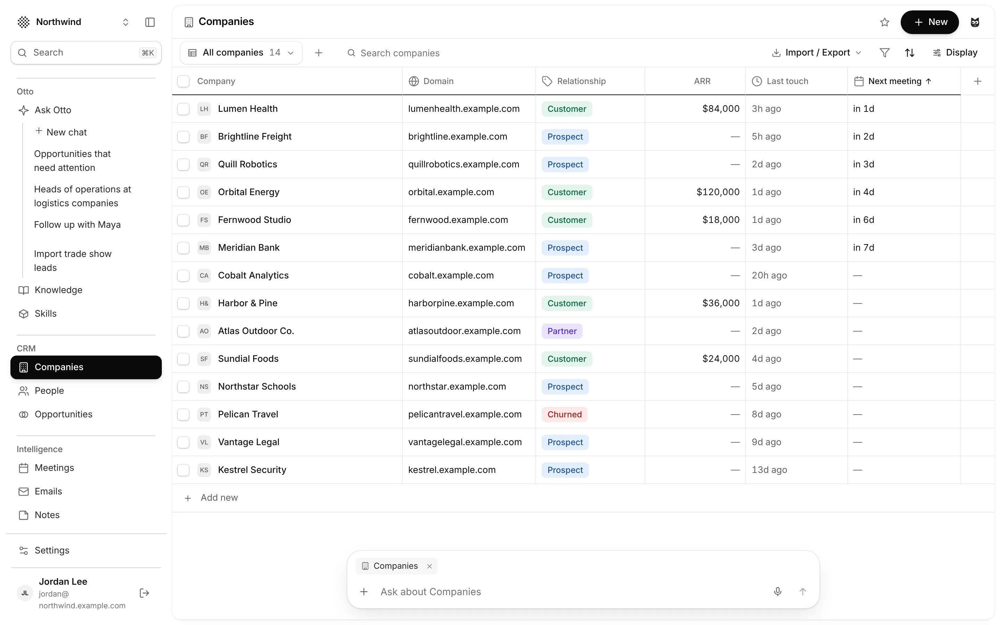
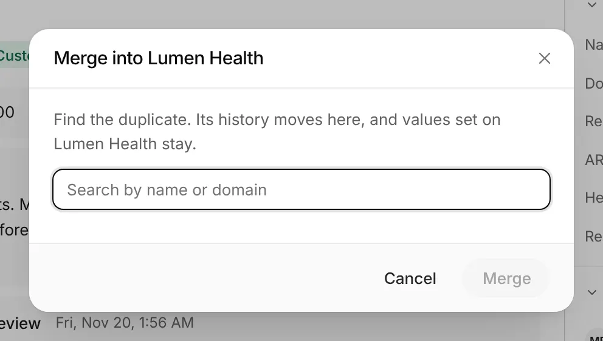
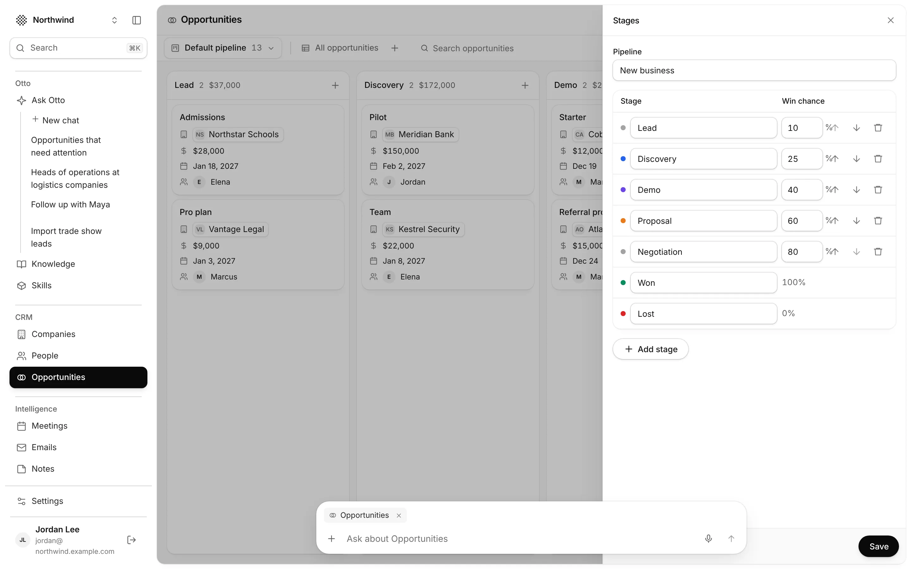

import { Aside, CardGrid, LinkCard, Steps } from '@astrojs/starlight/components';

**Goal:** your companies, people, opportunities and notes in Omniscient, owned by the right people, with no duplicates.

**Time:** about 30 minutes, plus the import itself. **Who:** owners and admins.

<Steps>

1. **Invite your team first**

   Deal owners are matched by email. Invite everyone who owns deals before you import, so their opportunities land on them.

   

1. **Add the fields you'll bring over**

   The import fills built-in fields like name, domain, amount, close date and stage. If you want more of your old fields, add them first in **Settings**, then **Data model**.

   

1. **Start the import**

   Go to **Settings**, then **Imports**. Pick your CRM's logo and click **Connect** with its name. Sign in with an admin user of your old CRM, who can see every record. Pipedrive asks for your API key on its sign-in page.

   

1. **Watch it run**

   The status goes from **Queued** to **Starting**, **Running** and **Finished**. It counts **Accounts**, **Contacts**, **Leads as people**, **Pipelines**, **Opportunities** and **Notes** as it goes. Only one import runs at a time.

   

1. **Check what came over**

   Open **Companies**, **People** and **Opportunities**. Sort by **Created** to see the newest first. Spot-check a few records you know well.

   

1. **Merge duplicates**

   If your inbox already made a company that the import made again, open one and choose **Merge a duplicate** from the record's menu. Pipedrive companies come in without a domain, so check those.

   

1. **Tidy the pipelines**

   The import brings your old pipelines and stages. Open **Opportunities**, then **Import / Export**, then **Edit stages** to rename, reorder or delete them.

   

</Steps>

## Run it again

Running the same import again matches what it brought before, fills only empty fields and adds what's new. Nothing you changed in Omniscient is overwritten. Use this while you run both CRMs side by side.

<Aside type="note">
From a spreadsheet or another tool, drop a CSV into Ask Otto. Otto shows its plan, imports it and can undo it.
</Aside>

## Related

<CardGrid>
  <LinkCard title="CRM imports" href="/integrations/crm-imports/" description="The four CRMs side by side." />
  <LinkCard title="Import your data" href="/get-started/import-your-data/" description="CSV files and more." />
</CardGrid>
