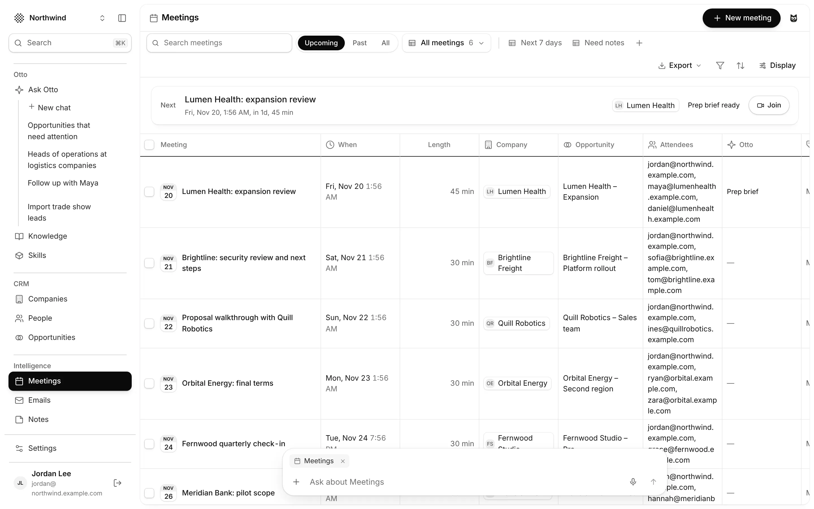
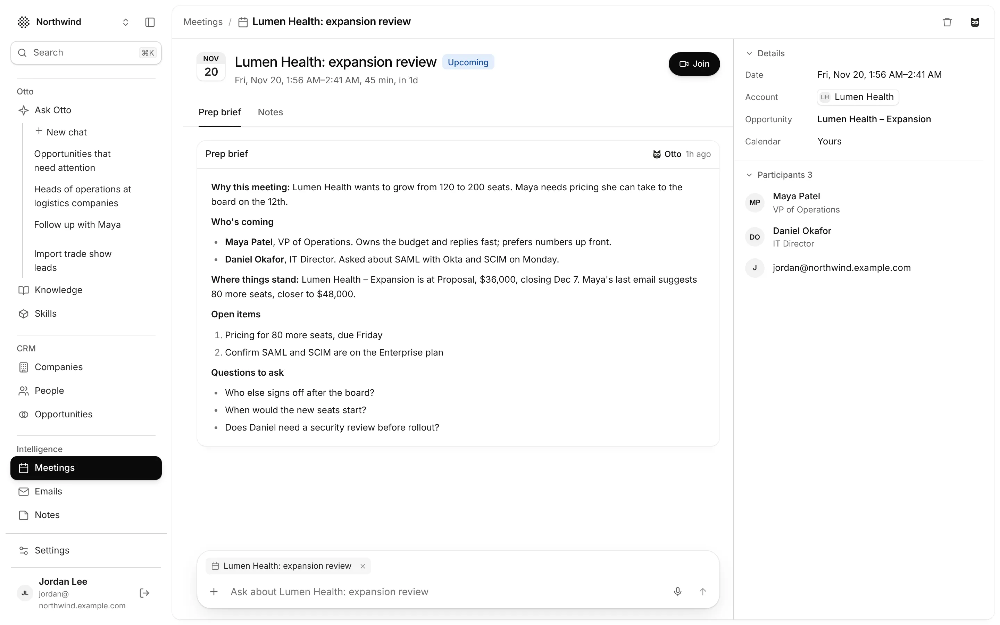
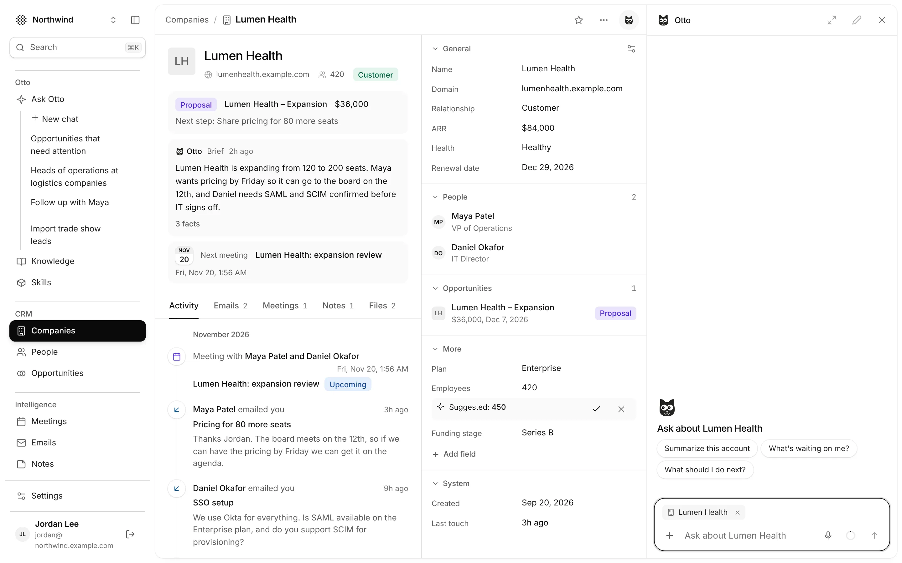
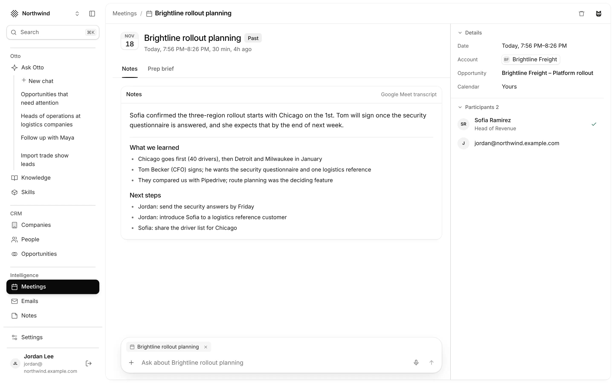
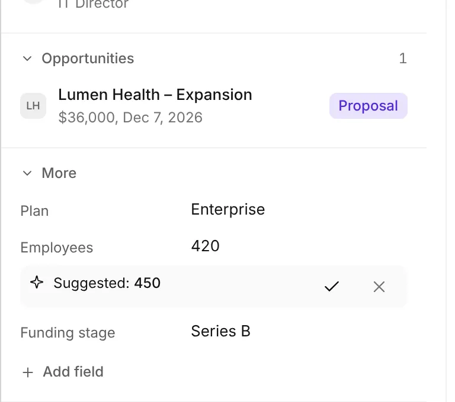
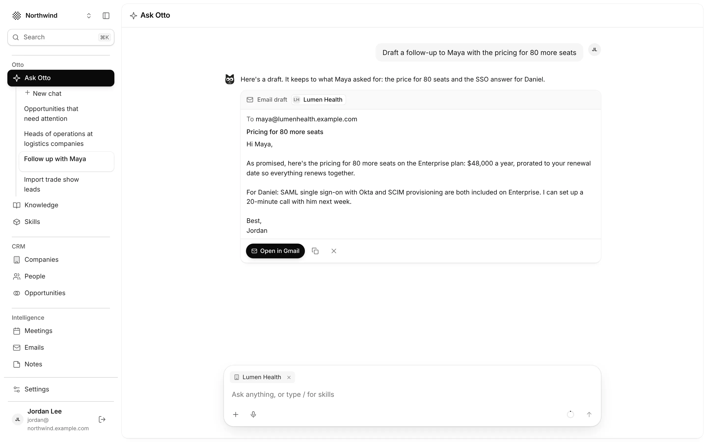

import { Aside, CardGrid, LinkCard, Steps } from '@astrojs/starlight/components';

**Goal:** walk into each external meeting prepared, and leave it with notes, a clean record and a follow-up sent.

**Time:** about 10 minutes a meeting. **Who:** anyone with their calendar connected and call notes on.

<Steps>

1. **Find the meeting**

   Open **Meetings** under **Intelligence**. **Upcoming** shows what's next. A meeting with a brief shows **Prep brief ready**.

   

1. **Read the prep brief**

   Open the meeting. The **Prep brief** sums up who's coming, what you discussed before, the open opportunity and what to ask. It's written from your emails, past calls and notes.

   

1. **Ask Otto anything else**

   Use the Otto bar at the bottom of the meeting page: "What did Tom say about the security review?" Otto answers with quotes and where they came from.

   

1. **Hold the call with transcripts on**

   Turn on transcripts in Meet, Teams or Zoom. After the call, Otto writes the notes on the meeting under **What we learned**.

   

1. **Review the record updates**

   Otto suggests field changes from the call, like a new close date or the next step, each with the quote it came from. Click **Accept** or **Skip** on each under **Record updates to review**.

   

   

   

1. **Send the follow-up**

   Ask Otto: "Draft a follow-up to Tom with the next steps." Read the draft, change what you want and send it from your own mailbox. Otto never sends for you.

   

</Steps>

<Aside type="tip">
No transcript? Click **Add call notes** on the meeting and paste text, upload a transcript file or a recording.
</Aside>

## Related

<CardGrid>
  <LinkCard title="Meetings and call notes" href="/email-and-calendar/meetings-and-call-notes/" description="Briefs, notes and updates." />
  <LinkCard title="Run a workflow after a meeting" href="/recipes/workflow-after-a-meeting/" description="Follow up on its own." />
</CardGrid>
