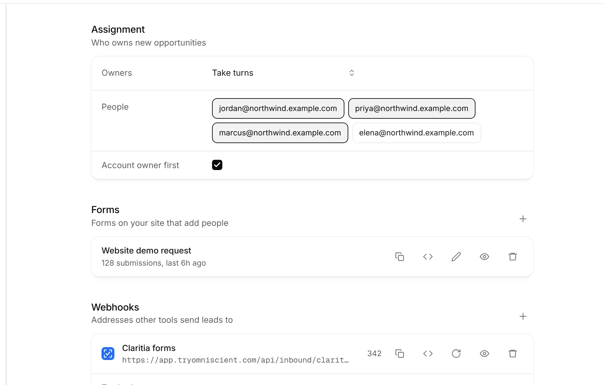
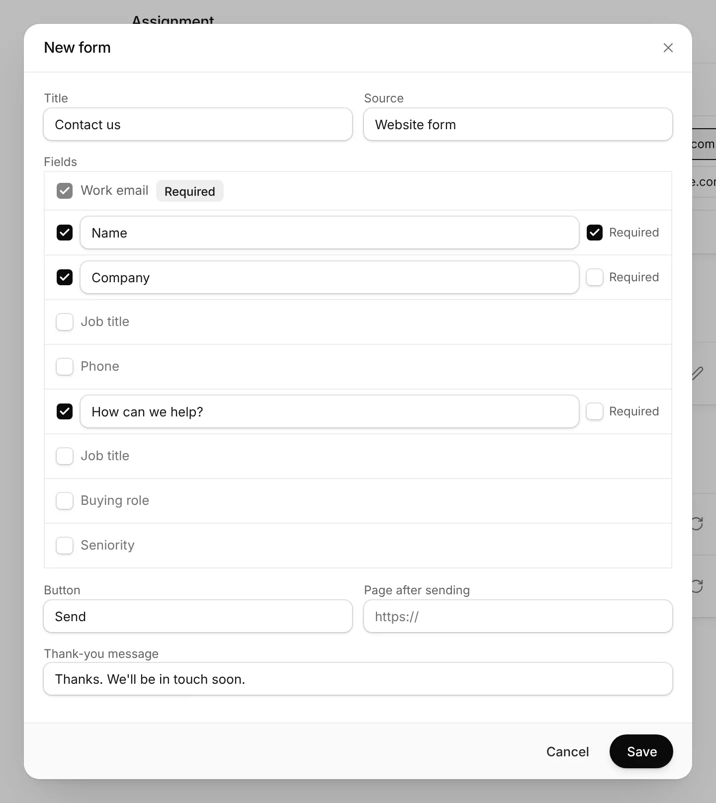
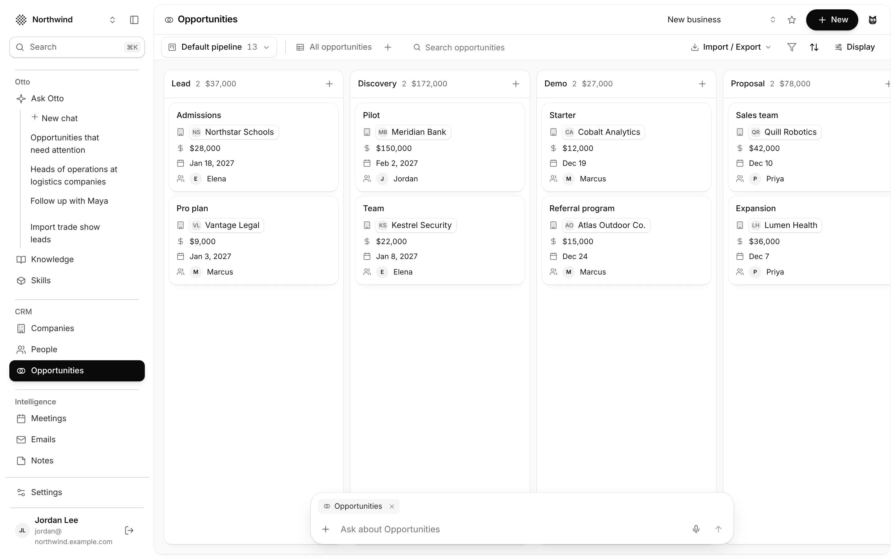
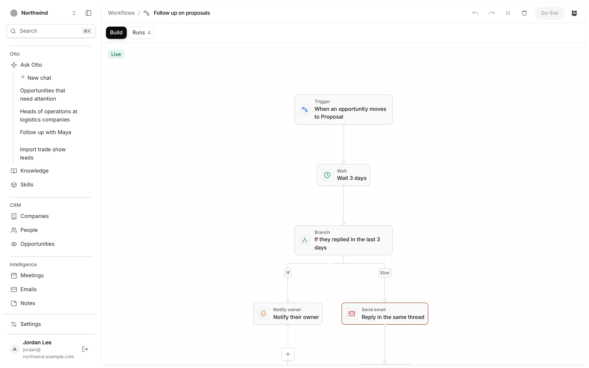

import { Aside, CardGrid, LinkCard, Steps } from '@astrojs/starlight/components';

**Goal:** each person who fills in a form on your site becomes a person and an opportunity, owned by the right rep, who gets an email at once.

**Time:** about 15 minutes. **Who:** owners and admins.

<Steps>

1. **Set who gets new leads**

   Go to **Settings**, then **Capture**. Under **Assignment**, pick **Take turns** or **Fewest open opportunities** in **Owners**, and pick the reps under **People**. Leave **Account owner first** on, so a lead from a company you already work with goes to its owner.

   

1. **Make a form**

   Click **New form**. Set the **Title** and **Source**. **Work email** is always asked. Tick the other fields you want and mark the ones that are **Required**. Set the **Button** text and the **Thank-you message**, or a **Page after sending**.

   

   

   

1. **Put it on your site**

   Click **Copy embed code** and paste it into your website where the form should show. Or click **Copy link** and use the hosted page in emails and ads.

   

1. **Or connect your form tool**

   Already use Typeform, Webflow or Zapier? Click **New webhook**, name it, click **Copy address** and paste it into the tool's webhook settings. Click **Copy example** to test it with a sample call.

   

1. **Send a test**

   Fill in your own form with a teammate's email. In a few seconds, a new opportunity opens in your default pipeline, owned by the next rep, and they get an email: "New: *name* from *form name*".

   

1. **Follow up fast**

   Build a workflow that starts on **Record created** for new opportunities from your form, and sends the first reply from the owner's mailbox. See [Run a workflow after a meeting](/recipes/workflow-after-a-meeting/) for how to build one.

   

</Steps>

<Aside type="tip">
Pass `utm_source`, `utm_medium` and `utm_campaign` in your page links. Omniscient keeps the channel, like **Paid search** or **AI referral**, on each opportunity.
</Aside>

## Related

<CardGrid>
  <LinkCard title="Capture settings" href="/settings/capture/" description="Every option." />
  <LinkCard title="Capture addresses" href="/api-reference/capture/" description="Field names and errors." />
</CardGrid>
