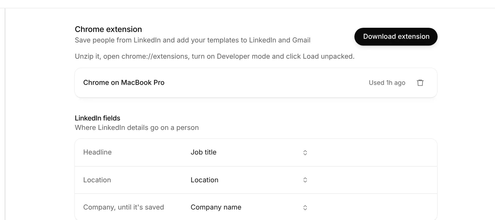
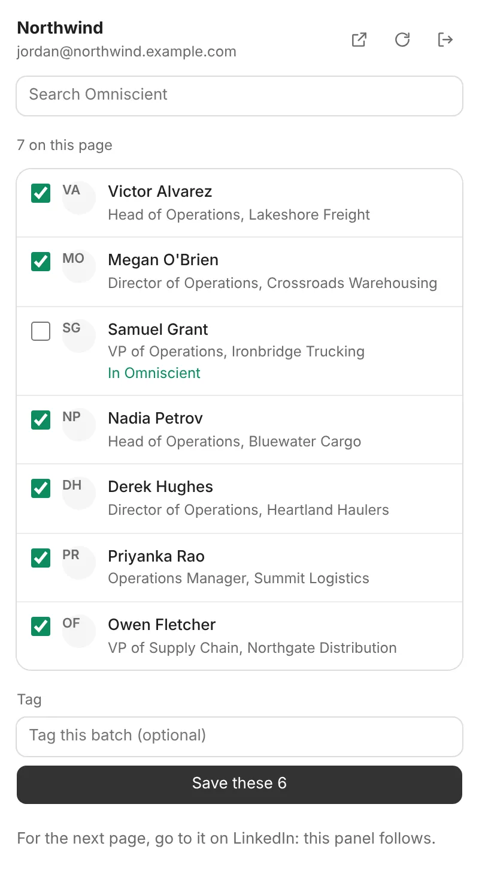
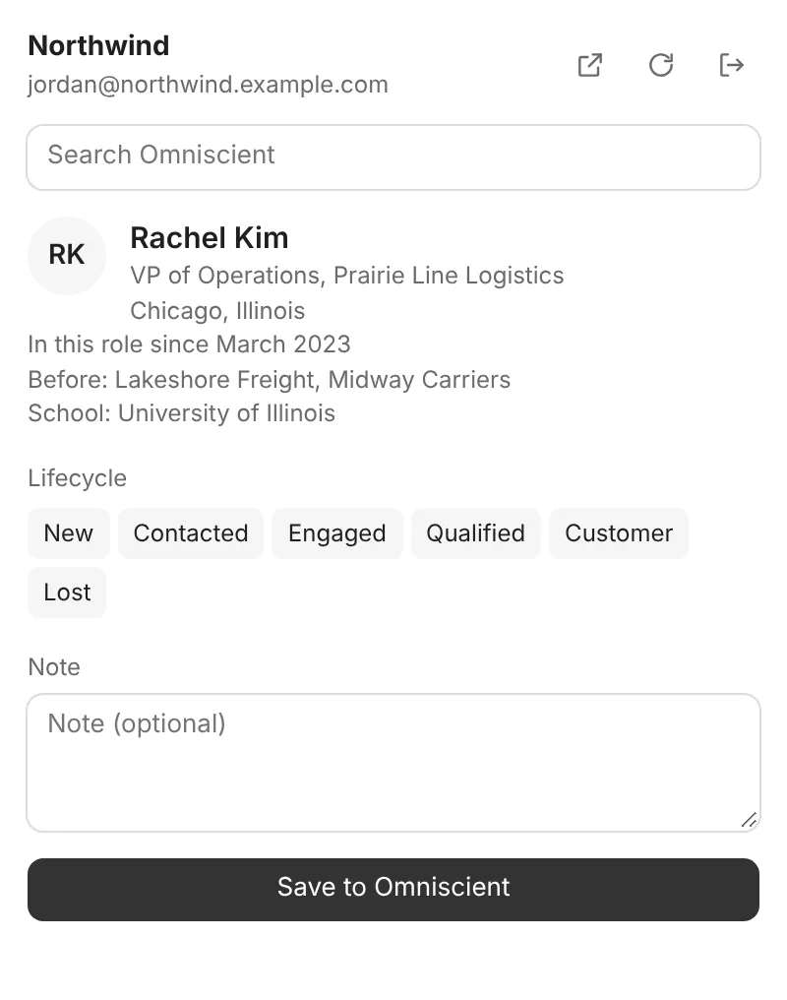
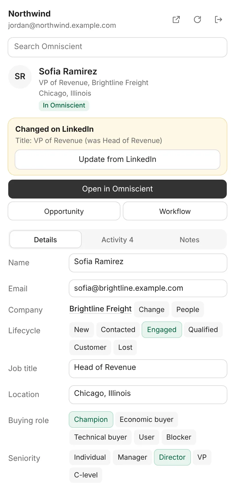
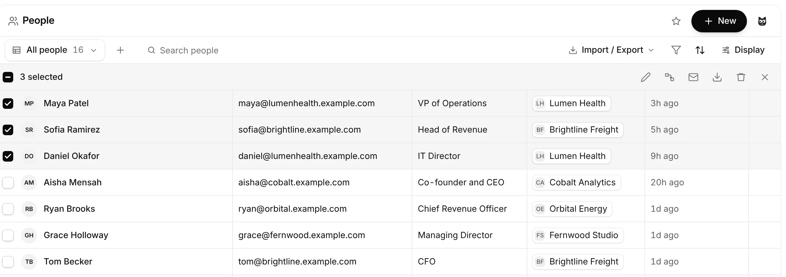

import { Aside, CardGrid, LinkCard, Steps } from '@astrojs/starlight/components';

**Goal:** people from a LinkedIn search you're looking at, saved in Omniscient with their companies, ready for follow-up.

**Time:** about 10 minutes. **Who:** anyone with the extension installed.

<Steps>

1. **Install and connect the extension**

   Go to **Settings**, then **Chrome extension**. Click **Download extension** and load it in Chrome, then click **Connect this browser**.

   

   

   

1. **Open a search on LinkedIn**

   Run a search on LinkedIn, like heads of operations at freight companies. Open the Omniscient side panel. It reads the page you have open, while the panel is open.

   

   

   

1. **Pick the people to save**

   The panel lists the people on the page. Anyone already in Omniscient is marked **In Omniscient**. Tick the ones you want under **Pick people to save**. You can save up to 10 at a click. Add a tag under **Tag this batch (optional)**, like "Freight ops, November".

   

   

   

1. **Save them**

   Click **Save these 10**, or the number you picked. Each becomes a person in Omniscient, with their company. For the next page of results, scroll LinkedIn yourself and click again. The extension never scrolls or opens profiles for you.

   

   

   

1. **Find their work emails**

   Click **Find emails** for the batch. Each lookup uses 10 credits, and people who already have an email cost nothing.

   

   

   

1. **Add them to a workflow**

   In Omniscient, open **People**, filter by your tag, tick the rows and click **Add to workflow**. Or click **Add to workflow** in the side panel.

   

</Steps>

<Aside type="caution">
Omniscient never sends LinkedIn messages. To write to someone on LinkedIn, open a message box, pick one of your team's templates from the extension, read it, change it and send it yourself.
</Aside>

## Related

<CardGrid>
  <LinkCard title="Use the extension" href="/chrome-extension/use-the-extension/" description="Every page it works on." />
  <LinkCard title="Templates" href="/settings/templates/" description="Write your team's messages." />
</CardGrid>
