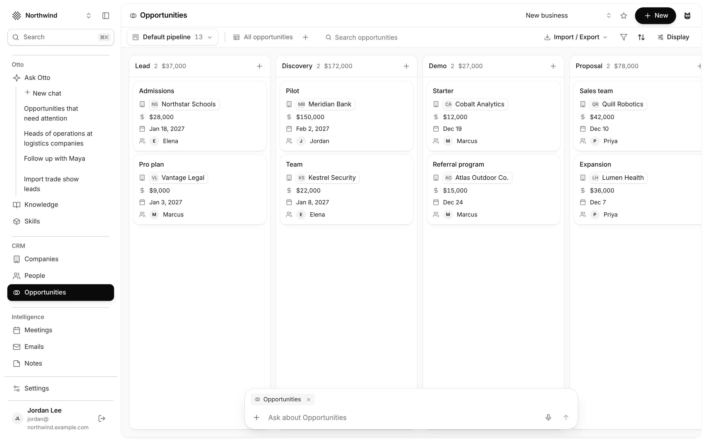
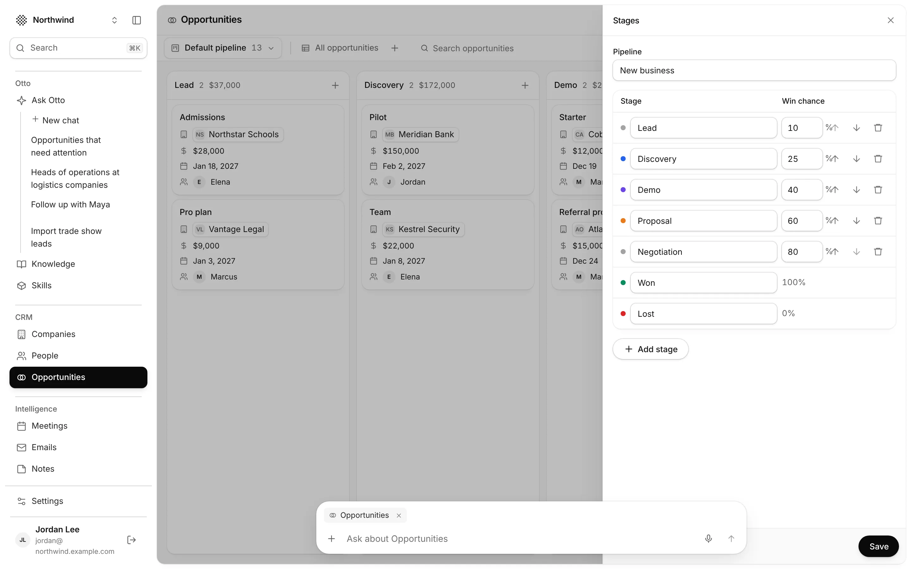
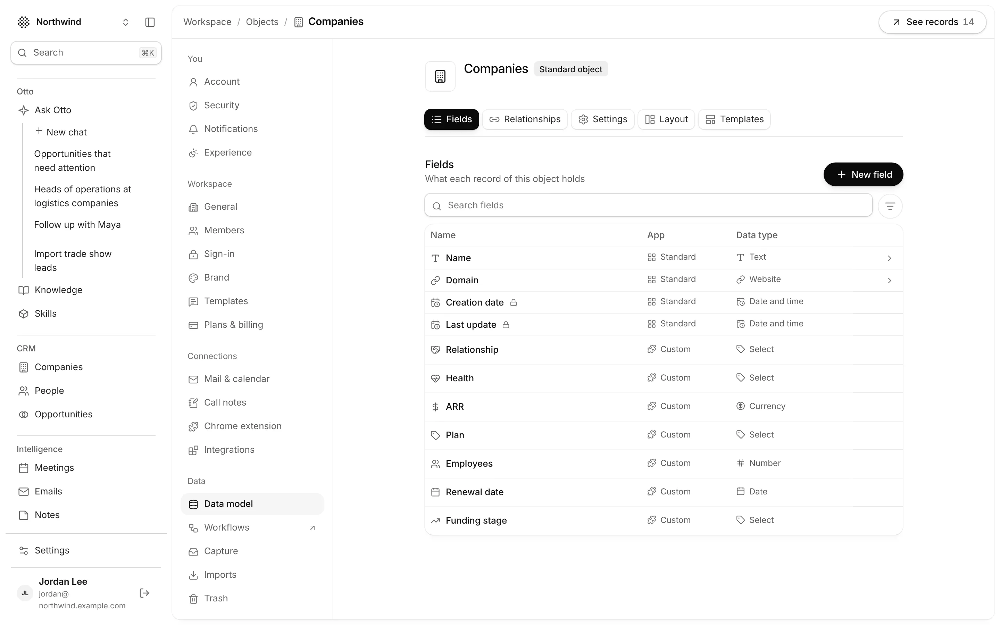
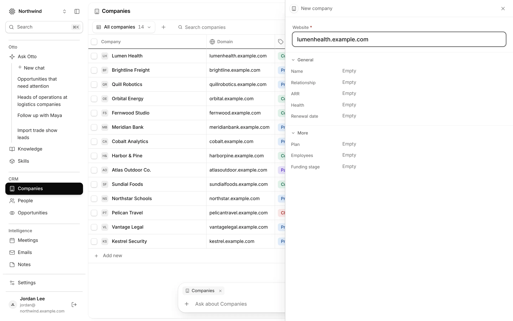
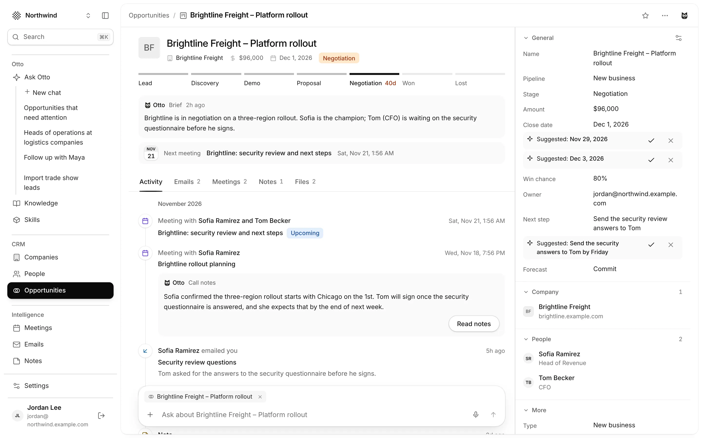
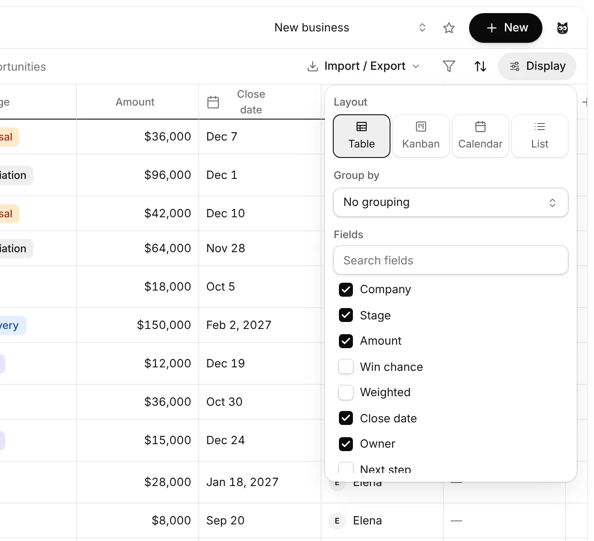
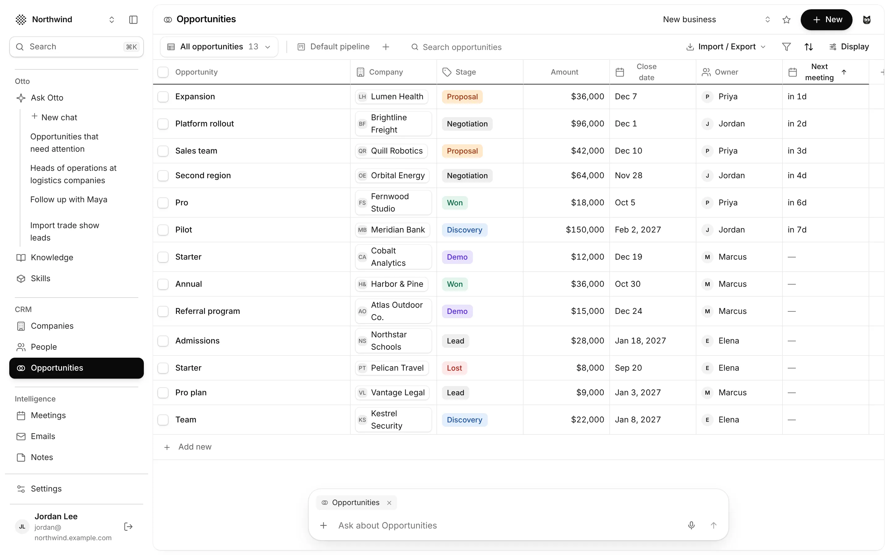

import { Aside, CardGrid, LinkCard, Steps } from '@astrojs/starlight/components';

**Goal:** a pipeline whose stages match how your team sells, with the fields you need and a board everyone uses.

**Time:** about 20 minutes. **Who:** anyone can add pipelines and stages. Only owners and admins add fields.

<Steps>

1. **Open Opportunities**

   Click **Opportunities** in the sidebar. It opens on the board, one lane per stage.

   

1. **Edit the stages**

   Open **Import / Export** and click **Edit stages**. Click **New pipeline** for a new one, or rename the default. Add a stage for each step a deal goes through, in order. Use **Move up** and **Move down** to sort them, and set each stage's **Win chance**.

   Keep it short: five to seven stages, ending in a won stage and a lost stage.

   

   <Aside type="tip">
   Not sure where to start? An owner or admin can click **Set up an industry** in [General settings](/settings/general/#industry). Otto adds a pipeline made for your kind of business, which you can then change.
   </Aside>

1. **Add the fields you track**

   An owner or admin opens **Settings**, then **Data model**, then **Opportunities**, and clicks **New field**. Add only what you'll use, like "Source" as a choice field or "Contract length" as a number. Turn on **Otto fills it** to let Otto fill a field from emails and calls.

   

1. **Open your first opportunities**

   Click **New** on Opportunities. Pick the company, the pipeline and the stage, and fill in the amount and close date. Or let them come in from your inbox, a form or an import.

   

1. **Set a next step on each one**

   Open an opportunity and fill in **Next step**, like "Send the security answers by Friday". Next steps live on the opportunity, so the board shows what's due.

   

1. **Save a board view for the team**

   Click **Display**, pick **Kanban**, and set **Lanes by** to the stage. Filter it to the pipeline. Click **Save as view** and name it, like "New business board". The view shows as a tab for everyone. The board needs Pro or Business.

   

1. **Star it**

   Click the star to **Add to favorites**, so the board sits at the top of your sidebar.

   

</Steps>

## What good looks like

- Every open opportunity has an owner, an amount, a close date and a next step.
- Stages describe what the buyer did, like "Demo held".

## Related

<CardGrid>
  <LinkCard title="Opportunities and pipelines" href="/crm/opportunities-and-pipelines/" description="Everything about pipelines." />
  <LinkCard title="Review your pipeline each week" href="/recipes/weekly-pipeline-review/" description="Keep it current." />
</CardGrid>
