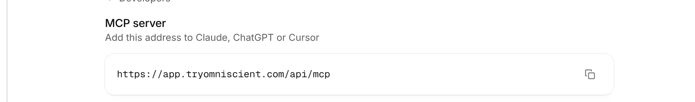
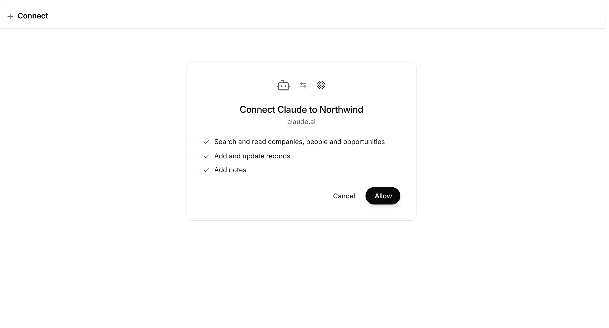
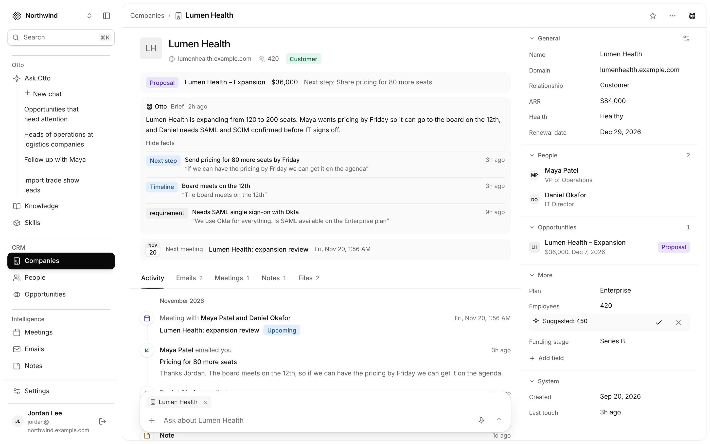
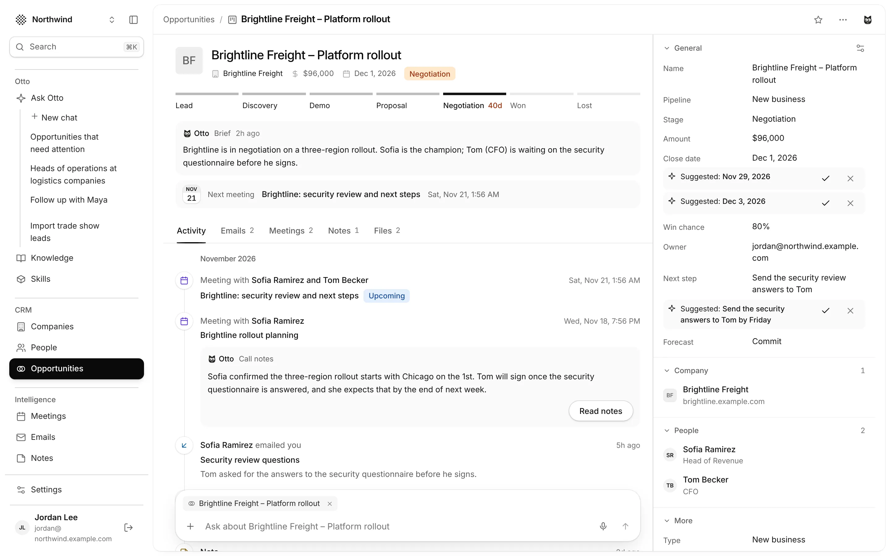
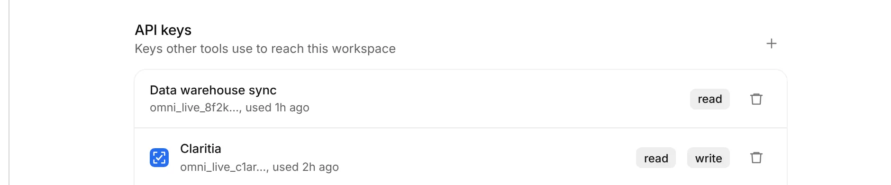

import { Aside, CardGrid, LinkCard, Steps } from '@astrojs/starlight/components';

**Goal:** ask Claude about your deals and have it update Omniscient for you. The same steps work in ChatGPT and Cursor.

**Time:** about 5 minutes. **Who:** anyone can start. An owner or admin clicks **Allow**.

<Steps>

1. **Copy the server address**

   In Omniscient, go to **Settings**, then **Integrations**, and open **Developers**. Copy the address under **MCP server**: `https://app.tryomniscient.com/api/mcp`.

   

1. **Add it to Claude**

   In Claude, open the settings for connectors and add a custom connector. Paste the address. Claude sends you to Omniscient.

   

1. **Allow it**

   Omniscient shows "Connect Claude to *workspace*" with what Claude can do: search and read companies, people and opportunities, add and update records, and add notes. An owner or admin clicks **Allow**.

   

1. **Ask Claude something**

   Back in Claude, ask: "Find Lumen Health in Omniscient and tell me about its open opportunities." Claude searches, reads the company with its notes and answers.

   

1. **Have it make a change**

   Ask: "Move the Lumen Health expansion to Negotiation and set the next step to legal review on Friday." Claude checks the stages first, then asks you before it changes anything. The change shows in the field's history in Omniscient, marked as made by AI.

   

1. **See or stop the connection**

   The connection shows under **API keys** in **Developers** as "Claude (MCP)". Click **Revoke** to disconnect Claude.

   

</Steps>

<Aside type="note">
Claude can't delete anything, and can't touch LinkedIn, contracts, emails or meetings through Omniscient.
</Aside>

## Related

<CardGrid>
  <LinkCard title="Claude, ChatGPT and Cursor" href="/integrations/ai-apps/" description="What your AI app can do." />
  <LinkCard title="MCP tools" href="/api-reference/mcp-tools/" description="Every tool and its inputs." />
</CardGrid>
