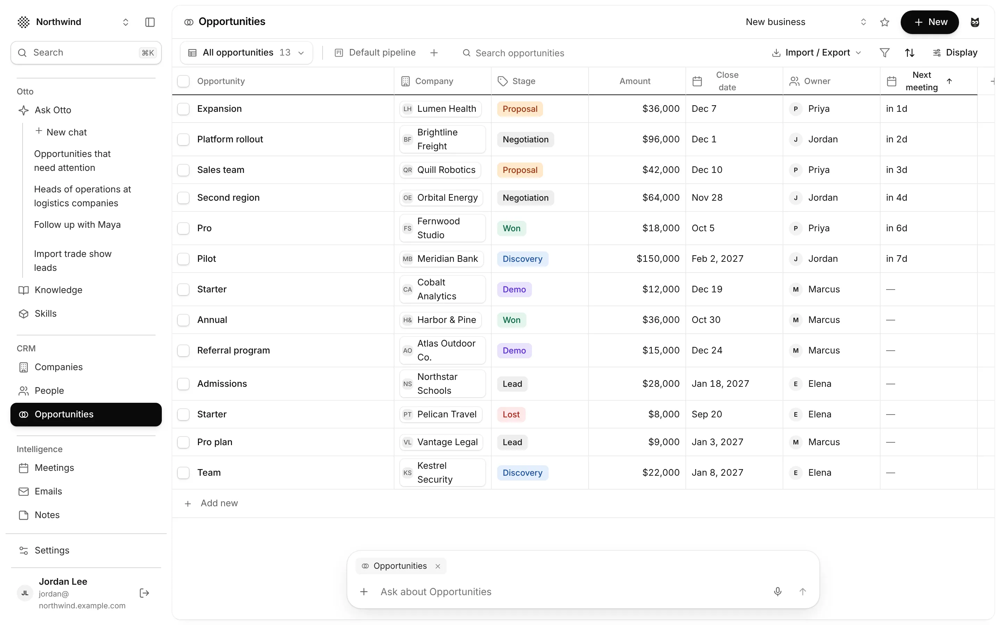
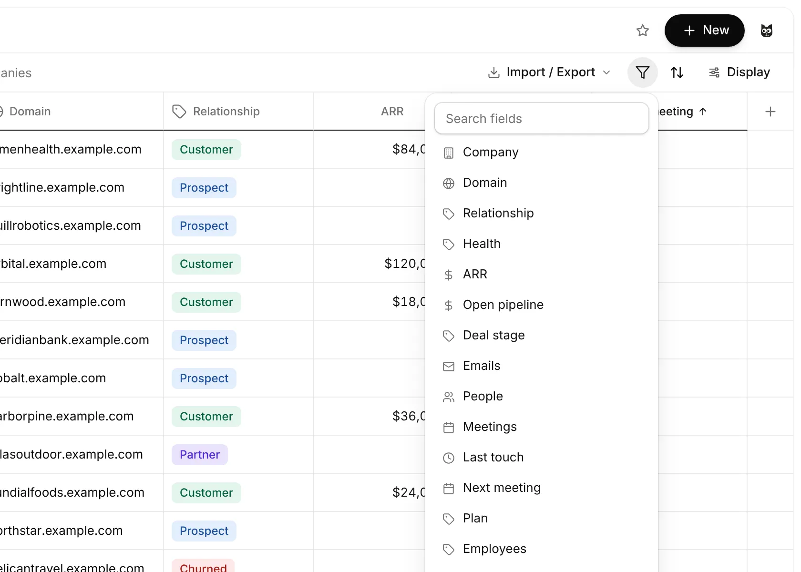
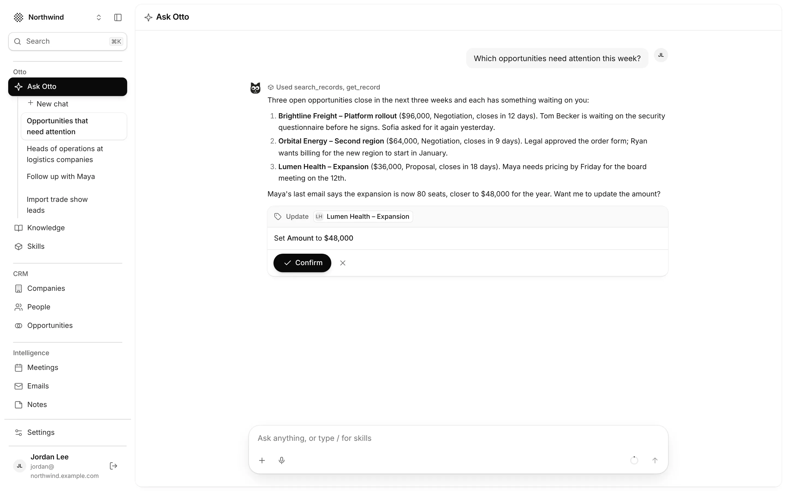
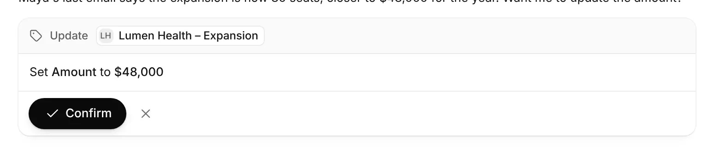
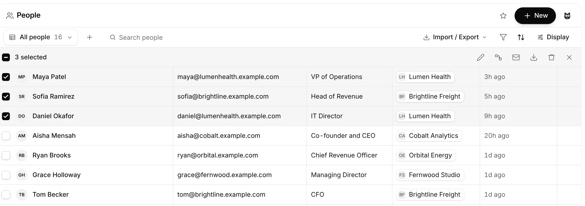
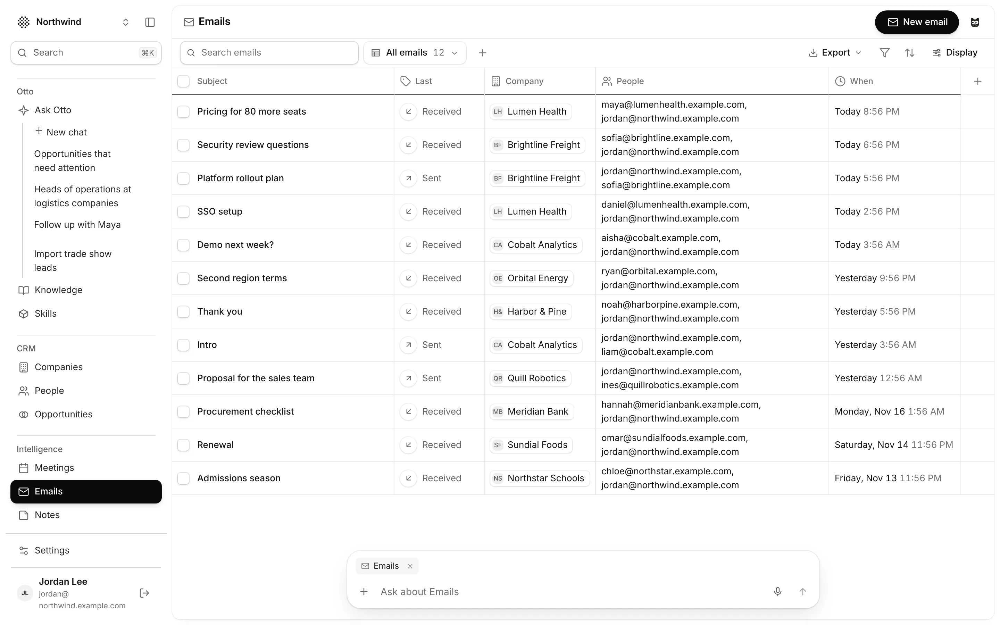
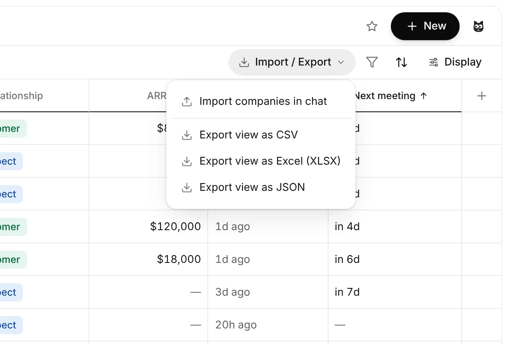

import { Aside, CardGrid, LinkCard, Steps } from '@astrojs/starlight/components';

**Goal:** every open opportunity you own has a real stage, close date and next step, and you know which deals need you this week.

**Time:** about 15 minutes, once a week. **Who:** anyone who owns opportunities. Managers can run it for the team.

<Steps>

1. **Open your pipeline**

   Open **Opportunities** and pick your saved board view, or the table. Click **Filter** and pick **Owner** is you, and stage is open.

   

1. **Save it as a view**

   Click **Save as view** and name it "My open deals". Next week it's one click away, under the tabs.

   

1. **Ask Otto what needs attention**

   In the Otto bar, ask: "Which of these need attention this week?" Otto reads the list on screen, with its filters, and answers with the deals that are quiet, past their close date or missing a next step.

   

1. **Fix them in place**

   Click a cell to edit it: move a close date, set the stage, write the next step. Or let Otto do it. It shows a confirm card, and nothing changes until you click.

   

   

   

1. **Change many at once**

   Tick several rows and use the bulk bar to set the same owner, stage or field on all of them.

   

1. **Answer what's waiting**

   Open **Emails** and check emails to answer from people on your open deals.

   

1. **Share the numbers**

   Click **Calculate** at the foot of the amount column for the total, or **Import / Export**, then **Export view** to send the list as CSV, Excel or JSON.

   

</Steps>

## What good looks like

- No open opportunity has a close date in the past.
- Every open opportunity has a next step with a date in it.
- You can name the three deals that matter most this week.

<Aside type="tip">
Ask Otto with the **Build a report** skill: "Report on my pipeline by stage with totals." It writes the report from your records.
</Aside>

## Related

<CardGrid>
  <LinkCard title="Views" href="/crm/views/" description="Filters, sorts and saved views." />
  <LinkCard title="Set up a pipeline from scratch" href="/recipes/set-up-a-pipeline/" description="Get the stages right first." />
</CardGrid>
