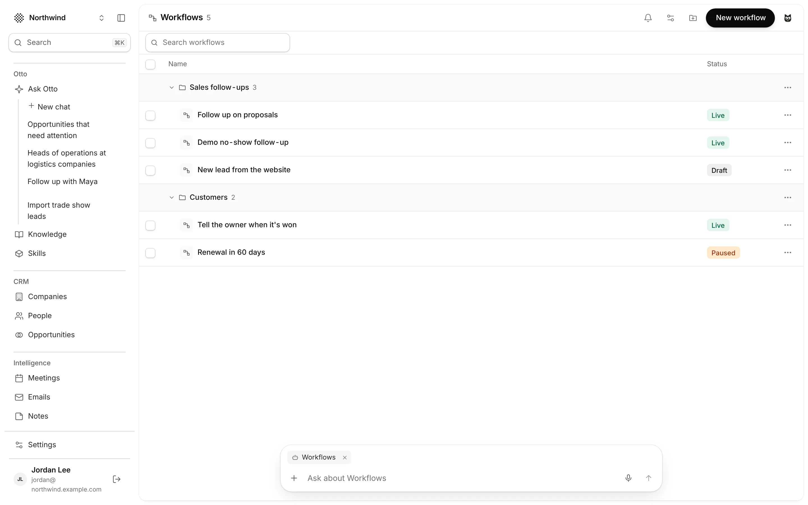
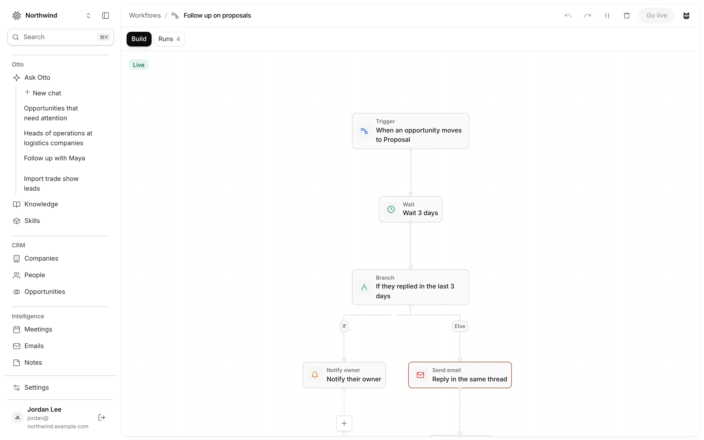
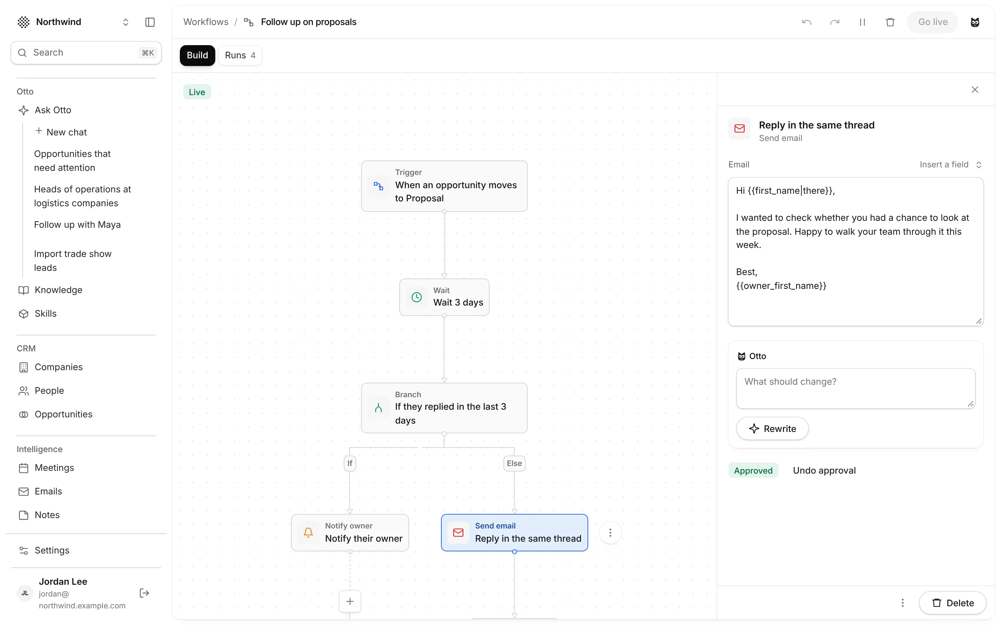
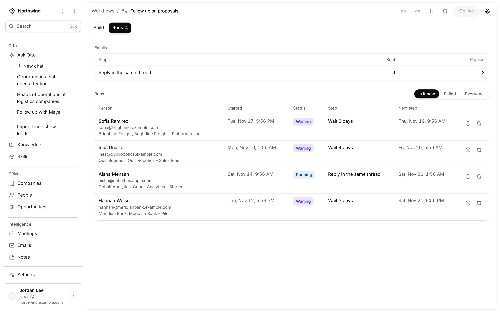

import { Aside, CardGrid, LinkCard, Steps } from '@astrojs/starlight/components';

**Goal:** after every external meeting, a follow-up email goes out from the meeting owner's mailbox, and the owner hears if nobody replies.

**Time:** about 20 minutes. **Who:** owners and admins build workflows. Call notes must be on: see [Call notes settings](/settings/call-notes/).

<Steps>

1. **Make a new workflow**

   Open **Workflows** in the sidebar and click **New workflow**. You can also start from a playbook and change it.

   

1. **Pick the trigger**

   Click the **Trigger** card. In **Starts when**, pick **Meeting ended with notes**, so the workflow starts once notes arrive for a finished meeting. Under **Only if**, limit it to the meetings you want, like opportunities in an open stage.

   A run is one person. For a meeting, each attendee gets their own run.

   

1. **Add the follow-up email**

   Click **+** under the trigger, then **Add an action**, then **Send email**. Write the **Subject** and the **Email**. Click a field name to drop it in, like `{{first_name|there}}`. Turn on **Reply in the same thread** to send it as a reply to your last email.

   Otto can draft it with **Draft**. You read it and click **Approve**.

   

1. **Wait for a reply**

   Add a **Wait** step for 3 days. Then add a **Branch** on **They replied** in the last 3 days. A reply stops the run on its own. An out-of-office reply pauses it until the person is back.

   

1. **Tell the owner**

   On the **No** path, add **Notify owner**: `No reply from {{first_name}} after our meeting`. It shows in the app, and in Slack when Slack is connected.

   

1. **Test it**

   Click **Test** and pick a real record. The test shows what each step would do, without sending anything.

   

1. **Go live and watch the runs**

   Approve every email step, then click **Go live**. Open **Runs** to see who is in it, the step they're on and how replies were tagged. A run that failed can be picked up with **Retry from the failed step**.

   

</Steps>

<Aside type="tip">
Ask Otto to build it for you: "Make a workflow that emails attendees after a meeting with notes, waits 3 days, and tells the owner if they didn't reply." Otto drafts it, and you check and publish.
</Aside>

## Related

<CardGrid>
  <LinkCard title="Workflows" href="/otto/workflows/" description="Every trigger and step." />
  <LinkCard title="Prepare for a meeting and follow up" href="/recipes/prep-and-follow-up/" description="The human side of the same job." />
</CardGrid>
