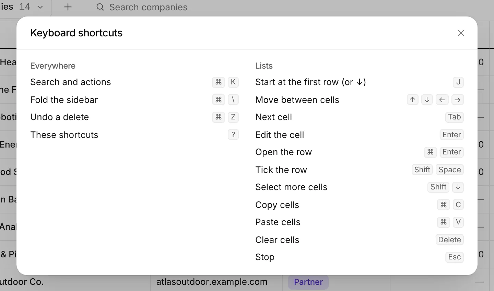

import { CardGrid, LinkCard } from '@astrojs/starlight/components';

Press <kbd>?</kbd> anywhere outside a text box to see these in the app. On Windows and Linux, use <kbd>Ctrl</kbd> where you see <kbd>⌘</kbd>.

## Everywhere

| Keys | What they do |
| --- | --- |
| <kbd>⌘</kbd> <kbd>K</kbd> | Search and actions |
| <kbd>⌘</kbd> <kbd>\\</kbd> | Fold the sidebar |
| <kbd>⌘</kbd> <kbd>Z</kbd> | Undo a delete |
| <kbd>?</kbd> | These shortcuts |
| <kbd>Esc</kbd> | Close a menu, a dialog or the Otto panel |

## Lists

These work on every list: Companies, People, Opportunities, Notes, Emails and your own objects.

| Keys | What they do |
| --- | --- |
| <kbd>J</kbd> or <kbd>↓</kbd> | Start at the first row |
| <kbd>↑</kbd> <kbd>↓</kbd> <kbd>←</kbd> <kbd>→</kbd> | Move between cells |
| <kbd>Tab</kbd> | Next cell |
| <kbd>Enter</kbd> | Edit the cell |
| <kbd>⌘</kbd> <kbd>Enter</kbd> | Open the row |
| <kbd>Shift</kbd> <kbd>Space</kbd> | Tick the row |
| <kbd>Shift</kbd> <kbd>↓</kbd> | Select more cells |
| <kbd>⌘</kbd> <kbd>C</kbd> | Copy cells |
| <kbd>⌘</kbd> <kbd>V</kbd> | Paste cells |
| <kbd>Delete</kbd> | Clear cells |
| <kbd>Esc</kbd> | Stop |

Copied cells paste into a spreadsheet as rows and columns, and rows from a spreadsheet paste into Omniscient the same way.

## In the search box

| Keys | What they do |
| --- | --- |
| <kbd>↑</kbd> <kbd>↓</kbd> | Move through the results |
| <kbd>Enter</kbd> | Open the result, or ask Otto |
| <kbd>Esc</kbd> | Close |

## In Ask Otto

| Keys | What they do |
| --- | --- |
| <kbd>/</kbd> at the start | Pick a skill |
| <kbd>Enter</kbd> | Send |
| <kbd>Shift</kbd> <kbd>Enter</kbd> | New line |

## Related

<CardGrid>
  <LinkCard title="The interface" href="/get-started/the-interface/" description="The sidebar, search and Otto." />
  <LinkCard title="Views" href="/crm/views/" description="Edit in the table." />
</CardGrid>
