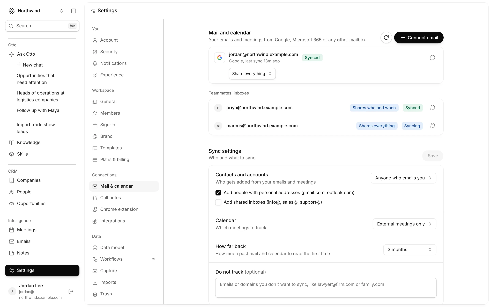

import { Aside } from '@astrojs/starlight/components';

Find your problem below. To look up the exact words of a message, see [Error messages](/reference/error-messages/). If you're still stuck, write to [hello@tryomniscient.com](mailto:hello@tryomniscient.com) with what you tried.

## Mailbox sync

### My mailbox says Connect again

Access to your mailbox ended. This happens when a password changes, when access is removed from your Google or Microsoft account, or when an IT admin changes the rules. Go to **Settings**, then **Mail & calendar**, and click **Reconnect** next to the mailbox.

### My mailbox says Sync failed

Read the line under the mailbox. It says what went wrong. For an IMAP mailbox, check the password. Many providers need an app password when two-step sign-in is on. Click **Reconnect** to type a new one.

### New emails aren't showing

New mail syncs every few minutes. Click **Sync now** in **Settings**, then **Mail & calendar**, to check right away. If an email still doesn't show, check that:

- The person isn't on your **Do not track** list.
- The email isn't a newsletter, notification or promotion. Those are skipped.
- The person is outside your team. Mail between teammates stays out of the CRM.

### Someone is missing from People

Your sync settings decide who gets added. If **Contacts and accounts** is set to **When you reach out**, people who email you first are added only once you reply. People with personal addresses like gmail.com are added only when **Add people with personal addresses** is on. Change these in **Settings**, then **Mail & calendar**, under **Sync settings**.

### A company I expected wasn't made

Companies come from work email domains. A person with a gmail.com or outlook.com address never makes a company. Add the company by hand on **Companies** and link the person to it.

### I can't read the full email

Omniscient saves the subject and a short preview, and reads the full text from your mailbox when you open it. If the mailbox needs to sign in again, the email shows a line asking you to reconnect it. If the email is from a teammate's mailbox, their sharing rule may hide it.

## Sending email

### Reply and Send aren't there

Sending needs its own permission. Click **Allow sending** on the thread, or the send icon next to your mailbox in **Settings**, then **Mail & calendar**.

### Only the inbox owner can send from this inbox

You opened a thread from a teammate's mailbox. Only they can reply from it. Write from your own mailbox with **New email** on the record instead.

## Call notes

### A call has no notes

Check each of these:

1. Call notes are on for that tool in **Settings**, then **Call notes**.
1. **Which calls get notes** includes this call. Internal calls need **Notes for all meetings**.
1. Your meeting tool made a transcript. Transcription or cloud recording has to be on.
1. Some time has passed. Transcripts can take a while to appear, and Omniscient keeps checking for a few days after the call.

To add notes right away, open the meeting and click **Add notes** to paste a transcript, upload a transcript file or upload a recording.

## Chrome extension

### The extension says Connect this browser to your workspace

Go to **Settings**, then **Chrome extension**, in Omniscient and click **Connect this browser**. If the page still shows **Download extension**, reload it after adding the extension to Chrome.

### The side panel doesn't show the person on the page

Wait for the page to finish loading, then press Refresh in the side panel. On lists, scroll so the people you want are on screen. The extension reads only what's loaded on the page.

### My templates don't show

Templates come from **Settings**, then **Templates**. If the list is empty, add one there. Click **Manage templates** in the extension to get there.

## Imports

### The import says Failed

Read the line under it. If access ended, sign in again and start the import again. The account you sign in with needs to be able to read the records you want.

### My CSV import missed some values

Open the import card in the chat. **Couldn't be imported** lists each row with the reason. Cells that can't be read stay blank. Fix the file and import it again: records the first import made are found, so nothing is copied twice.

## Workflows

### My workflow won't go live

Every **Send email** step needs **Approve** before the workflow can go live. Changing an approved email takes the approval away. Fix any step the editor marks, then click **Go live**.

### Someone didn't get an email

Open the workflow and click **Runs**. Click the person's run to see each step and what happened. Common reasons: they replied, unsubscribed or bounced, the email is waiting for the owner's working hours, or the mailbox reached its **Emails a day** limit. You can also ask Otto, "why didn't Maya get step 2?"

## Signing in

### My sign-in link doesn't work

Links work once and expire. If the link opened in another browser, type the 6-digit code from the same email instead. To get a new link, go back to the sign-in page and enter your email again.

### I lost my authenticator app

On the two-step screen, click **Use a backup code** and type one of your backup codes. Then go to **Settings**, then **Security**, turn off the old method and set up two-step again. If you have no backup codes, write to us.

<Aside type="note">
If your workspace uses single sign-on, sign in through your company's identity provider. Your IT admin can help with SSO problems.
</Aside>
