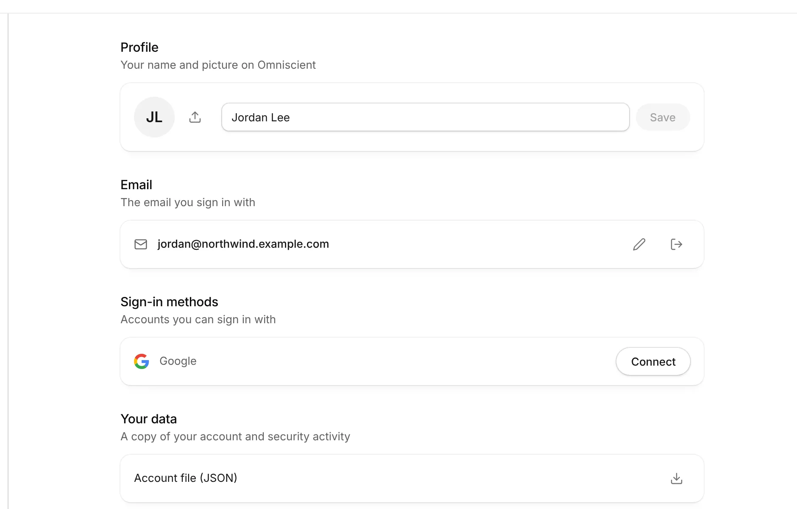

import { Aside, CardGrid, LinkCard, Steps } from '@astrojs/starlight/components';

**Settings**, then **Account** holds what belongs to you. Changes here follow you into every workspace you're in.

**Address:** `/settings/account` **Who:** everyone, for their own account

## Profile

"Your name and picture on Omniscient."

| Control | What it does |
| --- | --- |
| **Upload a picture** | Pick an image. It shows on your notes, chats and records you own. Omniscient says "Picture saved". |
| **Remove picture** | Asks "Remove your picture?" and goes back to your initials |
| **Your name** | Type and click away. Omniscient says "Name saved". |

## Email

"The email you sign in with."

| Control | What it does |
| --- | --- |
| **Change email** | Asks for the **New email**. Omniscient sends a link to both your old and new address. The change happens once you confirm from both: "Confirm the change from both *old* and *new*". |
| **Sign out** | Signs you out on this device |

## Sign-in methods

"Accounts you can sign in with."

Each row is a way you can sign in: **Google**, **Microsoft**, **Apple**, **Email code** or **Company SSO**. Each row with an email shows which address it uses.

| Control | What it does |
| --- | --- |
| **Connect** | Shows next to a method you don't use yet. Sign in once with it, and it's added. |
| **Disconnect** | Asks "Stop signing in with *Google*?" and removes it. You can't disconnect your last method or **Email code**. |

Microsoft and Apple show only where your server has them turned on. A workspace's [sign-in rules](/settings/sign-in/) can still limit which of these you may use there.

## Your data

"A copy of your account and security activity."

Click **Download** next to **Account file (JSON)** to save a file with your account details and your recent security activity. Records in workspaces belong to the workspace, so they aren't in this file. Use [Export view](/crm/views/) for those.

## Delete account

"Removes your account and any workspace only you are in."

<Steps>

1. Click **Delete my account**.
1. Type your email to confirm, then click **Delete my account**.

</Steps>

What happens:

- Your mailboxes stop syncing everywhere.
- A workspace where you are the only person is deleted with you.
- In shared workspaces you're removed, and your work stays with the team.

Omniscient stops you first if:

| Message | What to do |
| --- | --- |
| Make someone else the owner of *Northwind* first. | You own a workspace with other people in it. The app has no button for this yet, so write to support to hand it over (check). |
| Cancel the plan for *Northwind* in Plans & billing first. | A workspace only you are in has a paid plan. Cancel it in [Plans & billing](/settings/plans-and-billing/). |
| That isn't your email. | Type your own sign-in email exactly |

<Aside type="caution">
Deleting your account can't be undone.
</Aside>

## Related

<CardGrid>
  <LinkCard title="Security" href="/settings/security/" description="Password, two-step and passkeys." />
  <LinkCard title="Account and security guide" href="/workspace/account-and-security/" description="Step-by-step help." />
</CardGrid>
