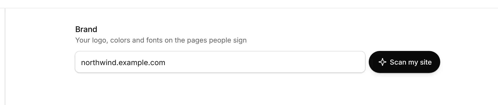

import { Aside, CardGrid, LinkCard, Steps } from '@astrojs/starlight/components';

**Settings**, then **Brand** holds your brand kit: "Your logo, colors and fonts on the pages people sign." The signing and review pages your buyers open wear it, so they look like your company.

**Address:** `/settings/brand` **Who:** owners and admins only

## Read it from your website

"Read the kit from your site."

<Steps>

1. Type your **Website**, like `acme.com`, and click **Scan my site**. A new workspace starts with its team domain filled in.
1. Omniscient reads your site: "Reading your site for its logo, colors, fonts and voice".
1. Check each part below and change what's off.

</Steps>

To start over, reset the kit. Omniscient asks "Reset the brand kit?" first.

## The parts

| Part | Settings |
| --- | --- |
| **Logo** | **Logo**, the address of your logo, like `https://acme.com/logo.svg`. **Logo on dark**, a light version for dark backgrounds. |
| **Colors** | **Main**, **Accent**, **Background** and **Text** |
| **Fonts** | A **Font pair**, or a **Heading font** and a **Body font** of your own |
| **Shape** | **Corners**: **Square**, **Slight**, **Soft**, **Round** or **Pill**. **Buttons**: **Filled** or **Outline**. **Headings**: **Light**, **Medium** or **Bold**. **Spacing**: **Tight**, **Normal** or **Roomy**. **Pictures**: **Square** or **Rounded**. |
| **Voice** | **What you do**, **Who you sell to**, **What they care about**, **Tone** and **Avoid** |

Changes save as you go.

<Aside type="note">
The brand kit changes pages your buyers see. It doesn't change how Omniscient looks for your team. For light or dark, see [Experience](/settings/experience/).
</Aside>

## Related

<CardGrid>
  <LinkCard title="General" href="/settings/general/" description="Workspace name and domain." />
  <LinkCard title="E-sign tools" href="/integrations/e-sign/" description="Connect DocuSign, PandaDoc and more." />
</CardGrid>
