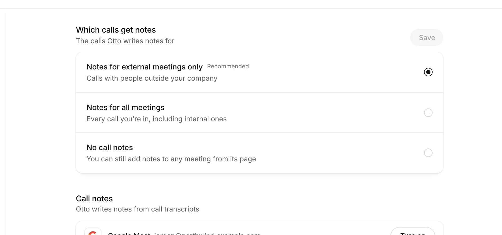

import { Aside, CardGrid, LinkCard, Steps } from '@astrojs/starlight/components';

**Settings**, then **Call notes** is where "Otto writes notes from call transcripts." Each person sets up their own calls.

**Address:** `/settings/calls` **Who:** everyone, for their own calls

## Which calls get notes

"The calls Otto writes notes for." Pick one, then click **Save**.

| Choice | What it means |
| --- | --- |
| **Notes for external meetings only** | "Calls with people outside your company". The default, and tagged **Recommended**. |
| **Notes for all meetings** | "Every call you're in, including internal ones" |
| **No call notes** | "You can still add notes to any meeting from its page" |

## Sources

Each connected Google or Microsoft mailbox shows a row:

| Row | Control | What it does |
| --- | --- | --- |
| **Google Meet** *address* | **Turn on** | Asks Google for read access to your Meet transcripts. Then shows **On**. |
| **Microsoft Teams** *address* | **Turn on** | Asks Microsoft for read access to your online meetings and their transcripts. Then shows **On**. |
| **Zoom** *address* | **Disconnect Zoom** | Shows when Omniscient last checked, like "Checked 5 minutes ago". **On**, or **Connect again** if access ended. |
| **Zoom** or **Add another Zoom account** | **Connect Zoom** | Sign in to Zoom |

Transcripts must be on in the call tool itself. In Zoom, turn on cloud recording and audio transcripts. In Meet and Teams, turn on transcripts for the meeting.

## How notes get written

- After a call ends, Omniscient looks for its transcript. Meet and Teams transcripts can take a while, so each meeting is checked every 30 minutes, up to 8 times over 3 days.
- Zoom accounts are checked for new recordings about every 20 minutes.
- Otto writes the notes, and pulls out next steps, promises and deal details as suggestions on the record.
- Summary emails from notetaker apps are read too. See [Notetaker apps](/integrations/notetakers/).

## Add notes by hand

On any meeting's page, click **Add call notes** and pick **Paste text**, **Transcript file** or **Recording**. Recordings can be up to 500 MB. The transcript itself is not stored. See [Meetings and call notes](/email-and-calendar/meetings-and-call-notes/).

<Aside type="note">
You can add notes only to meetings on your own calendar.
</Aside>

## Related

<CardGrid>
  <LinkCard title="Zoom" href="/integrations/zoom/" description="Connect Zoom for call notes." />
  <LinkCard title="Run a workflow after a meeting" href="/recipes/workflow-after-a-meeting/" description="Follow up on every call." />
</CardGrid>
