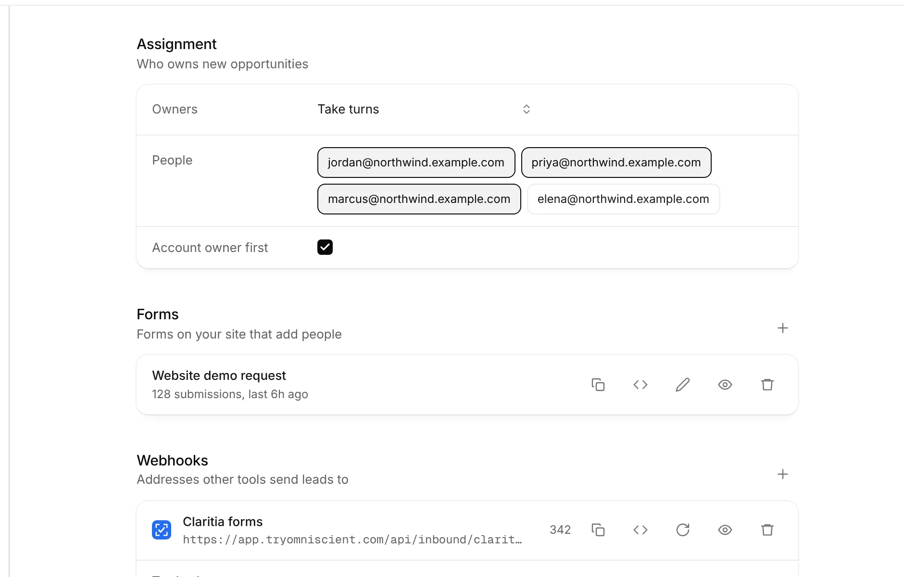

import { Aside, CardGrid, LinkCard, Steps } from '@astrojs/starlight/components';

**Settings**, then **Capture** turns people who fill in a form, or come from another tool, into people and opportunities with an owner.

**Address:** `/settings/capture` **Who:** owners and admins only

## Assignment

"Who owns new opportunities."

| Setting | Choices | Default |
| --- | --- | --- |
| **Owners** | **Off**, **Take turns**, **Fewest open opportunities** | **Off** |
| **People** | The teammates who get new opportunities | Nobody |
| **Account owner first** | On or off | On |

- **Take turns** gives each new opportunity to the next person in **People**.
- **Fewest open opportunities** gives it to the person with the fewest open ones.
- **Account owner first** gives it to whoever owns the company's latest opportunity, if they're in **People**.
- With **Off**, new opportunities have no owner.

The same rule picks owners for [POST /leads](/api-reference/leads/) and [Claritia](/integrations/claritia/).

## Forms

"Forms on your site that add people." A form has its own hosted page, a link and embed code.

### Make a form

<Steps>

1. Click **New form**.
1. Set the **Title**, like "Contact us", and the **Source**, like "Website form", which shows on every person it brings in.
1. Under **Fields**, **Work email** is always asked and always required. Tick **Ask for** next to the fields you want: **Name**, **Company**, **Job title**, **Phone**, **How can we help?** and any of your own person fields. Rename a field's **Label**, and tick **Required** where you need it.
1. Set the **Button** text, like "Send".
1. Set the **Thank-you message**, like "Thanks. We'll be in touch soon.", or a **Page after sending** that starts with `https://`.
1. Save.

</Steps>

### Each form

The row shows the form's name, **Off** when it's turned off, and how many submissions it has had, with the last one.

| Control | What it does |
| --- | --- |
| **Copy link** | The hosted page, `https://app.tryomniscient.com/f/…`. Share it anywhere. |
| **Copy embed code** | A snippet for your website. It shows the form in your page and passes the page address and referrer along, so you see where people came from. |
| **Edit** | Change the form |
| **Turn off** / **Turn on** | A form that's off says "This form doesn't exist." to visitors |
| **Delete** | Asks "Delete *name*?" and warns "Its address stops working. People it brought in stay." |

## Webhooks

"Addresses other tools send leads to."

<Steps>

1. Click **New webhook** and name it after the tool, like "Typeform, Webflow, Zapier…".
1. Click **Copy address** and paste it into the other tool's webhook settings.
1. Click **Copy example** for a sample `curl` call you can test with.

</Steps>

A webhook accepts any JSON. Omniscient reads common field names, like `email`, `full_name` and `company_name`, on its own. See [Capture addresses](/api-reference/capture/) for every name it understands.

| Control | What it does |
| --- | --- |
| **New address** | Asks "New address for *name*?" and warns "The old address stops working." Use it if an address leaks. |
| **Turn off** / **Turn on** | Stop or start taking posts |
| **Delete** | Removes it. People it brought in stay. |

## What happens on each submission

1. The person is found by email, or added with their company.
1. If they have no open opportunity from a form, webhook or the API, one opens in your default pipeline, with an owner from **Assignment**.
1. The owner gets an email: "New: *name* from *form name*".
1. The channel they came from, like **Organic search** or **AI referral**, is kept on the opportunity.

Bots that fill a hidden field are dropped, and one visitor can send at most 10 times in 10 minutes.

## Related

<CardGrid>
  <LinkCard title="Capture addresses" href="/api-reference/capture/" description="Every field name and error." />
  <LinkCard title="Send website leads to the right rep" href="/recipes/route-website-leads/" description="A step-by-step recipe." />
</CardGrid>
