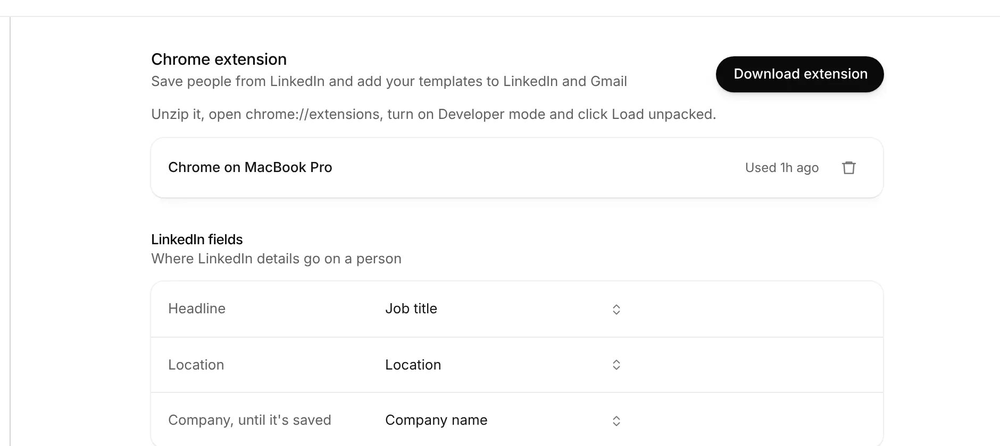

import { Aside, CardGrid, LinkCard, Steps } from '@astrojs/starlight/components';

**Settings**, then **Chrome extension** lets you "Save people from LinkedIn and add your templates to LinkedIn and Gmail."

**Address:** `/settings/extension` **Who:** everyone. Only owners and admins see **LinkedIn fields**.

## Install

Until the extension is in this browser, the page shows **Download extension** and how to load it: "Unzip it, open chrome://extensions, turn on Developer mode and click Load unpacked." See [Install and connect](/chrome-extension/install-and-connect/).

## Connect this browser

Once installed, the button changes to **Connect this browser**. Click it, and it shows **Connected**. The extension now saves into this workspace as you.

## Connected browsers

Each browser you connected shows as a row, with when it was last used, like "Used 2 hours ago". Click **Disconnect** to stop that browser saving. Omniscient asks first.

## LinkedIn fields

"Where LinkedIn details go on a person." Owners and admins pick which person field each LinkedIn detail fills when someone saves a profile.

| LinkedIn detail | Goes to by default |
| --- | --- |
| **Headline** | **Title** |
| **Location** | **Location** |
| **Company, until it's saved** | **Company name** |

Each menu lists your text and link fields. "Company, until it's saved" holds the company's name until the company itself is saved and linked.

<Aside type="note">
The extension acts only when you click. It never scrolls, opens profiles or sends messages for you. See [Use the extension](/chrome-extension/use-the-extension/).
</Aside>

## Related

<CardGrid>
  <LinkCard title="Install and connect" href="/chrome-extension/install-and-connect/" description="Step by step." />
  <LinkCard title="Save a prospect list" href="/recipes/save-a-prospect-list/" description="A recipe for the extension." />
</CardGrid>
