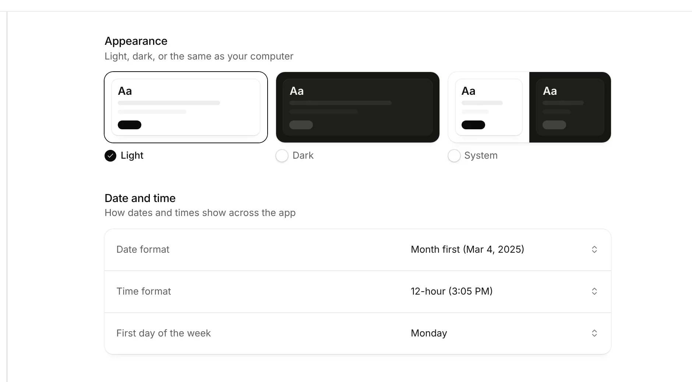

import { CardGrid, LinkCard } from '@astrojs/starlight/components';

**Settings**, then **Experience** sets how Omniscient looks for you. It changes nothing for your teammates. Your choice is saved with your account, so it follows you to another computer.

**Address:** `/settings/experience` **Who:** everyone, for themselves

## Appearance

"Light, dark, or the same as your computer."

<video class="clip" src="/videos/dark-mode.mp4" autoplay muted loop playsinline preload="metadata" width="1280" height="800" aria-label="Switching the app to Dark and back to Light"></video>

| Choice | What you get |
| --- | --- |
| **Light** | The default. White pages and black text. |
| **Dark** | Dark pages and light text |
| **System** | Follows your computer's light or dark setting, and changes when it does |

The app draws in your theme from the first moment, so a dark app never flashes white while it loads.

## Date and time

"How dates and times show across the app."

Each choice shows a sample of today's date in brackets, so you can see what you'll get.

| Setting | Choices | Default |
| --- | --- | --- |
| **Date format** | **System**, **Month first**, **Day first**, **Year first** | **Month first** |
| **Time format** | **System**, **12-hour**, **24-hour** | **12-hour** |
| **First day of the week** | **System**, **Monday**, **Sunday**, **Saturday** | **Monday** |

**System** uses your browser's language settings. The first day of the week changes calendar views and date pickers.

## Numbers

"How numbers and amounts show."

| Choice | Looks like |
| --- | --- |
| **System** | What your browser's language uses |
| **Commas and dot** | 1,234,567.89. The default. |
| **Dots and comma** | 1.234.567,89 |
| **Spaces and comma** | 1 234 567,89 |
| **Apostrophes and dot** | 1'234'567.89 |

Amounts and the totals at the foot of a column follow this choice.

## Related

<CardGrid>
  <LinkCard title="Views" href="/crm/views/" description="Tables, boards and calendars." />
  <LinkCard title="Account" href="/settings/account/" description="Your name and picture." />
</CardGrid>
