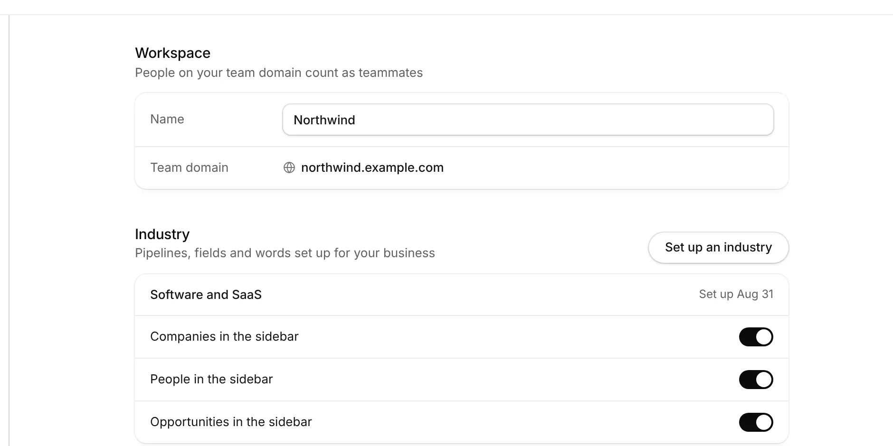

import { Aside, CardGrid, LinkCard, Steps } from '@astrojs/starlight/components';

**Settings**, then **General** is the first page in Settings. It holds the facts about the workspace itself.

**Address:** `/settings` **Who:** everyone sees it. Owners and admins change the name and industry. Only the owner sees **Danger zone**.

## Workspace

"People on your team domain count as teammates."

| Row | What it is |
| --- | --- |
| **Name** | The workspace's name, shown in the sidebar, invites and emails. Owners and admins type a new one and click **Save**. Members see it as text. |
| **Team domain** | The email domain your company uses, like `northwind.example.com`, or **None**. People with an email at this domain count as teammates, so emails and meetings with them count as internal. |

The team domain comes from the email of the person who made the workspace. To prove you own more domains, or turn on single sign-on, use [Sign-in](/settings/sign-in/).

## Industry

"Pipelines, fields and words set up for your business."

Owners and admins can have Otto set up the CRM for your kind of business. It adds pipelines and stages, fields, saved views and draft workflows, and can rename objects to your industry's words, like "Clients" for companies.

<Steps>

1. Click **Set up an industry**.
1. Pick your **Industry**. The preview on the right shows what your CRM will look like, with new parts marked **New**.
1. To fit it to your own services, turn on **Tailor with Otto**: "Your own services and words, from your site". Otto reads your website and adds up to 5 fields of its own.
1. Confirm. Omniscient says "Set up for *Real estate*".

</Steps>

### The industries

| Industry | Example pipeline stages |
| --- | --- |
| Software and SaaS | Lead, Discovery, Demo, Proposal, Negotiation, Won, Lost, plus a Renewals pipeline |
| Agency and consulting | Inquiry, Discovery call, Proposal sent, Negotiation, Signed, Lost |
| Real estate | New lead, Contacted, Showing, Offer, Under contract, Closed |
| Home services | Its own pipeline and fields |
| Recruiting | Its own pipeline and fields |
| Financial advice | Its own pipeline and fields |
| Health and wellness clinics | Its own pipeline and fields |
| Construction | Its own pipeline and fields |
| Nonprofit | Its own pipeline and fields |
| Legal | Its own pipeline and fields |

Draft workflows come in turned off. Open **Workflows** to read them and publish the ones you want. Setting up an industry adds to what you have. It never deletes your pipelines, fields or records.

## Danger zone

"Delete this workspace for good."

Only the owner sees this section.

<Steps>

1. Click **Delete workspace**.
1. Type the workspace's name exactly, then click **Delete workspace**.

</Steps>

This removes the workspace with all its records, emails, meetings and notes, and disconnects every inbox. It can't be undone. If the name doesn't match, nothing is deleted: "The name didn't match, so nothing was deleted."

<Aside type="caution">
Export what you want to keep first. Use **Import / Export**, then **Export view** on each list.
</Aside>

## Related

<CardGrid>
  <LinkCard title="Members" href="/settings/members/" description="Who's in the workspace." />
  <LinkCard title="Set up a pipeline from scratch" href="/recipes/set-up-a-pipeline/" description="A recipe for your stages." />
</CardGrid>
