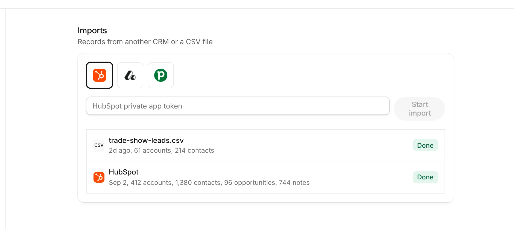

import { Aside, CardGrid, LinkCard, Steps } from '@astrojs/starlight/components';

**Settings**, then **Imports** brings "Records from another CRM or a CSV file."

**Address:** `/settings/imports` **Who:** owners and admins only

## Start an import

<Steps>

1. Pick your CRM by its logo: **HubSpot**, **Salesforce**, **Attio** or **Pipedrive**.
1. Click **Connect *HubSpot***. Sign in and approve. Pipedrive asks for your API key on its sign-in page.
1. The import starts on its own: "Import from *HubSpot* started."

</Steps>

If the CRM is already connected in **Integrations**, the import starts as soon as you click.

### When one-click sign-in isn't set up

The page shows a box for a token instead: **HubSpot private app token**, **Attio access token** or **Pipedrive API token**. Salesforce always signs in with its own page. This is a fallback, and most workspaces never see it.

## Each import

Each import shows as a row with its CRM, the account it came from, when it started and its status:

| Status | What it means |
| --- | --- |
| **Queued** | Waiting to start |
| **Starting** | Signing in to the other CRM |
| **Running** | Copying records |
| **Finished** | Done |
| **Failed** | Stopped. A line says why. |

While it runs, it counts each part as it goes: **Accounts**, **Contacts**, **Leads as people**, **Pipelines**, **Opportunities** and **Notes**.

Only one import runs at a time: "An import is already running. Wait for it to finish."

## What happens to your data

- Each record keeps its old CRM's id, so running the import again matches what it brought before.
- Records already in Omniscient are matched by domain or email. Only their empty fields get filled.
- Deal owners are matched by email, so invite your team first.
- Nothing is ever written back to the old CRM.

## A CSV file

For any other tool, drop a CSV into [Ask Otto](/otto/ask-otto/). Otto shows a plan to check, imports it and can undo it. Up to 5,000 rows and 150 columns at a time.

<Aside type="tip">
Run an import before you invite everyone, so the team arrives to a full CRM.
</Aside>

## Related

<CardGrid>
  <LinkCard title="CRM imports" href="/integrations/crm-imports/" description="All four CRMs side by side." />
  <LinkCard title="Import from another CRM" href="/recipes/import-from-another-crm/" description="A step-by-step recipe." />
</CardGrid>
