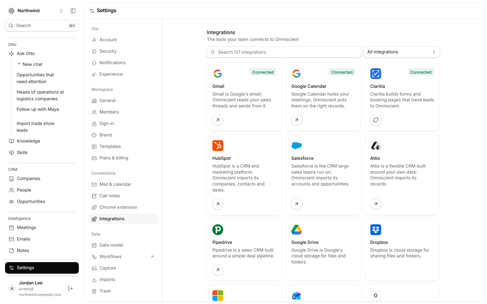
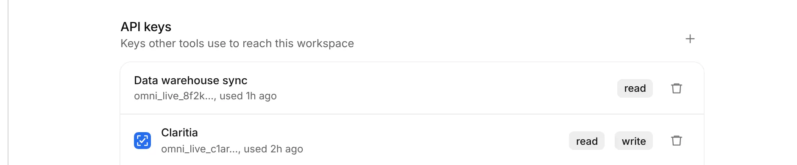

import { Aside, CardGrid, LinkCard } from '@astrojs/starlight/components';

**Settings**, then **Integrations** lists "The tools your team connects to Omniscient." Its address is `/settings/apps`.

**Who:** everyone sees it. Anyone connects a personal app. Owners and admins connect team apps and open **Developers**.

## The page

| Part | What it does |
| --- | --- |
| **Search integrations** | Finds an app by name. "No matches" when nothing fits. |
| **Category** menu | **All integrations**, or one category like **Booking** or **E-sign** |
| App cards | Each shows the app's logo, name, one line about it and its state |
| **About** *app* | Opens the app's sheet |

### Card states

| State | What it means |
| --- | --- |
| **Connected** | Ready to use |
| **Not connected** | Click **Connect** to sign in |
| **Connect again** | The sign-in ended. Click **Reconnect**. |
| **Built in** | Part of Omniscient, like MoltSets. Nothing to connect. |
| **Not available yet** | Not ready on your server |
| **Owners and admins connect it** | A team app. Ask an admin. |

### The app's sheet

Each sheet has **What it is**, **What Omniscient reads or does** and **Use cases**, then the buttons:

- **Connect**, **Reconnect** or **Disconnect**. Disconnect warns "Otto and workflows stop using it."
- **Import from *HubSpot*** on HubSpot, Salesforce, Attio and Pipedrive, which opens [Imports](/settings/imports/).
- **Open Mail and calendar**, **Open Chrome extension** or **Open Developers** on apps set up elsewhere.
- **Ask Otto** on MoltSets and Coresignal.

See [The app store](/integrations/app-store/) for every app and what Otto and workflows do with it.

## Claritia and Arrowsterr

These connect with their own approve page. Claritia's card has **Connect**, which opens Claritia. When connected, owners and admins see **Disconnect *Claritia***, which asks "Disconnect Claritia?" and warns "It stops reading and writing your records."

## Developers

At the bottom of the page, owners and admins open **Developers**. It has three sections:

| Section | What it's for |
| --- | --- |
| **MCP server** | "Add this address to Claude, ChatGPT or Cursor", with a copy button |
| **API keys** | "Keys other tools use to reach this workspace." **New key** asks for a name and shows the key once. Each key shows its scopes and when it was last used, with **Revoke**. |
| **Webhooks** | "Addresses Omniscient sends changes to." **New webhook** asks for an **Address** and **Events**. Each shows its last status, **Failing** or **Off**, with **Send test**, a switch and **Delete**. |

See [API keys and the REST API](/developers/api/), [Webhooks](/developers/webhooks/) and the [API reference](/api-reference/).

## Related

<CardGrid>
  <LinkCard title="Integrations" href="/integrations/" description="Every core connection." />
  <LinkCard title="The app store" href="/integrations/app-store/" description="More than 100 apps." />
</CardGrid>
