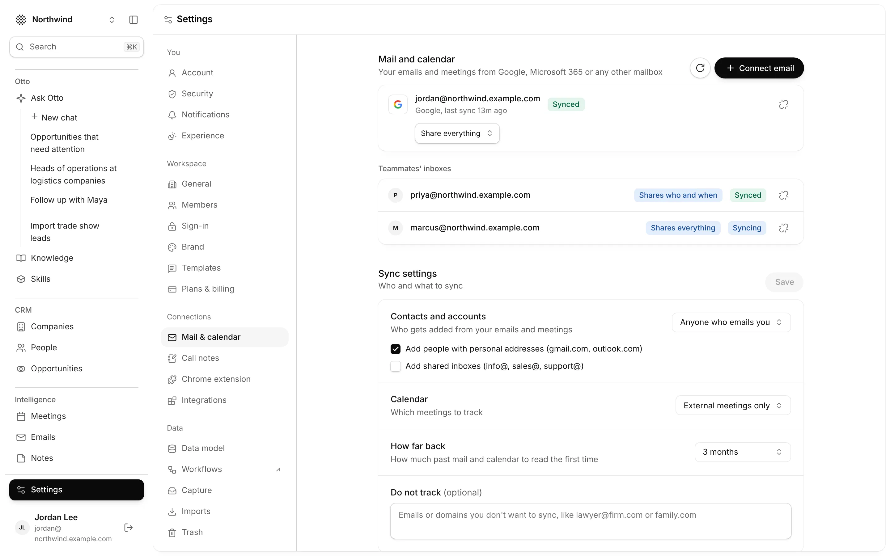
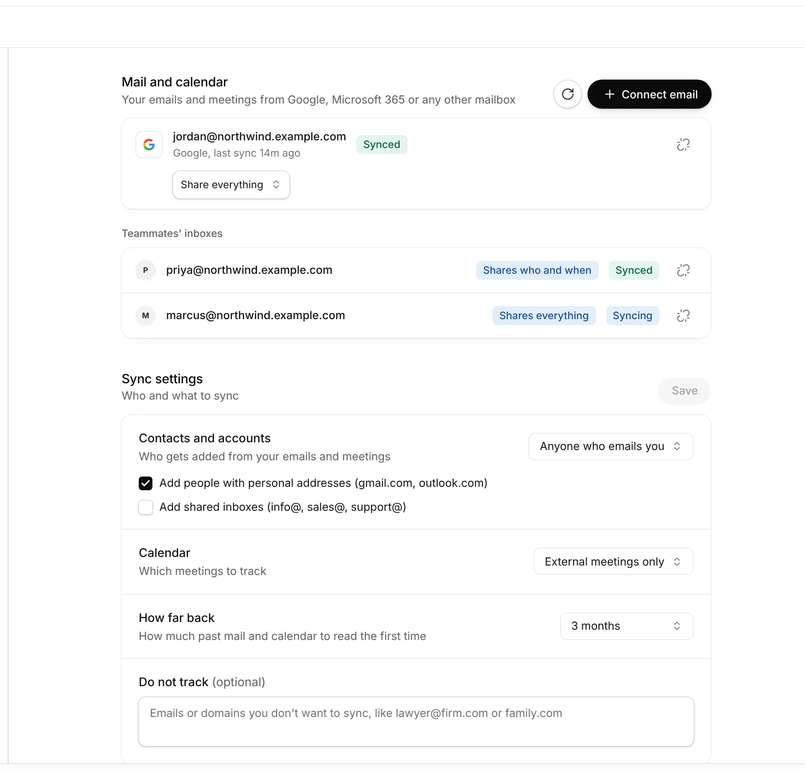

import { Aside, CardGrid, LinkCard, Steps } from '@astrojs/starlight/components';

**Settings**, then **Mail & calendar** connects "Your emails and meetings from Google, Microsoft 365 or any other mailbox." Each person connects and controls their own mailboxes.

**Address:** `/settings/mail` **Who:** everyone, for their own mailboxes. Owners and admins can also disconnect a teammate's mailbox.

## Your mailboxes

Click **Connect email**, type your address and Omniscient works out whether it's Google, Microsoft or other mail. See [Connect your inbox](/get-started/connect-your-inbox/).

Each mailbox row shows its address, its provider (**Google**, **Microsoft 365** or **IMAP**), when it last synced and its status:

| Status | What it means |
| --- | --- |
| **Waiting for first sync** | Just connected. The first sync starts soon. |
| **Syncing** | Reading mail now |
| **Synced** | Up to date |
| **Sync failed** | The last try failed. It retries on its own, waiting longer each time, up to 6 hours. A line under the row says why. |
| **Connect again** | The sign-in expired or was taken back. Click **Reconnect**. |

| Control | What it does |
| --- | --- |
| **Sync now** | Starts a sync of your mailboxes right away |
| **Allow sending** | Shows when a mailbox can't send yet. Approve the send permission to send from Omniscient and from workflows. |
| **Reconnect** | Sign in to the mailbox again |
| **Disconnect** | Asks "Disconnect *address*?" Omniscient stops syncing and removes the emails and meetings it brought in. Records stay. |
| Sharing menu | What teammates see from this mailbox. See below. |

### Sharing

Pick what your teammates see from each mailbox. Omniscient says "*address*: share everything" when it saves.

| Choice | Teammates see |
| --- | --- |
| **Share everything** | Subjects, previews and what Otto found, with quotes. The default. |
| **Share who and when** | Who and when, and what Otto found without quotes |
| **Keep private** | Nothing. What Otto finds stays with you. |

Only the person who connected a mailbox can change its sharing.

## Teammates' inboxes

Below your own, a list of every teammate's mailbox with its sharing tag (like **Shares everything** or **Private**) and its status. Owners and admins see **Disconnect** on each, for when someone leaves.

## Sync settings

"Who and what to sync." Change any of these, then click **Save**.

| Setting | Choices | Default |
| --- | --- | --- |
| **Contacts and accounts**: "Who gets added from your emails and meetings" | **When you reach out**, **Anyone who emails you** | **Anyone who emails you** |
| Add people with personal addresses (gmail.com, outlook.com) | On or off | On |
| Add shared inboxes (info@, sales@, support@) | On or off | Off |
| **Calendar** | **External meetings only**, **All meetings** | **External meetings only** |
| **How far back** | **1 week**, **1 month**, **3 months**, **6 months**, **1 year** | **3 months** |
| **Do not track** | Emails or domains you don't want to sync, like `lawyer@firm.com` or `family.com` | Empty |

**When you reach out** adds people only after you email them first. **How far back** sets the first sync. Later syncs read only what's new.

<Aside type="tip">
Put your lawyer, accountant, family and other private contacts in **Do not track** before your first sync.
</Aside>

## What syncs and how often

- Mailboxes are checked about every 5 minutes.
- Meetings are read up to 60 days ahead. All-day events are skipped.
- Gmail's chats, drafts and Promotions, Social, Updates and Forums tabs are skipped. Notetaker summaries are still read.

## Related

<CardGrid>
  <LinkCard title="Google" href="/integrations/google/" description="Gmail, Calendar and Meet." />
  <LinkCard title="Microsoft" href="/integrations/microsoft/" description="Outlook and Teams." />
  <LinkCard title="Other email (IMAP)" href="/integrations/other-email/" description="Fastmail, iCloud, Zoho and more." />
</CardGrid>
