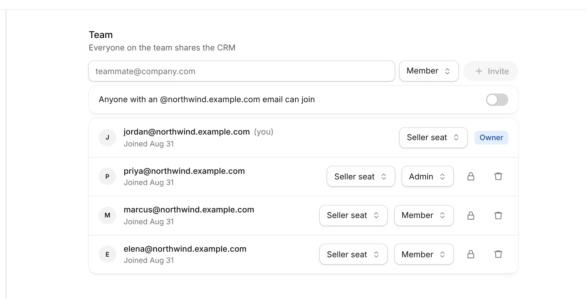

import { Aside, CardGrid, LinkCard, Steps } from '@astrojs/starlight/components';

**Settings**, then **Members** lists everyone in the workspace and every open invite. Everyone sees who's on the team. Owners and admins make changes.

**Address:** `/settings/members` **Who:** everyone sees it. Owners and admins invite, change and remove people.

## Team

"Everyone on the team shares the CRM."

### Invite someone

<Steps>

1. Type their email in the box, like `teammate@company.com`.
1. Pick **Member** or **Admin** in the **Role** menu. **Member** is the default.
1. Click invite. They get an email, and their row shows **Invite sent**.

</Steps>

When they sign in with that email, they join. No link is needed.

### Let your domain join

Owners and admins of a workspace with a team domain see a switch: **Anyone with an @*domain* email can join**. With it on, people who sign up with a work email at your domain can join without an invite. It's off by default.

For links anyone can use, see invite links in [Sign-in](/settings/sign-in/#invite-links).

## Each row

A row shows the person's email, their role tag (**Owner**, **Admin** or **Member**) and, on Pro and Business, their seat.

| Control | Who sees it | What it does |
| --- | --- | --- |
| **Role** menu | Owners and admins, on anyone but the owner and themselves | Switch between **Member** and **Admin** |
| Seat menu | Owners and admins, on Pro and Business | **Seller seat** or **Free seat**. Only Seller seats are billed. |
| **Make owner** | The owner, on anyone else on the team | Asks "Make *email* the owner?" and hands the workspace to them. You become an admin. |
| **Send again** | Owners and admins, on open invites | Sends the invite email again: "Invite sent again to *email*" |
| **Withdraw invite** | Owners and admins, on open invites | Asks "Withdraw the invite for *email*?" and cancels it |
| **Sign out everywhere** | Owners and admins | Asks "Sign *email* out everywhere?" and ends all their sessions. Use it when a laptop is lost. |
| **Remove from workspace** | Owners and admins, on anyone but the owner | Asks "Remove *email*?" Their inboxes are disconnected and the emails they brought in are deleted. Records, notes and deals stay. |
| **Leave workspace** | Anyone but the owner, on their own row | Asks "Leave *workspace*?" Your inboxes in this workspace are disconnected. |

<Aside type="note">
The owner can't be removed and can't leave. To step away, make someone else the owner first. See [Roles and permissions](/workspace/roles-and-permissions/).
</Aside>

## Make someone else the owner

A workspace has one owner. Only the owner can hand it to someone else, and only to a person who already joined.

<Steps>

1. Find the person's row. Pick someone who has joined. An open invite isn't enough.
1. Click **Make owner**, the crown button.
1. Read "Make *email* the owner?" and click **Make owner**.

</Steps>

You see "*email* is now the owner". They get the **Owner** tag, and you become an admin. Only the new owner can give it back.

The change shows in both people's sign-in history in **Settings**, then **Security**, and in the workspace's audit log in **Sign-in**. If you use two-step sign-in, finish your second step first. If it fails, you see one short line with **Retry**.

## Seats and billing

Changing a seat changes your bill. Adding a Seller seat adds one seat's price for the rest of the billing period. Making someone a Free seat takes it off. Free seats need Pro or Business, and a workspace needs at least one Seller seat.

## Related

<CardGrid>
  <LinkCard title="Members and roles" href="/workspace/members-and-roles/" description="The how-to guide." />
  <LinkCard title="Roles and permissions" href="/workspace/roles-and-permissions/" description="What each role can do." />
  <LinkCard title="Connect the whole team" href="/recipes/connect-the-whole-team/" description="A recipe for your first week." />
</CardGrid>
