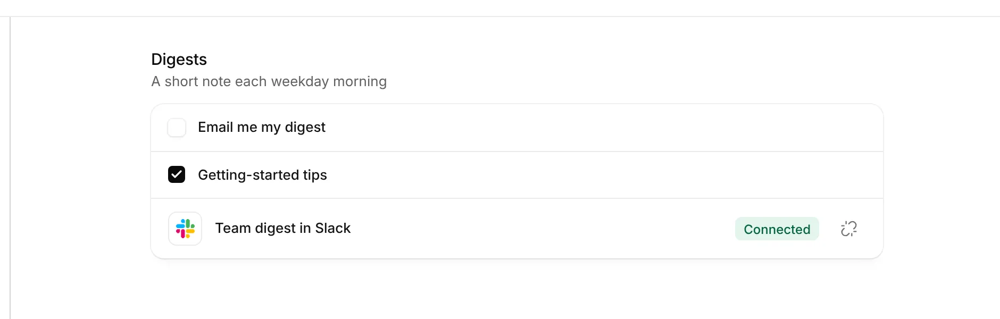

import { Aside, CardGrid, LinkCard, Steps } from '@astrojs/starlight/components';

**Settings**, then **Notifications** decides which short notes Omniscient sends you, and where the team digest posts.

**Address:** `/settings/notifications` **Who:** everyone. Only owners and admins connect Slack.

## Digests

"A short note each weekday morning."

| Setting | Default | What it does |
| --- | --- | --- |
| **Email me my digest** | On | A short email each weekday morning with today's meetings, emails to answer and opportunities that need attention. Days with nothing to report are skipped. |
| **Getting-started tips** | On | The short emails a new workspace gets in its first weeks, like how to connect your inbox and invite your team |
| **Team digest in Slack** | Off | One post a weekday morning for the whole team, in a Slack channel |

Each person's digest arrives at 8 in the morning in their own time zone.

## Team digest in Slack

The row shows **Connected** or **Off**.

<Steps>

1. Click **Add to Slack** next to **Team digest in Slack**. This needs an owner or admin.
1. Sign in to Slack and approve the Omniscient app.
1. Pick the channel to post in. The app joins a public channel by itself. Omniscient says "Slack notes go to #*channel*".

</Steps>

To post elsewhere, pick another channel. To stop, click **Disconnect Slack**. Omniscient asks "Disconnect Slack?" and warns "The team digest stops posting there."

The same Slack connection carries workflow **Notify owner** steps. See [Slack](/integrations/slack/).

### Older Slack connections

Workspaces that connected Slack before the Slack app may see a **Slack webhook URL** box. It takes an address that starts with `https://hooks.slack.com/services/`. It keeps working, and **Reconnect** on Slack's card in [Integrations](/settings/integrations/) moves it to the Slack app.

## Related

<CardGrid>
  <LinkCard title="Slack" href="/integrations/slack/" description="What Omniscient posts in Slack." />
  <LinkCard title="Your first week" href="/get-started/your-first-week/" description="What the digest helps with." />
</CardGrid>
