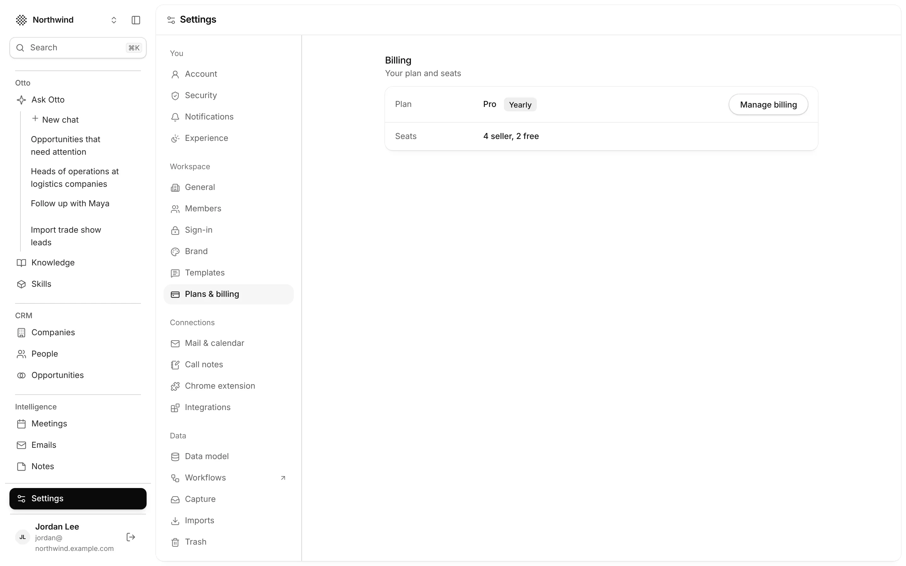

import { Aside, CardGrid, LinkCard, Steps } from '@astrojs/starlight/components';

**Settings**, then **Plans & billing** shows "Your plan and seats", and is where owners and admins pick and change a plan.

**Address:** `/settings/billing` **Who:** everyone sees the plan. Owners and admins change it.

## Billing

| Row | What it shows |
| --- | --- |
| **Plan** | Your plan's name, with **Yearly** or **Monthly**. During the free trial, a **Trial** tag with the days left. |
| **Seats** | How many Seller seats and Free seats you have |
| Status tag | **Payment failed**, **Payment pending** or **Paused**, when there's a problem |

## Choose a plan

<Steps>

1. Under **Choose a plan**, pick **Yearly** or **Monthly**. Yearly costs less per month.
1. Each card shows the price per seat and your total for the seats you have. Your plan shows **Current**.
1. Click **Choose Starter**, **Choose Pro** or **Choose Business**.
1. Pay on the secure checkout page.

</Steps>

Back in Omniscient, you see "Plan updated. It can take a minute to show here."

### What each card lists

| Plan | Lines on its card |
| --- | --- |
| Starter | Meeting notes and drafts, 2 agents |
| Pro | Pipeline board and forecast, Fields filled by rules, Prep briefs and field packs, 5 agents, Free teammate seats |
| Business | Manager mode and coaching, MEDDIC from every call, 15 agents, Admin controls |

For prices and every limit, see [Plan limits](/workspace/plan-limits/).

## Manage billing

Once you have a plan, **Manage billing** opens the billing portal. There you change plans, switch between yearly and monthly, update your card, download invoices or cancel.

| Message | What it means |
| --- | --- |
| This workspace already has a plan. Use Manage billing to change it. | Click **Manage billing** to change your plan |
| No billing account yet. Pick a plan first. | There's nothing to manage yet |
| Only owners and admins can manage billing. | Ask an admin |

## Seats

You pay for Seller seats. Free seats cost nothing and come with Pro and Business. Change a person's seat in [Members](/settings/members/). The bill changes for the rest of the period.

<Aside type="note">
When a trial ends without a plan, the workspace moves to Free. Nothing is deleted.
</Aside>

## Related

<CardGrid>
  <LinkCard title="Plans and billing guide" href="/workspace/plans-and-billing/" description="Plans, trials and seats explained." />
  <LinkCard title="Plan limits" href="/workspace/plan-limits/" description="Every limit in one place." />
</CardGrid>
